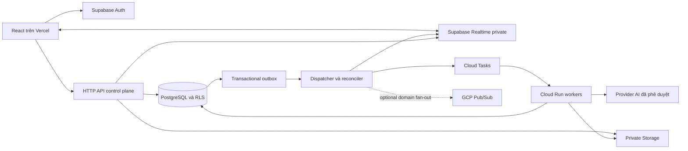

# Promptify: kế hoạch backend và kiến trúc production

Ngày: 08/10/2026. Trạng thái: **đề xuất triển khai**, chưa phải chứng nhận production. Phạm vi mới bao gồm live workshop/realtime, mở rộng so với plan pilot trước.

## 1. Cơ sở và kết luận kiến trúc

Đối chiếu bộ 16 UI tại `outputs/ui-comment-revision/`, bản combined/mockup, comment CSV, workbook Implement Plan/UI/STORY, sơ đồ learner do người dùng gửi và code local. Đã fetch origin/main: HEAD và origin/main cùng `bf1d194d67524683776606095fe13fa338252c12`. Điều đó không xác nhận alias Vercel hiện trỏ commit nào; web reader không truy cập được deployment và chưa kiểm dashboard deployment lần này.

**Kiến trúc đề xuất:** React/Vite trên Vercel; API HTTP ngắn làm control plane; Supabase Auth + PostgreSQL/RLS + private Storage là nguồn dữ liệu; Cloud Tasks điều phối công việc; Cloud Run chạy worker AI/Judge/ingestion; Supabase Realtime private channels chuyển sự kiện tới browser. Một outbox DB nối giao dịch nghiệp vụ với queue/realtime. Không chuyển toàn ứng dụng sang GCP và không xây WebSocket gateway riêng ở bước đầu.

GCP Pub/Sub dành cho fan-out nội bộ nhiều consumer nếu cần analytics/integrations; không phải kênh để browser subscribe trực tiếp. Cloud Tasks phù hợp command chạy worker có endpoint, retry và rate limit; run ID/job lease vẫn phải chống xử lý trùng. Supabase Realtime không thay thế DB hoặc durable notification inbox.

Nếu Intrepid bắt buộc toàn bộ realtime chạy trên GCP hoặc quota/region của Supabase không phù hợp: thay transport bằng Cloud Run WebSocket gateway + Redis fan-out. API/event schema và DB không đổi. Đây là phương án thay thế, không triển khai cả hai transport cùng lúc.

### Hiện có và phần cần đổi

| Hiện có trong repo | Cách xử lý |
|---|---|
| React/Vite, component/logo/style hiện tại | Giữ; prototype HTML không trở thành runtime production. Port thiết kế vào các component feature hiện có. |
| `api/generate.ts`, `api/evaluate.ts` | Giữ entry tương thích trong giai đoạn chuyển đổi; dần gọi RunService mới, không tiếp tục nhận canonical output/rubric từ client. |
| `apiAuthorizationService.ts` xác thực Supabase token và quyền lớp | Tái sử dụng nhưng trả AuthContext có user/tenant/scope; bỏ bypass lesson không phải UUID; kiểm enrollment, publication và session. |
| `apiServerService.ts` nhận inputContext, systemInstruction, rubric/output từ request | Tách provider adapter; resolve dữ liệu chuẩn phía server và policy kiểm soát chỉ dẫn learner. |
| `dbService.ts`, RPC attempt/progress, migrations 016/017 | Giữ lịch sử; migration mới siết provenance và quyền ghi, rà cả DELETE/EXECUTE, không chỉ INSERT/UPDATE. Không giả định migration đã apply. |
| Role chỉ learner/instructor/admin | Bổ sung role assignment theo scope; không gán Head/L&D vào instructor rồi ẩn vài nút. |
| HTML mô phỏng, sessionStorage, score fixture | Thay bằng API/DB; không migrate fixture sang production. |

Sơ đồ gửi có UI-11 Library và score >=8. Bản UI-11 mới là Curriculum Studio. Library là feature riêng, không lấy số 11 cũ làm contract. Pass threshold phải thuộc lesson revision được duyệt; không tự mặc định >=8 cho mọi bài.

## 2. Sơ đồ tổng thể



Dispatcher dùng endpoint nội bộ được scheduler gọi định kỳ và wake-up best effort sau commit; outbox tồn tại dù wake-up lỗi. Có job lease, retry/backoff, dead-letter record trong DB, sweeper phát hiện run/job kẹt. Chốt kỳ quét phù hợp latency SLO trong staging; không tuyên bố gọi async sau response là queue bền vững.

## 3. Vai trò và quyền

| Vai trò | Đọc | Ghi/hành động | Cấm |
|---|---|---|---|
| Guest | Landing, syllabus public được duyệt | Yêu cầu demo nếu feature bật | Curriculum nội bộ, roster, SOP |
| Learner | Lesson được enrollment; prompt/output/attempt của mình; SOP được gán | Draft, run, retry Judge, acknowledge hint, correction request | Điểm/output chuẩn, role, scope, session status, prompt của người khác |
| Trainer | Course/cohort/session được giao; learner/run tương ứng | Author/publish theo quyền, broadcast/private hint, freeze/end, note/clearance, roster sync nếu được cấp | Tenant khác, secret provider, role admin |
| Department Head | Progress/attempt counts/last activity trong department | Export dữ liệu được phép; không CRUD/Sync mặc định | Raw learner prompt, tenant-wide ROI, trainer controls |
| SOP Contributor | SOP trong department được cấp | Upload/version/submit review | Tự publish hoặc đọc department khác nếu không có quyền |
| L&D Analyst | Aggregate trong tenant được giao | Export/report theo policy | Raw draft realtime và secret |
| System Admin | Config/audit hệ thống theo scope | Domain policy, emergency throttle, yêu cầu rotation | Không mặc định có quyền đọc toàn bộ prompt cá nhân |
| Worker identity | Job và dữ liệu tối thiểu để xử lý | Server result/usage/outbox | Truy cập giao diện người dùng hoặc token của learner |

Head upload trong mockup mâu thuẫn Head read-only trong plan. Giải quyết bằng capability `sop:contribute` riêng, không cấp Head quyền trainer. JWT chỉ định danh; quyền mutable lấy từ DB. Tenant/department từ lookup server, không tin giá trị client. RLS áp dụng cả REST/Storage/views/export; API worker dùng quyền cao phải kiểm scope tường minh.

## 4. Định nghĩa domain và dữ liệu

Course = chương trình; lesson/lab = nội dung; class/cohort = nhóm ghi danh hiện có; live session = một buổi workshop của class. Không dùng chung status cho publication, lịch workshop và trạng thái learner.

| Nhóm | Bảng/relation dự kiến | Invariant |
|---|---|---|
| Identity | users hiện có, clients→tenant mapping, departments, memberships, role_assignments | Auth subject unique; normalized verified email; FK tenant/department nhất quán; role không lấy từ Sheet |
| Roster | roster_sources, roster_imports, roster_rows, profile_corrections | Import staging→validate→transaction; upsert idempotent; không xóa progress khi row bị remove |
| Curriculum | courses/modules/lessons/resources hiện có; lesson_revisions, rubric_revisions, lesson_assignments | Revision published immutable; run ghim revision; save atomically; weight=100 nếu weighted rubric |
| SOP | sop_documents, sop_versions, sop_chunks, ingestion_jobs, lesson_resource_links | Checksum/version/owner/confidentiality/page/section; storage private; chỉ approved+ready được gán vào run |
| Workshop | live_sessions, session_lab_assignments, session_participants, session_controls | starts/ends UTC; version monotonic; allowed transitions; freeze khác ended |
| Learning | workspace_drafts, runs, run_jobs, evaluations, prompt_attempts hiện có, lesson_progress | Run belongs user/class/lesson/session; output/result server-only; unique attempt number per learner+class+lesson |
| Intervention | interventions, intervention_recipients, trainer_notes, clearances | Broadcast/private target snapshot; inbox durable; manual clearance không sửa AI score |
| Delivery | outbox_events, consumer_receipts, notification_ack | event ID unique; duplicates allowed on transport, not on side effects |
| Operations | usage_reservations, usage_ledger, rate_buckets, provider_configs, audit_events | Atomic budget; provider actual model/usage; config chứa secret reference, không key plaintext |

Các tên bảng mới là thiết kế đề xuất; cần schema diff đầy đủ trước migration. Không tạo lại bảng đã có. Khóa UNIQUE `(tenant_id, actor_id, operation, idempotency_key)` và request hash; retry key cũ với body khác trả 409. Những FK quan trọng gồm tenant/session/class phải kiểm đồng nhất, không chỉ kiểm UUID tồn tại.

Attempt là snapshot prompt/output đã generate thành công; evaluation có thể pending/failed. Run failed không tự tăng completed attempt. Progress có generation_completed và evaluated/passed riêng; không gọi completed run là mastery. Pass dùng rubric revision và threshold đã được duyệt. Thay đổi threshold không sửa im lặng lịch sử.

## 5. Contract chung

API trả `{data, request_id}` hoặc `{error:{code,message,retryable,field_errors},request_id}`. Pagination cursor và giới hạn page size; signed URL ngắn hạn; không chứa raw text trong lỗi/log. 401 = auth, 403 = scope, 409 = version/lifecycle conflict, 422 = validation, 429 = rate/budget, 503 = dependency unavailable.

Request mutation dùng Idempotency-Key và optimistic revision/If-Match. AuthContext chứa actor_id, tenant_id, capabilities và scope được DB xác nhận. Client không chọn actor_id thực tế. Timestamps server UTC; locale chỉ hiển thị.

Run submit ví dụ:

```json
{"class_id":"uuid","lesson_id":"uuid","session_id":"uuid-or-null","test_case_id":"uuid","draft_revision":12,"prompt":"learner input","ai_output_language":"vi"}
```

Response 202 `{run_id,status:"queued",attempt_number:null,status_url}`. Không nhận client-generated output, score, resource quyền rộng hoặc model tự do. Advanced instructions của learner được coi là untrusted input, kiểm kích thước và policy; không ghi đè server guardrail/system prompt. Endpoint status trả projection và `revision`, không lộ provider key.

Event v1:

```json
{"event_id":"uuid","type":"run.evaluated","schema_version":1,"tenant_id":"uuid","session_id":"uuid","aggregate_id":"run-uuid","aggregate_revision":4,"occurred_at":"server-utc","payload":{"run_id":"uuid","status":"evaluated"}}
```

Durable event có aggregate revision và audience được server resolve; event payload ưu tiên ID/summary. Browser refetch authorized data; không broadcast raw prompt lên session-wide topic. Không dùng sequence toàn cục để suy ra một client đã nhận mọi event: consumer không nhất thiết có quyền nhận các event bị lọc. Inbox có cursor riêng theo recipient; resync session bằng snapshot/version.

## 6. Mapping đủ 16 UI → backend

| UI | API/domain | Ghi và event | Điều kiện nghiệm thu |
|---|---|---|---|
| 00 Landing | GET public config/syllabus; POST demo request optional | demo_lead.created nếu bật | Public data duyệt; không lộ tenant content |
| 01 Auth | Google OAuth/Supabase; GET /me | Membership resolution audit | Verified account+roster; refresh/logout; denied reason |
| 02 Profile | GET /me/profile; POST confirm/correction | profile.confirmed/correction.requested | 4 field; correction không tăng scope |
| 03 Denied | /me access result + support route | Denial audit không PII trong public log | Domain hợp lệ nhưng không roster vẫn bị chặn |
| 04 Hub | GET /classes/{id}/lessons, progress/resources | Read projection | Assigned published labs; Active filter server/client đúng |
| 05 Workspace | GET workspace; PATCH draft; POST /runs; POST assistance events | draft revision, run.created/generated; hint viewed/solution accepted | Editor/context cùng lesson revision; no fake completion |
| 06 Compare | GET attempts?lesson+class; GET compare?a_run&b_run; POST draft/restore | draft.restored, restore provenance | Hai run cùng learner/lesson scope; labels/data đồng nhất; restore không overwrite history |
| 07 Judge | GET run/evaluation; POST /runs/{id}/evaluation-retry | evaluation job/result | Retry cùng output không thêm attempt; strict JSON; pending/error rõ |
| 08 SOP | GET resources/version/pages/search; signed original URL | Read/access audit nếu policy yêu cầu | Citation trỏ đúng version/page; file missing không bịa content |
| 09 Workshop | GET trainer/home/sessions/snapshot; PATCH controls; POST interventions | session state, broadcast, freeze/unfreeze/end | Scope assigned; KPI từ DB; reconnect đúng trạng thái |
| 10 Inspector | GET participant/attempts; POST private intervention/note/clearance | targeted inbox, trainer audit | Selected learner đúng; reason mandatory; clearance riêng AI score |
| 11 Studio | POST/PATCH lesson draft; POST validate/sandbox/publish; cohort endpoints | revision published/assignment changed | Rubric gate; resources ready; dates/scope; atomic save |
| 12 Analytics | GET head/department hoặc L&D tenant aggregates; POST export | export job/result | Head read-only và RLS; CSV/PDF đúng scope; ROI có giả định nguồn |
| 13 SOP Upload | POST upload intent/complete/ingest; GET job; version approve | sop.ingested/failed/approved | Confidentiality; verify file; indexing status/error; contributor riêng |
| 14 Governance | GET health/usage/audit; PATCH rate policy/throttle; POST rotation request | config.changed/rotation audit | Admin scope; secret reference only; quota lấy từ ledger |
| 15 Roster | POST /roster/import-preview, /imports/{id}/commit; GET logs | roster.imported; membership revoked | Manual sync được phép; row errors; idempotency; snapshot giữ khi lỗi |

Prototype UI-12 hiện là L&D ROI nên phải thêm Head mode đúng scope. UI-05 Agribank và UI-06/07 Intrepid không dùng làm một learning flow: mọi API dùng ID thật; mỗi scenario là lesson revision riêng. Không đổi bằng cách thay title mà giữ dữ liệu bài khác.

## 7. Luồng đăng nhập và roster

1. Trainer có capability roster sync cấu hình private Sheet/tab; secret chỉ ở server. Sheet pilot 4 field Email/Full Name/Department/Country. Provider identity của người vận hành không trở thành quyền user trong Sheet.
2. Worker đọc snapshot, normalized emails, báo thiếu/duplicate/unknown department từng row, preview diff. Import có source version/checksum và khóa per source; transaction commit/upsert nhất quán, remove membership theo policy được xác nhận, không cascade xóa attempts.
3. OAuth hoàn tất → backend verify token/user, verified email/domain allowlist, membership active. Domain đúng chưa đủ vào learning zone. Default enterprise mode không có public self-enroll/non-UUID fallback.
4. Profile confirm → correction pending nếu sai; quyền giữ theo membership đã duyệt. Trainer có workflow xem/duyệt hoặc giữ correction pending, không cho client tự sửa quyền.
5. Route theo capabilities. Logout xóa cache/account-class, unsubscribe channels; đổi account không đọc draft cũ. Revocation chặn API ngay; đã mở channel phải được reauthorize/đóng hoặc session delivery dừng; không coi cache authorization realtime là kiểm quyền từng message.

## 8. Authoring, publish và live session

Curriculum lifecycle: DRAFT→PUBLISHED→ARCHIVED. Session lifecycle: SCHEDULED→ACTIVE→ENDED→ARCHIVED. Freeze là control `{editing_enabled:false}` với revision, không đổi publication status. UI label inactive được map từ ended/archived, không gộp vào một enum mơ hồ.

Studio lưu title/code/brief/pillar, cohort+department scope, access tier, start/end timezone, system instruction, variables, test cases, sample/SOP links và rubric revision trong transaction. Sandbox run dùng draft revision được phép, không cập nhật learner progress/KPI. Publish gate kiểm content, resource quyền/ready, weight 100, criterion ranges, approved threshold, provider allowlist và schedule. Không dùng điểm sandbox duy nhất làm bảo đảm rubric đúng.

Scheduler activate/end hỗ trợ retry; start/end được API kiểm theo thời gian server ngay cả scheduler đang trễ. Trainer start/end thủ công có reason và revision compare-and-swap. End commit controls+outbox atomically. Run mới sau end trả conflict; learner chuyển read-only sau event hoặc refetch. Run đã accepted trước end được hoàn tất và đánh dấu late_result; không nhận run mới, không bỏ kết quả đã tiêu tiền. Freeze tương tự chặn submit/restore server-side, không chỉ disable button.

## 9. Generate → Judge → attempt → compare

1. POST run: verify auth/scope/enrollment/session control, lesson revision/test case/resource policy; validate prompt size/PII policy, reserve token budget atomically; create run+job+outbox một transaction.
2. Dispatcher enqueue Cloud Task chỉ chứa job/run ID. Worker OIDC từ task identity, claim lease/CAS, recheck run cancel/permission policy; resolve canonical resources/rubric and store snapshot hashes/version.
3. Provider adapter nhận prompt untrusted tách khỏi system guardrail và approved context. Chốt provider/model ID thực tế từ credential/quota; không copy nhãn Gemini 3.8/1.5 trong mockup thành config production. Fallback chỉ model/provider đã phê duyệt cho dữ liệu đó, audit model đã dùng.
4. Persist output+usage và attempt number atomically. Nếu generate lỗi: fail run, giữ reason, release/reconcile reservation theo usage biết được. Commit output xong mới phát run.generated; không gửi message success trước transaction.
5. Enqueue Judge bằng ID cùng run/output hash/rubric revision. Validate strict schema, bounded criterion scores, mandatory fields, total server computed; prompt injection trong output không đổi Judge policy. Fail JSON → evaluation_failed, giữ generated output, không nâng pass/best score.
6. Commit evaluation+progress+outbox một transaction. Retry Judge khóa unique `(run_id, output_hash, rubric_revision, evaluation_generation)` và không tạo thêm attempt. Re-evaluation mới phải có explicit version/audit, không rewrite lịch sử.
7. Browser nhận event, tải projection; response run cũ chỉ cập nhật đúng run, không đè output mới. Compare lấy run A/B đúng lesson+owner và immutable snapshot; restore tạo draft revision mới, giữ source_run_id; lần Run tiếp là attempt mới.

Worker/task redelivery là bình thường. Provider call có thể đã được xử lý dù timeout: lease không bảo đảm exactly-once ở provider. Nếu provider không có idempotency key/status lookup, ghi trạng thái uncertain, reconciliation/manual retry và budget exposure; không retry mù hoặc hứa không bao giờ gọi AI trùng. Đảm bảo local commit idempotent, tránh duplicate attempt/score.

## 10. Realtime: draft, telemetry, broadcast và private hint

**Mức đề xuất:** mọi learner phát trạng thái hoạt động nhẹ; full draft preview chỉ khi trainer chủ động chọn learner trong session có thông báo rõ cho learner và policy dữ liệu đã duyệt. Không gửi từng keystroke của 1.150 người vào DB hoặc session-wide feed.

| Kênh private | Subscribers | Payload |
|---|---|---|
| tenant/session/control | Participants và assigned trainers | Freeze/end/lab transition revision, không PII |
| tenant/session/trainer | Assigned trainers | Run/score/status summary và presence summary; không raw prompt |
| tenant/session/learner/user/inbox | User đó; trainer lấy qua authorized API | Targeted notification ID; fetch inbox |
| tenant/session/draft/user | Trainer có authorized watch lease | Draft đã xử lý theo data policy, revision/TTL |

Browser không được publish `score`, `freeze`, `hint` hoặc durable event. Server publish sau authorization/DB commit. Private topic names không phải security mechanism; RLS trên realtime.messages kiểm role/membership/scope và private mode. Learner không đọc draft của learner khác. JWT refresh/rejoin, revoked-membership test và policy checks bắt buộc.

Draft: editor debounce 500–1.000ms cho learner đang được watch; limit payload/revision và coalesce latest; full preview đi qua authorized ingestion endpoint (Cloud Run live API nếu Vercel overhead không phù hợp) để validate/redact, rồi publish private topic. Chỉ status/activity của người không được watch, debounce khoảng 5s và có jitter; không ghi heartbeat mọi lần vào Postgres. Persist draft checkpoint thưa hơn (ví dụ 5–10s/on blur) cho recovery, có version concurrency. Các con số là cấu hình thử nghiệm, cần benchmark; không phải cam kết throughput.

PII: draft gõ chưa scrubbed có thể chứa dữ liệu nhạy cảm. Không log raw draft, không gửi raw vào analytics, không dựa regex như bảo đảm khử PII tuyệt đối. Chế độ raw inspection chỉ bật khi quy trình/quyền/lưu giữ được phê duyệt; default preview redacted và có privacy notice. Draft preview là advisory, không phải attempt hoặc bằng chứng chấm điểm.

Broadcast: Trainer POST intervention target=all/selected/stuck. Resolve recipient snapshot trong transaction, lưu message+recipients+outbox, send inbox event. Trạng thái tách accepted/published/client_received/viewed; không báo “mọi người đã nhận” từ publish ack. Learner offline tải inbox khi reconnect; TTL/end policy. Private hint chỉ target learner được giao, không đi tenant/session chung.

Freeze/end: server control là nguồn thật; event best effort giúp phản hồi nhanh. Lost event/reconnect → GET session snapshot; API reject write theo control/time. Presence là approximate, không chứng minh enrollment/attendance. Telemetry authoritative lấy run lifecycle, không tin status từ browser.

## 11. SOP ingestion và grounding

Contributor xin upload intent → server check tenant/department/confidentiality/extension/size → signed private upload → completion verify object checksum/MIME/size → quarantined → scan/parse worker → chunks+page/section+index → ready → review/approve → assign lesson revision.

PDF/MD là ưu tiên; DOCX/XLSX parsers sandbox và giới hạn decompression/CPU. Drive/URL fetch chỉ host/resource allowlist, kiểm permission, chống SSRF/private IP/redirect, không fetch URL tùy ý. Service identity chỉ được đọc folder/file đã cấp. Ingestion failure hiển thị step/reason/retry, không báo RAG ready chỉ từ upload thành công.

RAG optional theo lesson: retrieval filter tenant+department+approved version trước semantic similarity; kết quả cite immutable resource version/page/section. Embedding model/version stored; rebuild không đổi content snapshot của run lịch sử. SOP là untrusted content: không dùng instructions trong tài liệu để ghi đè system policy. Viewer UI-08 search đúng tài liệu được phép, citation verified tồn tại; missing page không tạo văn bản giả.

Full scope có ingestion, nhưng pilot đầu có thể dùng approved text/URL resources theo plan cũ. Gate ingestion hoàn tất trước khi bật UI-13 “ready” thật.

## 12. Analytics, governance và quota

KPI lấy aggregate từ evaluations/progress/session participants; định nghĩa enrolled/online, average score latest hay best, stuck theo failed evaluated runs và policy PII được cấu hình. Không dùng attempts>=5 để tự suy ra “>5 failed runs”. Trainer detail phân biệt failing, inactive, waiting_on_AI và blocked dependency.

Head dashboard query scope department qua RLS/security-invoker projection; L&D tenant aggregate capability riêng. CSV/PDF exports async và signed URL ngắn, chống spreadsheet formula injection, audit scope. Pre/post so cùng benchmark revision; hours saved/ROI phải gắn baseline, survey và assumptions, không tự biến token/score thành ROI.

Đề xuất quota cần chốt: 20 AI submits/user/min và 50k tokens/user/live-session; generation+Judge cùng budget, draft/events dùng quota riêng. Có tenant global daily budget/concurrency, model max input/output; emergency throttle bằng config version kiểm trước enqueue/provider call. Server rate/reservation atomic PostgreSQL cho pilot; nếu load test cần thì Redis token bucket, ledger vẫn DB.

Reservation = estimated input + capped output + Judge allowance; settle actual provider usage, estimated/unavailable usage ghi rõ, timeout uncertain giữ exposure đến reconcile. Đồng thời 2 request không được vượt budget. Không reserve quota theo biến RAM từng function. UI-14 đọc ledger/health, chỉ secret ref/rotation status; key không bao giờ trả về learner/admin UI để unmask.

## 13. Failure modes và production vận hành

| Sự cố | Hành vi |
|---|---|
| DB commit rồi enqueue lỗi | Outbox retry/reconcile; run queued, không biến mất |
| Worker crash/provider timeout | Lease expiry; uncertain-call policy; idempotent persistence |
| Judge lỗi | Output giữ; evaluation_failed; retry cùng run |
| Realtime mất/delivery duplicate | ID dedup, snapshot/inbox refetch; controls enforce API |
| Concurrent studio save | Revision conflict; không overwrite người khác |
| Sheet import lỗi | Giữ snapshot và progress cũ; row report |
| Resource revoked | Run mới block; lịch sử redaction/access theo retention policy; không silently fallback cross-tenant |
| Session ended khi run đang chạy | Accepted-before-end completes; new run denied; late marker |
| Client offline edits | Pending draft riêng; sync conflict dialog sau reconnect; không replay submit tự động |
| Provider capacity exhausted | Queue backpressure, max wait, retry-after; tenant cap; no silent cheaper-provider data transfer |

Dev/staging/prod có Auth, DB, buckets, task queues, cloud service accounts và secret references riêng. Preview Vercel không dùng production write credentials. Worker IAM chỉ Cloud Tasks invoker; public live API verify JWT/CORS/origin và rate, không bypass vì là Cloud Run. Cross-cloud credentials dùng federation khi môi trường hỗ trợ được kiểm chứng; nếu chưa thì secret quản lý/rotate, không key service account trong browser/repo.

Schema triển khai expand→backfill→verify→app dual-compatible→switch→revoke old write paths→contract trong lần sau. Chỉ tạo migrations mới và staging fixtures; không chạy SQL production trong task viết kế hoạch. Backup/PITR và restore drill, rollback app/config và forward repair DB; rollback destructive migration không tự chạy khi đã có user data mới.

Structured logs với request/run/job/event IDs; redact prompts/SOP/keys. Metrics queue lag, oldest job, provider latency/errors/usage, eval failure, outbox lag, RT delivery/client ack, authorization denies, stale controls. Alerts ngân sách/delivery/DB saturation. SLO đề xuất cần đo: command API p95<500ms không tính AI; notification/control online p95<2s; catch-up<5s; không mất durable intervention. AI latency phụ thuộc model/load, đo percentile thay vì hứa 800ms như mockup.

Retention đề xuất để owner duyệt: draft checkpoint 7 ngày hoặc đến session end+7 ngày; previews không lưu raw; attempts/SOP/audit theo enterprise retention policy, export TTL ngắn. Chốt residency GCP/Supabase/provider cùng legal/data owner trước đưa SOP thật vào AI; chưa xác minh region/credential/quota của account.

## 14. Kế hoạch triển khai theo phụ thuộc

Ước lượng ban đầu **40–60 ngày công engineering + 8–12 ngày công QA/UAT**, chưa gồm chờ credential/nội dung/phê duyệt. Đây là scope đầy đủ, không cam kết đạt trước 23/10 với một người. Có thể song song frontend/API/infra sau contract, nhưng critical path DB→run persistence→realtime→integration vẫn giữ.

| Phase | Công việc cụ thể | Ngày công eng ước lượng | Gate |
|---|---|---:|---|
| P0 Discovery/contracts | Diff schema deployed; inventory16/role/source; resolve model/scenario/retention/quota; OpenAPI/events; staging/IAM | 3–4 | Owner chốt các quyết định mục 16; môi trường tách |
| P1 Identity/roster/RLS | Department memberships/capabilities; roster preview+commit; OAuth gate/profile correction; negative scope tests | 5–7 | 10 users/2 departments, không privilege escalation |
| P2 Curriculum/resources/lifecycle | Lesson revisions, rubric validation, publish/assign, sandbox, schedules và session controls | 5–7 | Draft hidden; weight invalid rejected server; session end enforce |
| P3 Run pipeline | Outbox/Tasks/worker, provider adapter, reservation, canonical generate/Judge, provenance/attempts/progress, uncertain-call recovery | 8–12 | Real approved lesson end-to-end, duplicate/retry/race tests |
| P4 UI integration | Port 16 designs into React features; query/cache/account scope, compare restore, SOP/feedback drawers, Head/L&D modes | 5–7 | Browser flow dùng API thật; không fixture success |
| P5 Realtime/workshop | Private policies/topics, selected draft preview, durable broadcast/private hint, ack/inbox, freeze/end, telemetry/snapshot | 6–9 | Multi-role/2 departments, offline/revoke/reconnect, load gate |
| P6 Ingestion/analytics/admin | Scan/parse/version/index, contributor approval, scoped exports, real KPI, roster scheduling optional/admin throttle | 5–8 | Approved SOP ground/cite đúng; real scoped report/config |
| P7 Release/hardening | Load/security/restore drills, observability/costs, canary, UAT/rollback docs | 3–6 | Go-live gates bên dưới |

Tổng các range phase =40–60. Manual pilot release có thể ở sau P3+phần P4 tối thiểu; không gọi đó là hoàn thành full UI/realtime. Realtime không còn tự động “sau pilot” nếu owner yêu cầu nó trong pilot; phải đổi milestone/resource plan thay vì giữ deadline cũ.

### Placement dự kiến trong repo

API adapters trong `api/`; domain/integration services trong `src/services/` theo thư mục `identity`, `roster`, `curriculum`, `runs`, `workshop`, `resources`, `analytics`; DTO/events/types trong `src/types/`. API module server-only không import vào client; tách build entries và secret/environment boundary. Cloud Run entry `src/server/worker.ts` và `src/server/liveApi.ts` nếu live endpoint cần, deploy IaC/config đề xuất `infra/`; scripts backfill/verification trong `scripts/`; migrations mới trong `supabase/migrations/`. Worker không có React/browser dependency.

Các UI feature giữ directory hiện có; API hooks chỉ resolve data/state, không copy prototype AST interpreter/unsafe eval/sessionStorage fixture vào app. Reusable component ở common; account/tenant/class cache keys; không dùng translated labels làm ID. Chưa tạo các thư mục runtime/IaC này trong task kế hoạch.

## 15. Nghiệm thu và go-live

- Unit/domain: lifecycle transitions, rubric/threshold ranges, idempotency hash, budget reservations, diff/history ownership, citation mapping.
- DB integration: 2 tenants/2 departments, Learner/Trainer/Head/Contributor/L&D/Admin; forged score/RPC write/DELETE, direct URL, Storage/RT subscribe đều bị chặn ngoài scope.
- Queue chaos: double delivery, lease race, provider timeout sau xử lý, DB fail sau output, outbox enqueue gap, stale worker result, Judge retry không thêm attempt.
- Realtime E2E: all/selected/stuck/private recipients; chỉ intended learner nhận; offline catch-up; duplicate ack; freeze/end khi offline; permission revoked đang subscribe; multiple tabs.
- UI E2E đủ16: verified profile→lesson→SOP→run→Judge→rerun→compare/restore→refresh; author→sandbox→publish→workshop→inspect/hint/end→Head/L&D report; admin sync/error/throttle.
- Load test staged 50→200→1.150 concurrent learners; đo active watchers, subscriptions, messages fan-out, DB connections/CPU, queue latency and AI concurrency. 1.150 connections không bằng 1.150 simultaneous AI calls. Kịch bản 2 draft updates/s toàn bộ =2.300 incoming/s trước fan-out, nên không bật mặc định; selected20 watchers/session ≈40 preview/s/session trước overhead, cần quota thực tế.
- UI09 streaming aggregates coalesced khoảng1s; fetch paginated learners, không push toàn bộ cohort mỗi keystroke. Test realistic số concurrent sessions, trainer watchers, input bytes, token distributions; bằng chứng latency/cost/quota recorded.
- `npm run build` + relevant existing offline tests khi implement runtime; staging live tests chỉ sau kiểm credential/dataset và chi phí được phép. UAT signed by business owner cho SOP/rubric/privacy, không chỉ developer báo test xanh.
- Go-live requires provenance server-only, authorization/RT negative tests, backups restore evidence, queue recoverability, configured quotas/budget alerts, verified provider IAM/model, no browser secrets, owner-approved monitoring and rollback.

## 16. Quyết định cần chốt (đề xuất mặc định để tiếp tục thiết kế)

1. Kịch bản pilot: Intrepid approved; Agribank là lesson riêng/demo, không dùng fixture chung.
2. Thầy xem draft: default selected learner + visible notice + redacted preview; full raw monitoring chỉ sau policy approve.
3. Transport: Supabase private Realtime; GCP gateway là fallback có trigger cụ thể (compliance/quota/load).
4. Threshold/weights: per lesson revision được duyệt; UI-11 chặn sum!=100 ở cả FE/API/DB.
5. Head/SOP: Head read-only; capability contributor riêng. UI-12 có Head/L&D modes; UI-11 là Studio.
6. Quota 20/min và50k/session: đề xuất user+AI operations, thêm tenant cap; scope cần owner confirm.
7. Provider/model/region/credentials/residency: verify actual account trước wiring; nhãn mockup không phải quyết định triển khai.
8. Session end: finish already accepted runs, block new submits; explicit override audited.
9. Roster: manual Trainer capability cho pilot, auto-sync scheduled option sau có reconciliation và quyền; 5/15 phút không hard-code từ mockup.
10. Giai đoạn/deadline: full scope40–60 engineering days; rebaseline milestone/resource với owner. Các giả định này không phải người dùng đã phê duyệt.

## 17. Nguồn và giới hạn kiểm chứng

Code: `api/generate.ts`, `api/evaluate.ts`, `src/services/apiAuthorizationService.ts`, `apiServerService.ts`, `src/types/database.ts`, `supabase/schema.sql`, migrations016/017, guide repo. UI source/version trong manifest của bộ mới; workbook các sheet UI/STORY/Implement Plan. Sơ đồ learner gửi là business reference, không contract backend hiện có. Flow trainer/L&D cũ trong `USER_FLOWS_FROM_UI_MOCKUPS.md` đọc trước khi UI11 update, nên không dùng tên UI11 Library làm chuẩn mới.

Tài liệu chính thức tra cứu08/10/2026:

- [Supabase Realtime authorization](https://supabase.com/docs/guides/realtime/authorization): private channel authorization dùng RLS; thiết kế vẫn cần chống spoof/revocation.
- [Supabase Realtime limits](https://supabase.com/docs/guides/realtime/limits): kiểm quota thực tế của account trước load target, không mặc định mọi plan đủ1.150 users.
- [Cloud Tasks overview](https://docs.cloud.google.com/tasks/docs/dual-overview): worker commands có target endpoint/retry; ứng dụng vẫn phải idempotent.
- [Pub/Sub exactly-once](https://docs.cloud.google.com/pubsub/docs/exactly-once-delivery): không suy ra exactly-once business/AI call; push worker không dựa vào guarantee này.
- [Cloud Run WebSockets](https://docs.cloud.google.com/run/docs/triggering/websockets): phương án gateway phải reconnect và đồng bộ nhiều instances; session affinity chỉ best effort.
- [Vercel Node runtime](https://vercel.com/docs/functions/runtimes/node-js): giữ API HTTP adapters; không dựa vào background work trong request để bảo đảm job durability.

Chưa đo hạ tầng/provider live, chưa kiểm applied migrations/DB grants hoặc dashboard Vercel, chưa deploy/provision/migrate. Tài liệu xác định kiến trúc và gate để đạt production, không tuyên bố sản phẩm đã production-ready.
