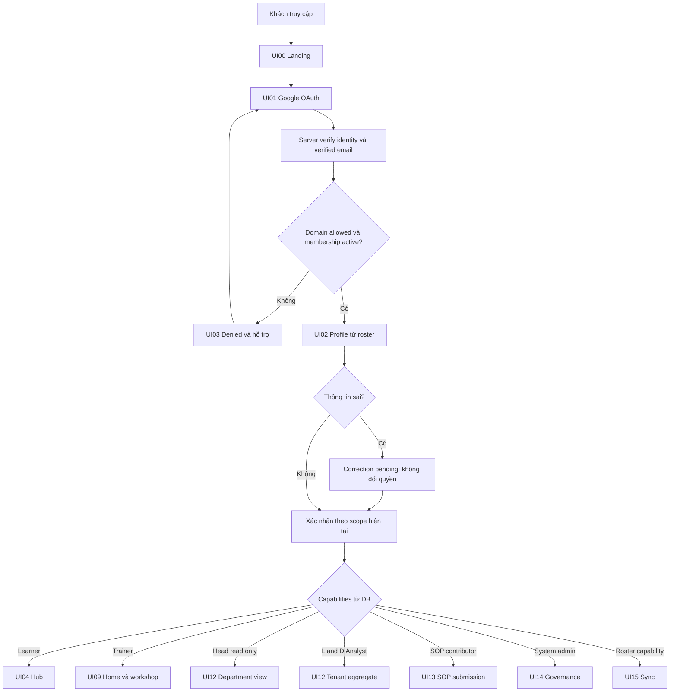
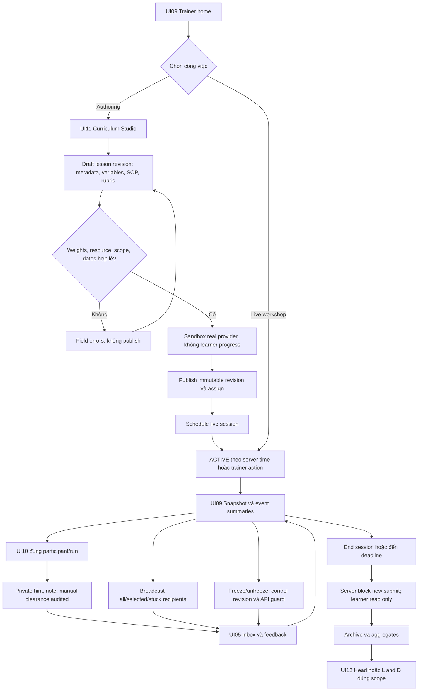
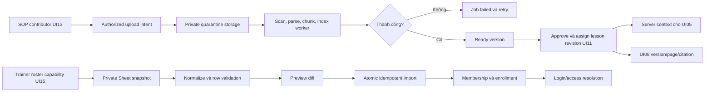
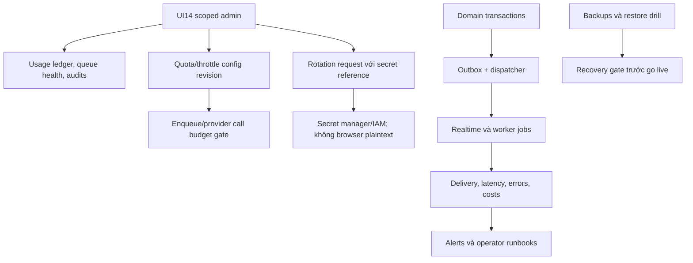

# Promptify — full backend flows production (đề xuất)

Đi kèm [kế hoạch kiến trúc](PRODUCTION_BACKEND_ARCHITECTURE_PLAN_2026-10-08.md). Các sơ đồ là mục tiêu triển khai, không phải flow đã có trong backend. UI-11 dùng nghĩa mới Curriculum Studio; Library không bị gán lại vào số này.

## 1. Đăng nhập và điều hướng mọi vai trò



## 2. Learner: run, Judge, retry và compare

```mermaid
sequenceDiagram
  participant L as Learner UI05
  participant API as API
  participant DB as PostgreSQL
  participant Q as Outbox và Cloud Tasks
  participant W as Cloud Run worker
  participant AI as Approved provider
  participant RT as Private realtime
  L->>API: Submit prompt + lesson/session/test-case IDs + idempotency key
  API->>DB: Check membership, published revision, control/time và budget
  alt Session frozen/ended hoặc scope sai
    API-->>L: Reject có mã lỗi, không enqueue
  else Hợp lệ
    API->>DB: Atomic reserve + run + job + outbox
    API-->>L: 202 run_id queued
    DB->>Q: Dispatcher lease và enqueue
    Q->>W: Job ID với service identity
    W->>DB: Claim lease, load canonical resource/system/rubric
    W->>AI: Generate
    AI-->>W: Output + actual model/usage
    W->>DB: Atomic generated output + attempt + usage + outbox
    DB->>RT: Dispatcher run.generated
    RT-->>L: ID và revision; learner fetch result
    W->>Q: Judge job qua outbox
    Q->>W: Judge cùng run/output hash
    W->>AI: Evaluate canonical snapshot
    AI-->>W: Structured result
    alt JSON/score không hợp lệ hoặc provider lỗi
      W->>DB: evaluation_failed; output giữ nguyên
      L->>API: Retry Judge theo run_id
      API->>DB: New evaluation job, không thêm attempt
    else Valid
      W->>DB: Atomic evaluation + progress + outbox
      DB->>RT: Dispatcher run.evaluated
      RT-->>L: Refresh UI07 feedback
    end
    L->>API: UI06 load run A/B đúng lesson và owner
    API-->>L: Immutable prompt/output/evaluation snapshots
    L->>API: Restore B thành draft revision mới
    API->>DB: Draft với source_run_id; history unchanged
  end
```

Run được accepted trước end có thể hoàn tất với late marker; run mới sau end bị chặn. Transport/worker có thể giao trùng; DB side effects idempotent. Provider timeout có trạng thái uncertain, không hứa exactly-once AI call.

## 3. Trainer: authoring → workshop → kết thúc



Clearance không sửa AI score. Stuck dùng cấu hình failed evaluated runs/PII riêng, không suy từ tổng attempts. Weekly timeline/adaptive hero cần bổ sung vào trainer home dù prototype UI09 hiện chỉ workshop.

## 4. Draft preview và notification delivery

```mermaid
sequenceDiagram
  participant T as Assigned trainer
  participant API as Authorized API
  participant D as DB
  participant R as Private realtime
  participant L as Learner workspace
  T->>API: Watch selected participant
  API->>D: Check scope + monitoring policy
  API-->>T: Short watch lease
  API-->>L: Visible monitoring notice
  L->>API: Debounced draft revision khi được watch
  API->>API: Validate/redact, payload limit, coalesce
  API->>R: Private draft topic
  R-->>T: Latest advisory preview
  T->>API: Send hint/broadcast với target
  API->>D: Atomic message + resolved recipients + outbox
  API-->>T: Accepted; không khẳng định mọi learner đã nhận
  D->>R: Dispatcher inbox event
  alt Learner online
    R-->>L: Notification ID
    L->>API: Fetch authorized message
    L->>API: Client received và viewed ack riêng
  else Learner offline
    L->>API: Reconnect: fetch inbox cursor và session snapshot
    API-->>L: Pending messages + current controls
  end
```

Learner không publish control/score/hint. API ingestion xử lý draft là endpoint có auth, không phải task queue cho mỗi lần gõ. Checkpoint persistence và ephemeral preview khác nhau; raw PII policy phải được duyệt.

## 5. SOP và roster



SOP ready khác approved; Head read-only không mặc định là contributor. Import fail không xóa snapshot/progress cũ; role không đọc từ roster.

## 6. Governance và vận hành


