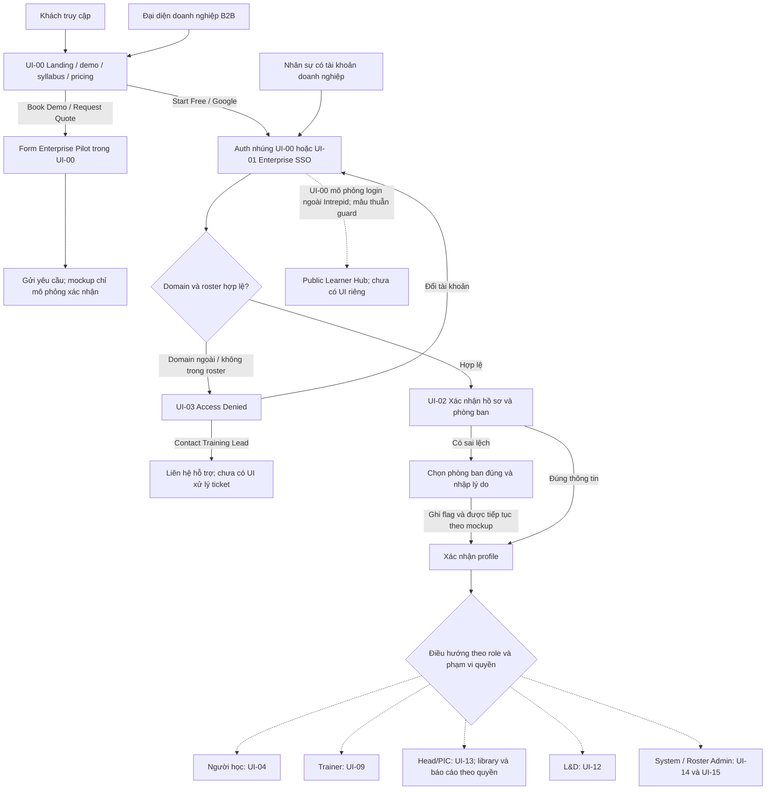
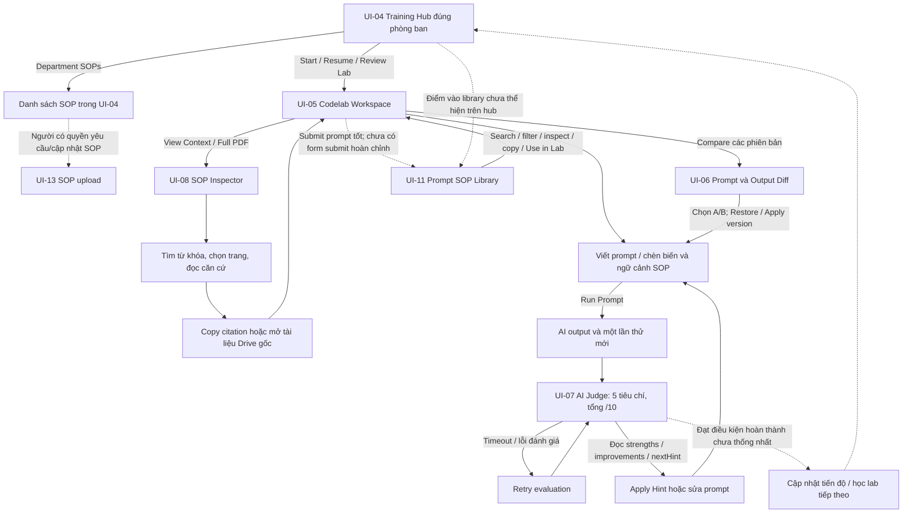
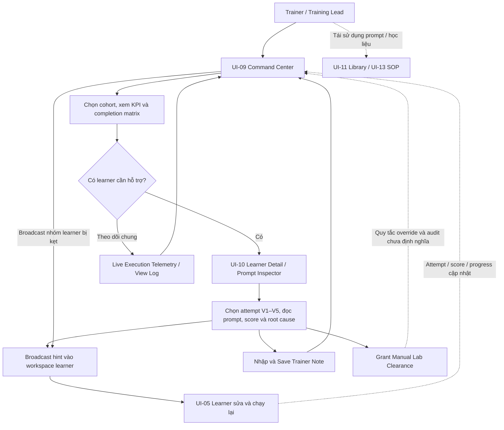
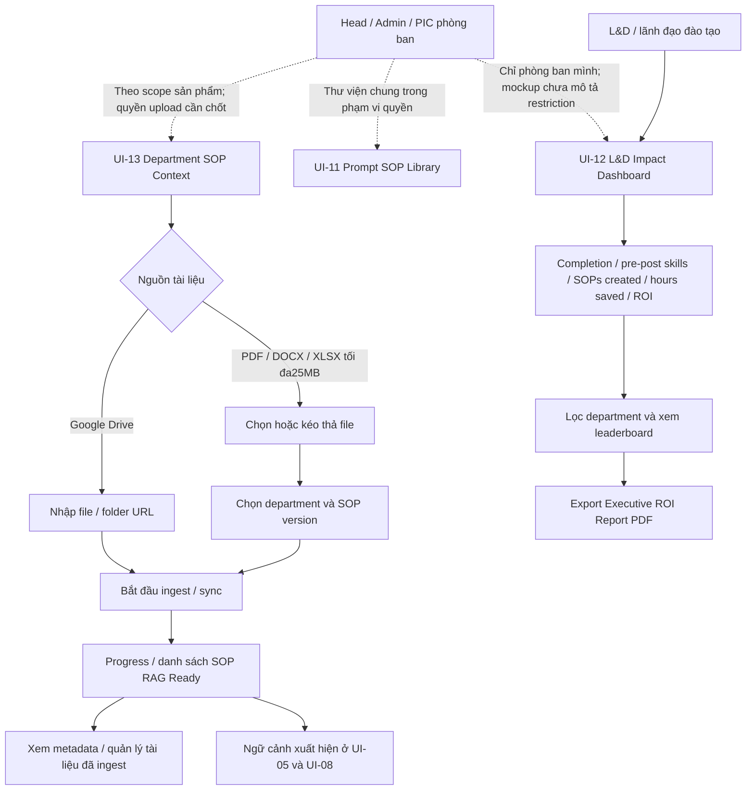
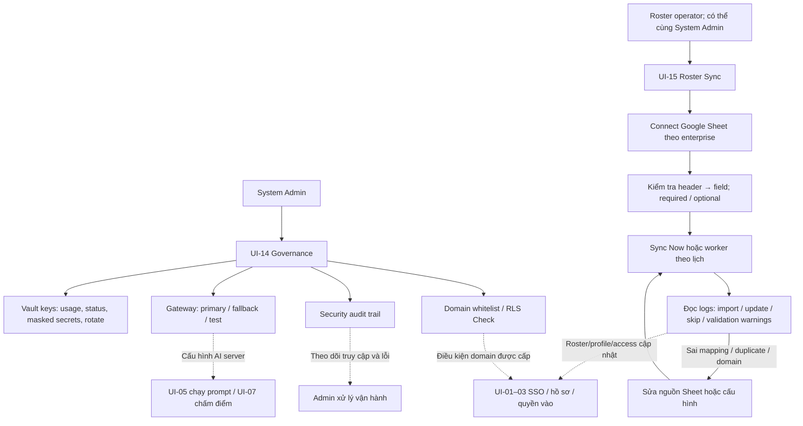
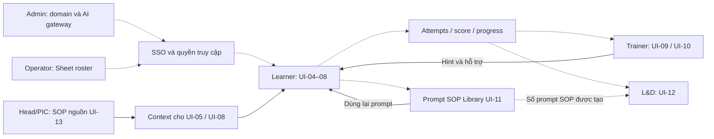

# Luồng người dùng Promptify theo UI mockup

Ngày đọc: 07/10/2026. Nguồn chính: 16 HTML trong [UI Mockup](<UI Mockup-20261006T140854Z-1-001/UI Mockup>). Đây là luồng thiết kế đọc từ mockup, không phải chứng nhận flow đang chạy trong repo hay Vercel.

Mũi tên liền: hành động/đích được mô tả trong mockup, kể cả nút đang dùng alert để mô phỏng. Mũi tên nét đứt: nối nghiệp vụ suy luận hoặc quyền/flow còn cần chốt. Google SSO, AI Judge và worker là tác nhân hệ thống, không phải kiểu người dùng.

## Các kiểu người dùng

| Kiểu người dùng / tình huống | Mục tiêu | UI liên quan | Mức chắc chắn từ mockup |
|---|---|---|---|
| Khách truy cập / cá nhân muốn học | Xem demo, chương trình, giá và bắt đầu học | 00; auth nhúng; 04 là đích mô phỏng | Luồng cá nhân ngoài Intrepid mâu thuẫn domain guard |
| Đại diện doanh nghiệp / khách B2B | Xin demo, báo giá và đề nghị setup đào tạo | 00 + Enterprise Pilot modal | Có form; không có CRM, sales portal hoặc payment flow |
| Learner — nhân viên Intrepid | Xác nhận hồ sơ, học, thử và cải thiện prompt, dùng thư viện | 01–08, 11 | Vai trò và learning loop rõ |
| Trainer / Training Lead | Theo dõi cohort, tìm learner bị kẹt, xem prompt và hỗ trợ | 09–10; dùng 11/13 là nối nghiệp vụ | Command center rõ; UI quản lý curriculum không nằm trong bộ mockup |
| Head/Admin/PIC phòng ban | Cung cấp/cập nhật SOP, xem thư viện và kết quả phòng ban | 13; 11/12 theo phạm vi quyền cần chốt | UI-04 gọi đích upload là Department Head; UI-13 không tự xác định role |
| L&D / lãnh đạo đào tạo | Xem tác động, chênh lệch năng lực, hiệu suất và ROI | 12 | Dashboard toàn doanh nghiệp, không phải chỉ phòng ban |
| System Admin | Quản trị key, gateway, domain, security logs | 14 | Header SysAdmin Lead rõ |
| Roster Admin / người vận hành roster | Kết nối Sheet, mapping, sync và sửa lỗi danh sách | 15; 02 khi mismatch | Tình huống vận hành; chưa có bằng chứng đây là role riêng với System Admin |

## 1. Điểm vào và phân luồng quyền

UI-02 ghi rõ người báo sai phòng ban được tiếp tục ngay; yêu cầu được flag vào Roster Sync Log để trainer review. Mockup chưa định nghĩa cơ chế cấp quyền an toàn trong thời gian chờ xử lý, hoặc giao diện trainer duyệt yêu cầu đó. Không hiểu lựa chọn phòng ban là quyền được tự cấp.

UI-02 có Employee ID, office location, manager và department. Không tự bổ sung màn hình xác nhận country vào sơ đồ đọc từ mockup.

Role router là nối nghiệp vụ suy luận: mockup không có màn chọn role và không mô tả đầy đủ SSO của admin/trainer. Role phải lấy từ quyền đã cấp, không phải người dùng tự chọn.

## 2. Người học — vòng lặp thực hành

UI-04 hiển thị 5 codelabs, trạng thái completed/in_progress/not_started. Mockup chưa có màn chứng chỉ hoặc flow hoàn thành toàn khóa riêng. Không vẽ thêm payment, certificate hoặc leaderboard cá nhân.

UI-11 là thư viện prompt mẫu SOP: tìm kiếm, lọc department/technique, xem syntax, copy, load/fork vào UI-05. Nút Submit New Prompt SOP có nhưng không có submit modal/approval workflow hoàn chỉnh. Không đồng nhất nút submit với prompt đã được enterprise approve.

## 3. Trainer — theo dõi và can thiệp

Mockup UI-09 cho chọn cohort, xem learner stuck, broadcast, inspect và telemetry; UI-10 có timeline, diagnostics, copy syntax, note và manual clearance. Các action này chủ yếu mô phỏng alert. Tạo course, chỉnh curriculum, tạo cohort và ghi danh học viên không có màn hoàn chỉnh trong 16 mockup; đó là khoảng trống, không phải flow đã được vẽ đủ.

## 4. Head/PIC và L&D — học liệu và tác động

UI-13 có link quay lại Learner Dashboard; UI-04 gọi request sync là chuyển đến Department Head SOP Upload. Vì vậy không có đủ căn cứ để cho mọi learner quyền upload/delete hoặc chọn bất kỳ department. Nguồn sản phẩm Phase1 xác định Head chỉ xem phòng ban mình; UI-12 mockup lại hiển thị All Departments. Cần tách scope của Head và L&D bằng quyền thật.

UI-12 có phạm vi L&D executive toàn doanh nghiệp. Date range trong header chưa phải bộ chọn thời gian tương tác hoàn chỉnh. Các số ROI/giờ tiết kiệm là dữ liệu minh họa; chưa có cách thu thập/định nghĩa calculation đã được chốt.

## 5. System Admin và người vận hành roster

Google service account, sync worker, AI execution/evaluation là hệ thống hỗ trợ. Người học không phải người vận hành key hoặc worker. Unmask/Rotate trong UI-14 là hành vi mockup, không tự chứng minh quyền xem secret hoặc cách vault hoạt động.

UI-15 hiển thị interval15m, khác yêu cầu5min trong inventory. Sơ đồ dùng “theo lịch” để không biến một số minh họa thành cấu hình đã duyệt.

## 6. Liên kết giữa các vai trò

Nét đứt ở phần dữ liệu là quan hệ nghiệp vụ cần backend thực hiện, không phải bằng chứng đã có subscription hoặc data pipeline production.

## Coverage và điều cần chốt

| UI | Chức năng đọc từ HTML | Nhánh sơ đồ |
|---|---|---|
| 00 | Landing, auth nhúng, demo/pricing, B2B lead | Điểm vào |
| 01 | Enterprise SSO, session expired | Điểm vào |
| 02 | Profile confirmation / mismatch / department | Điểm vào |
| 03 | Domain hoặc roster access denial / recovery | Điểm vào |
| 04 | Department Training Hub 5 labs | Learner |
| 05 | Codelab Workspace | Learner |
| 06 | Attempt syntax/output comparison / restore | Learner |
| 07 | Judge diagnostic / hint / retry | Learner |
| 08 | SOP document inspector / search / citation | Learner |
| 09 | Trainer cohort Command Center | Trainer |
| 10 | Learner attempts inspector / intervention | Trainer |
| 11 | Enterprise Prompt SOP Library | Dùng chung theo quyền |
| 12 | L&D Executive Impact & ROI | Head theo phạm vi / L&D |
| 13 | SOP file / Drive ingestion / management | Người có quyền quản lý SOP |
| 14 | Vault / gateway / whitelist / security | System Admin |
| 15 | Sheet connections / mapping / sync logs | Roster operator |

1. Public/free và multi-enterprise có trong mockup UI-00/14/15, nhưng [scope Intrepid Phase1](00_PRODUCT_SOURCE_OF_TRUTH.md) loại public registration, free/payment và generic multi-tenant SaaS. Đọc mockup đầy đủ không có nghĩa mở các nhánh này trong Phase1.
2. Quyền upload/delete SOP, quyền xem All Departments và role của roster operator chưa được mockup định nghĩa đầy đủ.
3. Mismatch cho đi tiếp nhưng người review/approve, routing tạm thời và giới hạn dữ liệu chưa có flow hoàn chỉnh.
4. UI-09 nói pass >8/10; UI-07 simulator nói8/10 Passed. Không chốt ngưỡng pass từ mockup.
5. UI-11 có submit CTA và approved data nhưng không có quy trình review/approve. Không vẽ người duyệt hoặc approval stages như đã tồn tại.
6. UI-00 và UI-07 có lỗi JavaScript ở lần kiểm tra trước; luồng này đọc cả markup/action, không dựa ảnh render để khẳng định các action hoạt động.

## Dấu vết nguồn chính

- UI-00: Start Free/Book B2B Demo tại129/135; mô phỏng Intrepid/Public auth tại469–476; form Enterprise Pilot tại516.
- UI-02: mismatch cho tiếp tục tại179; confirm và routing department tại201–207.
- UI-04: mở workspace tại234/309; request SOP chuyển Department Head tại374.
- UI-05: View Context tại117; Compare tại124; chèn variables tại247–248; Run tại273.
- UI-07: criteria và hint trong x-data; scorecard/error-retry và Apply Hint & Revise.
- UI-09: broadcast tại167; inspect learner tại347–350; View Log tại401.
- UI-10: timeline/diagnostics và verbatim syntax; Broadcast Hint, trainer note và clearance.
- UI-11: submit188; scope tabs242–263; Use in Lab359; fork/load418.
- UI-12: executive dashboard109/174; export123–127; leaderboard300.
- UI-13: learner back link118; department metadata215; tabs183/190/197; ingest/status và RAG Ready.
- UI-14/15: SysAdmin/governance và roster operator tabs, actions, state trong HTML gốc.

Các số dòng trên trỏ về HTML gốc trong thư mục nguồn, không phải mã React hiện tại.
