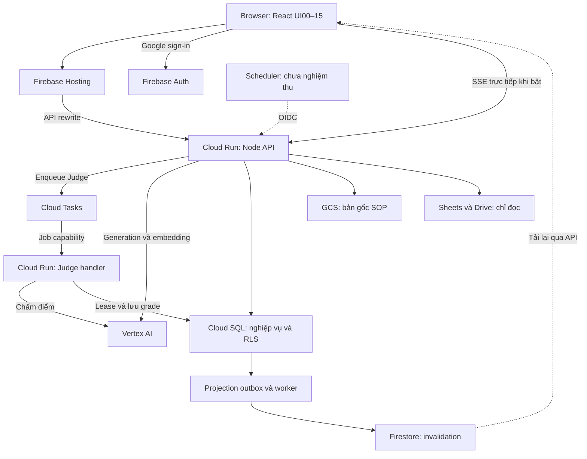
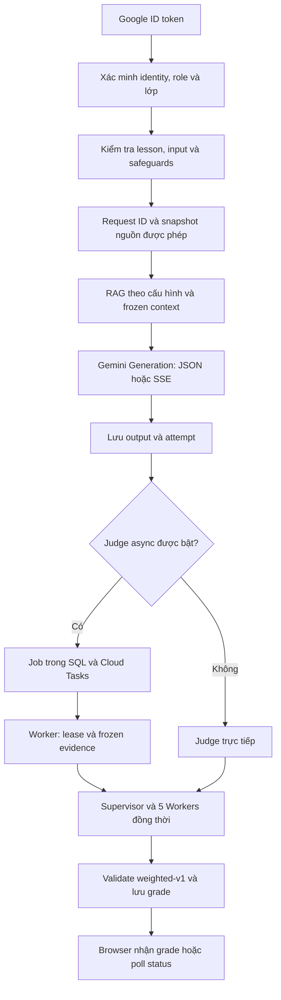

# Kiến trúc Promptify Intrepid

Cập nhật 23/10/2026. Đây là **file chính để theo dõi kiến trúc hiện tại và lịch sử thay đổi kiến trúc** của Promptify Intrepid. Tài liệu này thay thế bản kiến trúc 2 app ngày 12/10 ([archive](archive/repository/ARCHITECTURE-two-apps-2026-10-12.md)). Mọi đường dẫn bên dưới đều tương đối với `apps/promptify-intrepid/`, trừ khi ghi rõ khác.

## Đọc nhanh cho người review

**Readback bổ sung 23/10 khi chuẩn bị đồng bộ GitHub:** Cloud Console với tài khoản staging xác nhận `promptify-intrepid-api-hint3-1023` nhận 100% traffic; image `sha256:eed6c13320513bc20a8d01e33196cd528e888551c02208fb0011e2026adc43f7`, timeout 300s, concurrency 80, revision max instances 100. Container cấu hình Vertex / `gemini-3.8-flash` / `parallel-v1`, Judge async, SSE và safeguards bật. Danh sách env không có `PROVIDER_ADMISSION_MODE`, `GENERATION_MODE`, `JUDGE_FENCING_MODE`; theo code các ứng viên này không được bật bằng những flag đó. Chưa readback SQL schema và Firebase Hosting release trong bước này. Cloud Run không hiển thị source/build provenance của revision; cần khôi phục/đối chiếu source image trước khi công bố snapshot là bản staging. Readback mới này bổ sung cho các đoạn giới hạn ở lần audit trước phía dưới; không đổi kết quả test hoặc xác nhận đầy đủ acceptance.

Promptify là một ứng dụng web đào tạo prompt nội bộ. Frontend React được phục vụ qua Firebase Hosting; backend Node chạy trên Cloud Run; Firebase Auth xác thực Google; Cloud SQL PostgreSQL là nguồn dữ liệu nghiệp vụ chính và thực thi RLS. GCS lưu bản gốc SOP bất biến. Firestore chỉ gửi tín hiệu có thay đổi để browser tải lại dữ liệu qua API. Vertex AI sinh câu trả lời và chấm rubric. Google Sheets/Drive cung cấp roster và tài liệu theo nguồn đã được cấp phép.

Backend tổ chức dưới dạng **modular monolith**: các service nghiệp vụ trong cùng app, không phải mỗi service TypeScript là một microservice đã deploy. Cloud Tasks tách thời gian chấm Judge khỏi request của browser. Cơ chế tách AI worker và async Generation có trong code nhưng chưa đủ bằng chứng xác nhận được bật trên staging.

Đọc theo thứ tự: sơ đồ tổng thể → luồng Run/Judge → ma trận triển khai → module/phân quyền/dữ liệu → nhật ký thay đổi. [Bộ audit](audits/REMEDIATION_ROADMAP.md) đánh giá rủi ro và kế hoạch khắc phục; file này mô tả kiến trúc, không phải chứng nhận production-ready.

### Mức bằng chứng và phạm vi

- **CODE:** đối chiếu implementation local ngày 23/10.
- **OFFLINE:** kiểm tra với mock/PGlite; không chứng minh tải hoặc chất lượng Gemini thật.
- **LIVE lịch sử:** có báo cáo/evidence staging tại thời điểm ghi nhận; không mặc nhiên là cấu hình đang phục vụ bây giờ.
- **Chưa xác minh live:** cần đọc lại service/image/traffic/env/schema thực tế.

Lần cập nhật này không deploy, thay đổi database hay gọi AI. Hai probe public trong phiên audit gặp ENOTFOUND; chưa đọc lại runtime. Báo cáo release cuối được tìm thấy ghi API `hint3-1023`, Hosting `e7f637fef72a7263` ngày 23/10; đây là **mốc lịch sử**, không phải một lần xác nhận traffic mới. Một số bảng revision trong tài liệu cũ hơn vẫn giữ mốc 21–22/10; dùng ngày/evidence để đối chiếu, không chọn cấu hình theo tên file hoặc số migration lớn nhất.

## Repository

```text
apps/promptify-intrepid/   ứng dụng duy nhất: src/, api/, gcp/ (SQL, Docker/Cloud Build, template), scripts/, tests/
supabase/                  lịch sử schema/migration gốc (001–050) — nguồn để dựng gcp/sql/001_baseline.sql; test offline đọc 038
design-drafts/             mockup/prototype; pre-separation/ là bản lưu nguyên văn trước khi tách app
scripts/                   tool repo: tài liệu schema, review UI, progress tracker; historical/ là tool cũ
docs/                      tài liệu (xem README.md)
```

Root `package.json` chỉ chứa các lệnh chuyển tiếp vào app, không có dependency. Root `vercel.json` cố ý chặn deploy từ root.

## Sơ đồ kiến trúc tổng thể

Sơ đồ thể hiện quan hệ thành phần theo code và evidence staging đã lưu. Nhánh Scheduler có code; lần ghi nhận cũ là PAUSED, chưa nghiệm thu end-to-end. Cloud Tasks Judge có LIVE lịch sử; async Generation/global admission được tách rõ ở ma trận bên dưới.



`Judge handler` là vai trò xử lý trong Cloud Run, **không khẳng định có một service riêng đang deploy**: code cho phép handler chạy trong API khi chưa bật isolation. Projection worker có implementation; liveness/lịch chạy hiện tại chưa xác minh. Các job dùng capability riêng; đường roster/projection sử dụng kiểm tra OIDC. Không thay thế hai cơ chế này bằng một mô tả auth chung.

## Luồng chính: đăng nhập → Run → Judge → hiển thị điểm



Đây là nhánh A `parallel-v1`, giữ model/rubric/threshold hiện hành. Nếu bật async Generation ứng viên, enqueue/lease diễn ra trước RAG và Generation; worker mới thực hiện retrieval rồi đóng băng evidence. Global provider admission nếu bật được áp dụng **trước từng transport call/retry** của Generation/Judge, không phải giữ một permit cho cả luồng. SSE chỉ cải thiện hiển thị Generation, không rút ngắn thời gian Judge.

## Ma trận implementation và triển khai

| Thành phần | Code/config quyết định | Bằng chứng và giới hạn |
| --- | --- | --- |
| Auth, RLS, SOP originals, manual roster | Các service và SQL 001–011 | CODE/OFFLINE + LIVE lịch sử trên staging; nhiều ca chỉ dùng dữ liệu giả lập |
| Judge async | `JUDGE_MODE=async`, queue/worker URL hợp lệ, SQL 012 | LIVE lịch sử 23/10; chưa đọc lại env/traffic hiện tại |
| Global provider admission | `PROVIDER_ADMISSION_MODE=sql`, SQL 013 | CODE/OFFLINE; mặc định bypass khi unset/disabled; activation live chưa xác minh |
| Async Generation/RAG | `GENERATION_MODE=async`, queue/worker URL hợp lệ, SQL 014 | CODE/OFFLINE; chưa có nghiệm thu runtime thực tế |
| Judge dispatch fencing | `JUDGE_FENCING_MODE=sql`, SQL 015 | CODE/OFFLINE; không suy ra đã apply từ việc 016–018 được release |
| Safeguards | `ACCESS_EXPIRY_MODE`, `SESSION_TOKEN_CAP`, `INJECTION_GUARD`, SQL 016 | CODE/OFFLINE + báo cáo LIVE lịch sử; còn lỗi enforcement/accounting trong audit |
| Generation streaming | `GENERATION_STREAM=true`, `VITE_STREAM_API_URL` | LIVE lịch sử 3 Runs; tự tắt khi async Generation/isolation được bật |
| Facilitator hint requests | `workshopSupportService.ts`, SQL 017/018 | CODE/OFFLINE + release lịch sử tới hint3; browser acceptance đầy đủ còn thiếu |
| Judge B/C | `consolidated-v1` / `integrated-v1` | 2/1 logical calls bình thường; local/mocked, chưa nghiệm thu quality/latency; không tự đổi strategy |
| AI worker isolation | `RUNTIME_MODE=ai-worker`, `AI_WORKER_ISOLATED=true` | CODE/OFFLINE; chưa chứng minh có service tách riêng live; Studio sync AI và SSE bị vô hiệu khi isolation bật |

Nguồn đối chiếu: [inventory audit](audits/SYSTEM_INVENTORY.md), [functional audit](audits/FUNCTIONAL_AUDIT.md), báo cáo release riêng trong `apps/promptify-intrepid/outputs/` (private, không commit/share), và [handoff audit](audits/AUDIT_HANDOFF.md). Chỉ ghi tên biến cấu hình, không ghi secrets hay capability token.

## Frontend

- `src/main.tsx:7-8`: `/rebuild` mở prototype review (mọi dữ liệu là mô phỏng), chỉ khi `VITE_REBUILD_PRODUCTION !== 'true'`. Image Cloud Run đặt biến này là `true` (`Dockerfile:11`).
- `src/components/rebuild/ProductionApp.tsx`:
  - Điều hướng bằng `?ui=NN` (0–15), có gate theo role tại `:88,109`.
  - Màn hình mặc định: learner → 4, head → 12, admin → 14, trainer → 9.
  - UI 9/10/11/15 yêu cầu `can_manage`.
  - Poll snapshot mỗi 15s (5s ở UI09 hoặc khi còn hint request đang chờ).
  - Listener Firestore chỉ báo "có thay đổi"; dữ liệu luôn tải lại qua API.
- `src/services/productionClientService.ts`: API chính `POST /api/product` gửi action và các trường payload kèm Bearer Firebase ID token, timeout 65s. Streaming gọi `/api/stream` trực tiếp trên Cloud Run qua CORS khi có build config phù hợp. Judge status polling 1s trong 10s đầu, sau đó 3s tới 30s rồi 10s, tạm dừng khi tab ẩn; grade authoritative được hiển thị trước bulk snapshot refresh.
- i18n EN/VI: `productI18nService.ts`, `sourceUiTextService.ts`.

## API

- `api/cloud-run.ts` → `src/services/cloudRunServer.ts`.
  - Route: `/health`, `/healthz`, `/readyz` (`SELECT 1`), `/api/product|generate|evaluate|roster-worker`, `/api/stream` khi bật. Readiness hiện chỉ kiểm tra kết nối SQL, không chứng minh schema/feature flags tương thích.
  - `/internal/roster` trên API chỉ hoạt động khi `ROSTER_STAGING_ENABLED`, đúng project, đúng `K_SERVICE` và có OIDC hợp lệ (`:29-43,90`).
  - `RUNTIME_MODE=worker` mở `/internal/roster` và `/internal/projections`; `ai-worker` mở các AI handler được cấu hình, chặn API thường. `/internal/judge` và `/internal/generation` có thể chạy trong API khi chưa isolation. Chưa xác nhận deployment của service worker tách riêng.
- `src/services/productionServerService.ts`, hàm `handleProductRequest`: 60 action; [inventory audit](audits/SYSTEM_INVENTORY.md) liệt kê đầy đủ.
  - `supportConfig`, `accessRequest`, `enterpriseRequest`, `enrollBasic` chạy trước full roster context; access request và Basic enrollment vẫn xác minh identity. Không coi toàn bộ nhóm này là endpoint anonymous.
  - `classScope` và danh sách manager actions kiểm tra `can_manage`; một số action còn có gate riêng theo role/owner và SQL RPC.
- `api/generate.ts`, `api/evaluate.ts`: giữ lại để tương thích, gọi chung `rebuildRunService.ts`.

## Xác thực và phân quyền

- **Firebase:** dùng Google popup. Server gọi `verifyIdToken(token, checkRevoked=true)`, bắt buộc `email_verified` và provider `google.com`. Danh tính được map sang user qua `gcp_identity_bindings` (`firebaseServerIdentityService.ts:10-33`). Email không có trong roster → 403 (`productionServerService.ts:45-65`).
- **Postgres:** transaction theo actor chạy `SET LOCAL ROLE authenticated` kèm claim `request.jwt.claim.sub`; transaction nội bộ chạy `service_role` và cần filter class/owner tường minh. Nhờ đó RLS và `auth.uid()` (tạo lại trong `gcp/sql/001_baseline.sql:15-21`) hoạt động giống mô hình Supabase. Login runtime `promptify_runtime` có thuộc tính NOBYPASSRLS (`003_runtime_role.sql`). `cloudDatabaseService.ts` là query builder theo cú pháp Supabase nhưng chạy trên `pg`; client Supabase thật (`supabaseClient.ts`) không còn được import ở runtime.
- **Role trong DB:** `learner`, `instructor` (UI hiển thị là "trainer"), `head`, `admin`.
- **Phạm vi lớp** (`productionServerService.ts:79-104`):
  - Instructor: qua `course_instructors`.
  - Head: qua `product_class_grants` do admin cấp.
  - Learner: qua enrollment còn active hoặc completed.
  - Có thêm allowlist domain email theo từng client.
  - **Không có code so sánh phòng ban của Head với phòng ban của lớp**: phạm vi Head đúng hay sai phụ thuộc vào grant admin cấp.

## Dữ liệu

- **Schema trong repo:** `gcp/sql/001…018` (+ các rollback đã có). Có hai file lịch sử cùng số `006`; không đổi tên/rewrite migration đã apply. `001_baseline.sql` được gộp từ `supabase/schema.sql` + `supabase/migrations/002…049`, trừ 037, 041, 050 (050 được thay bằng `005_*`). Trạng thái apply từng migration xem ma trận phía trên; số lớn nhất không chứng minh cả chuỗi đã được apply.
- **Cách apply:** `scripts/render_gcp_config.mjs` → `gcp/06-apply-schema.sh.template`. Apply migration mới cần credential owner; login runtime không đủ quyền ([kế hoạch 21/10](proposals/STAGING_ROSTER_AND_DRIVE_FIX_PLAN_2026-10-21.md)).
- **Storage** (`cloudStorageService.ts`): bucket `GCP_SOP_BUCKET`. Signed URL V4 hiệu lực tối đa 300s. Upload không ghi đè được (`ifGenerationMatch:0`), tối đa 25 MB. Bản gốc immutable có kiểm SHA-256.

## SOP và RAG

- **Ingestion** (`sopIngestionService.ts`):
  - Định dạng: PDF (tối đa 100 trang), DOCX, XLSX (tối đa 5.000 dòng), md/txt/csv. Google Doc được export sang TXT, Google Sheet sang XLSX.
  - Chunk 2.000 ký tự, overlap 200, tối đa 60 chunk.
- **Embedding:** evidence cấu hình trước ghi `text-multilingual-embedding-002`, 768 chiều, gọi qua SQL `google_ml_integration` hoặc Vertex `:predict`. Model/path phụ thuộc cấu hình embedding và cần readback khi release; không suy từ mặc định trong một service sang live model. Embedding không dùng chung budget Gemini admission.
- **Tìm kiếm:** `intrepid_search_sop`, pgvector HNSW, trả về top 10 (`gcp/sql/004_pgvector_vertex.sql:25-46`).
- **Đưa vào generation** (`rebuildRunService.ts`): lấy nguồn SOP đã duyệt, retrieval theo vector mode khi bật, giới hạn context 100k ký tự. Kiểm lại quyền nguồn rồi lưu snapshot context/citations kèm hash. Nhánh async Generation chuyển retrieval vào worker có lease; không chạy embedding trong enqueue. Việc kiểm tra expiry/session mới trong delayed worker còn thiếu — xem audit I05.

## Generation và Judge

- **Generation** (`productionAiService.ts`, `vertexAiService.ts`):
  - Gọi Vertex `aiplatform.googleapis.com/v1/.../locations/global/.../gemini-3.8-flash:generateContent` bằng ADC.
  - Giới hạn output mặc định 4.096 token, JSON sync deadline 50s; stream và async Generation có nhánh deadline dài hơn, worker Generation tối đa 240s và bị chặn bởi lease còn lại.
  - Với reject rõ ràng 429/503: có thể dùng fallback nếu được cấu hình, hoặc retry cùng model tối đa một lần nếu deadline còn đủ; cấu hình staging lịch sử không có fallback model.
  - Lỗi mạng hoặc abort → 504, nghĩa là "chưa rõ kết quả".
  - Giữ upstream status trong chẩn đoán. Upstream 404 được mô tả là model/endpoint không tồn tại và trả application 502; không tự coi là quota 429.
- **Judge** (`parallelJudgeService.ts`):
  - Strategy A `parallel-v1`: 1 Supervisor kiểm task alignment và 5 worker tiêu chí được khởi chạy **đồng thời**, rồi tổng hợp deterministic; không có thêm model call để tổng hợp.
  - Sync deadline chung 50s; async Judge deadline 270s, lease 290s, task deadline 300s. Stage sử dụng thời gian còn lại; được retry 504 một lần nếu còn ít nhất 15s. Retry transport 429/503 và retry job là các lớp khác, phải tính riêng.
  - Luồng bình thường: 6 logical Judge calls, cộng Generation thành 7. Retry có thể tăng số transport calls; không dùng trần 13 từ code cũ cho mọi trường hợp hiện tại.
  - B `consolidated-v1` và C `integrated-v1` đã có code với 2/1 logical calls bình thường; chưa có benchmark Gemini thật chứng minh quality tương đương hoặc Judge dưới 10s. Không đổi strategy theo tài liệu này.
  - Điểm làm tròn về 0/25/50/75/100% trọng số của từng tiêu chí; tổng điểm 0–10, theo hợp đồng `weighted-v1` (`weightedRubricService.ts`).
- **Claim, ngân sách và recovery** (`rebuildRunService.ts`, `judgeFencingService.ts`):
  - Sync Judge dùng claim và bảo toàn outcome uncertain để tránh ghi trùng. Async Judge có queued/running/retry_wait/succeeded/failed/expired, bounded dispatch và lost-worker recovery; SQL 015 khi bật bổ sung dispatch fence cho finish/settle. 409 có thể là busy/recovery state, không mặc định là một claim kẹt vĩnh viễn.
  - Judge: 40 lượt/giờ (`product_take_budget`).
  - Run: 40/giờ và 200/24h (trigger SQL `product_limit_ai_run`). Gói Basic: 10/ngày.
- **Hàng đợi:** Cloud Tasks Judge có LIVE lịch sử; global SQL admission và async Generation là ứng viên local cần schema/flags và nghiệm thu riêng. Không có yêu cầu phải thêm Redis. Kiến trúc queue và mục tiêu latency/cost xem [performance audit](audits/PERFORMANCE_AUDIT.md) và [proposal capacity](proposals/STAGING_GEMINI_CAPACITY_LATENCY_PROPOSAL_2026-10-22.md).

## Safeguards, workshop và hint requests

- `learnerSafeguardService.ts` và SQL 016: expiry theo enrollment, read-only check, Generation token ledger theo user/class/lesson/session, reset, security events chỉ lưu hash/signals.
- `promptInjectionService.ts`: phát hiện theo rule EN/VI; không phải detector bảo đảm chặn mọi injection. Lesson có thể cho phép adversarial practice phục vụ đào tạo.
- `WorkshopMessaging.tsx` hiển thị broadcast/private hints và read receipts; `workshopSupportService.ts` + SQL 017/018 xử lý learner request → facilitator approve/decline → hint/history trong đúng lớp/bài. Không còn self-unlock hints của learner trong luồng mới.
- Các chức năng có code và offline tests; báo cáo release staging ngày 23/10 tồn tại, nhưng full browser acceptance còn thiếu. Session cap/count hint còn race và safeguards còn fail-open khi thiếu schema — không mô tả chúng như kiểm soát đã hoàn thiện. [Issues I03–I05/I10/I15](audits/ISSUES_REGISTER.md).

## Roster và Drive

- **Đọc Sheets** (`googleRosterService.ts`): scope `spreadsheets.readonly`. Sheet phải có trong `WORKSPACE_SOURCE_BINDINGS_JSON` (`workspaceSourcePolicyService.ts`). Hỗ trợ hai định dạng: v1 (sáu tab) và v2 (Table).
- **Sync thủ công:** action `syncSheet`. **Sync theo lịch:**
  - Thiết kế worker: claim 1 connection mỗi lượt, cách nhau ít nhất 15 phút (`rosterWorkerService.ts`).
  - Route staging: 2 cặp lớp/Sheet giả lập được hard-code, chu kỳ 5 phút (`stagingRosterClaimService.ts:4-15`).
- **Thu hồi** (`product_finish_roster_snapshot`, `gcp/sql/011_roster_lifecycle.sql:212-328`): khi một người vắng mặt trong snapshot đầy đủ, enrollment của họ chuyển thành `removed`, nhưng chỉ khi enrollment đó do roster tạo, không có cờ `manual_preserved`, và không còn nguồn active nào khác chứa người đó.
- **Drive chỉ đọc** (`drive.readonly`). Không có code nào cấp hay thu hồi quyền Drive. "Thu hồi" nghĩa là: đổi trạng thái DB, gửi thông báo Firestore `revoked`, và chặn mọi request mới. Signed URL đã cấp vẫn dùng được tối đa 5 phút.

## Biến môi trường (chỉ liệt kê tên)

| Nhóm | Biến |
| --- | --- |
| Server | `RUNTIME_MODE`, `PGHOST`/`PGDATABASE`/`PGUSER`/`PGPASSWORD` (secret), `PGPOOL_MAX`, `GCP_SOP_BUCKET`, `AI_PROVIDER`, `GEMINI_MODEL`, `VERTEX_LOCATION`, `JUDGE_STRATEGY`, `EMBEDDING_*`, `GCP_VECTOR_MODE`, `GCP_ANALYTICS_MODE`, `GCP_WAREHOUSE_ENABLED`, `GOOGLE_WORKSPACE_SERVICE_ACCOUNT`, `WORKSPACE_SOURCE_BINDINGS_JSON`, `ROSTER_STAGING_ENABLED`, `WORKER_AUDIENCE`, `WORKER_INVOKER_EMAIL`, `CORS_ORIGINS` |
| AI jobs và admission | `JUDGE_MODE`, `JUDGE_QUEUE`, `JUDGE_WORKER_URL`, `JUDGE_FENCING_MODE`, `GENERATION_MODE`, `GENERATION_QUEUE`, `GENERATION_WORKER_URL`, `PROVIDER_ADMISSION_MODE`, `AI_WORKER_ISOLATED` |
| Safeguards/stream | `ACCESS_EXPIRY_MODE`, `SESSION_TOKEN_CAP`, `INJECTION_GUARD`, `GENERATION_STREAM` |
| Client | `VITE_FIREBASE_*`, `VITE_REBUILD_PRODUCTION`, `VITE_STREAM_API_URL` |

Danh sách này là index tên cấu hình dùng trong code, không phải bản dump env live. Khi release phải đối chiếu từng flag với schema/path thực sự; không lấy `.env.example` làm bằng chứng cấu hình đang chạy và không ghi secret values vào tài liệu.

## Guardrail

`npm run lint` chạy kiểm tra AST/config/tham chiếu file và Dependency Cruiser. `npm run test:boundaries` gồm các test âm tính cho import ra ngoài app. Hiện còn một warning đã biết: cycle kiểu `ProductionWorkspace.tsx` ↔ `ProductionWorkspaceV7.tsx`. Knip chỉ mang tính tham khảo; không xóa code chỉ dựa trên kết quả của nó.


## Chi tiết ứng viên admission / async Generation / fencing — 23/10

Acceptance is CODE + OFFLINE only: no evidence here establishes migrations013/014/015 applied and enabled live. Some flag-off integration source may be packaged in later overlays; packaging is not activation. Candidate Generation uses migration014 durable jobs, existing identity quotas and frozen server evidence. Status projects queued → generating → generated → judging → completed/failed. Cloud Tasks deliveries use per-job capabilities; SQL lease and dispatch fences prevent duplicate output/grade saves. Generation never automatically replays an unknown provider outcome. Owner status polling repairs an unconfirmed enqueue after30s, and does not rotate acknowledged queued tasks.

Every Generation/Judge generateContent or streamGenerateContent transport attempt enters `admittedModelService` → `providerAdmissionService` when `PROVIDER_ADMISSION_MODE=sql`. Migration013 serializes budget decisions on one SQL row across all instances and queues. Defaults are4 concurrent calls,120000 conservatively reserved tokens/minute,200 pending+active calls and20 per identity. These are initial safety settings, not measured Vertex quotas. Reservations use input UTF8 bytes plus maxOutputTokens; no extra default32768 thinking reservation is added. Actual usage is reconciled at settlement. A running call retains its token reservation beyond60s, and a settled call retains max(estimate,actual) for60s after settlement, including calls that ran longer than a minute. Unknown outcomes hold concurrency until the transport deadline plus30s; this bounds app-side leases, not proof that a remote provider stopped computation.

A bounded batch of the oldest last-served tenant heads is eligible, FIFO within each tenant using a monotonic SQL identity sequence (timestamp ties cannot reorder calls); a head that cannot fit the remaining token budget blocks smaller followers to prevent starvation. Singleton locking still enforces the exact global concurrency cap. Backlog/TTL are bounded. Admission polling uses100–250ms jitter (circuit-open1–1.5s); exponential polling was benchmarked and caused FIFO idle time, so exponential jitter is reserved for actual failed transport retry. Existing provider retry is bounded and obtains a new permit each time. Three consecutive429/503 outcomes open the shared breaker15s. Metadata tombstones remain24h, with bounded100-row cleanup per enqueue. Embeddings remain outside this Gemini budget.

Migration015 enforces the3-dispatch retry budget in SQL even on crash/reclaim and atomically fences async Judge finish/settle by job generation, dispatch count and live lease when `JUDGE_FENCING_MODE=sql`; migration012 is unchanged. `RUNTIME_MODE=ai-worker` rejects ordinary API routes. `AI_WORKER_ISOLATED=true` closes AI worker routes on the API and refuses synchronous Studio sandbox AI. Do not repurpose an active roster/projection worker or create a new service without checking existing delivery and resource constraints.

Async enqueue performs no embedding. The live-leased worker performs the unchanged RAG retrieval, rechecks scoped sources and freezes its context/hash before Gemini. Generation/Judge release SQL connections before waiting for Gemini; managed Cloud SQL embedding still occupies one worker SQL connection while its existing google_ml_integration query runs. `providerOperationsService` supplies operator-only hourly queue/latency/error/token aggregates; structured provider events separate actual provider time from SQL settlement time and include correlation IDs, estimated/known tokens and uncertainty, never prompts/outputs. Cost per grade remains unknown without verified pricing and complete per-grade usage. There is no public operations endpoint or new monitoring resource.

Authenticated app HTTP load, multiple PostgreSQL connections/instances, Cloud SQL saturation, real provider throughput and browser recovery are NOT proven by the fake-provider/PGlite in-process benchmark. See `DEMO_SCRIPT.md` for acceptance and `04_OPERATIONS.md` for release gates.

## Rủi ro kiến trúc đang mở

| Rủi ro | Tác động | Theo dõi |
| --- | --- | --- |
| Nested service/actor SQL transactions và pool idle errors | Có thể gây timeout/restart dù DB vẫn tồn tại | Audit I01/I02 |
| Schema/expiry/session và delayed-worker checks chưa đồng nhất | Enforcement có thể cho qua hoặc accounting sai | Audit I03–I05 |
| Admission/fencing chưa được xác minh live, tải nhiều instance chưa đo | Chưa cam kết 100 pipeline hay throughput thực tế | Audit I06 |
| B/C chưa quality gate; A có latency dài trong evidence | Chưa chứng minh Judge <10s; không tự hạ rubric/model | Audit I07/I13 |
| Source uncommitted, overlay image, schema/readback chưa thống nhất | Khó tái lập release và rollback đúng revision | Audit I08/I17 |
| Scheduler, alerts/restore và role/browser acceptance chưa đủ | Chưa sign-off production | Audit I09/I14/I15 |

Chi tiết severity, bằng chứng, cách sửa và nghiệm thu nằm trong [ISSUES_REGISTER.md](audits/ISSUES_REGISTER.md). Không biến rủi ro/suy luận CODE thành khẳng định lỗi đang xảy ra trên live.

## Nhật ký thay đổi kiến trúc

| Ngày/mốc | Thay đổi | Mức bằng chứng và nguồn |
| --- | --- | --- |
| 12–14/10, nền tảng GCP | App-local runtime, Firebase Auth/Hosting, Cloud Run, Cloud SQL/RLS, GCS, Vertex; lịch sử Supabase giữ provenance | CODE và tài liệu `intrepid-google-cloud/`; không suy ra cấu hình live hiện tại |
| 21/10, roster/originals | Nguồn sở hữu roster, omission/revocation, immutable Drive originals | LIVE lịch sử: [lifecycle acceptance](STAGING_LIFECYCLE_LEARNER_ACCEPTANCE_2026-10-21.md) |
| 22/10, hợp nhất repo | Chỉ hỗ trợ Intrepid, retire MVP, tài liệu canonical tại docs | [README](README.md), [archive MVP](archive/legacy-mvp/README.md) |
| 23/10, Judge async | SQL 012 + Cloud Tasks + polling; giải quyết request dài bằng async | LIVE lịch sử: phase-3 report được index trong [audit handoff](audits/AUDIT_HANDOFF.md) |
| 23/10, ứng viên capacity/fast Judge | SQL 013/014/015, isolation, metrics, B/C | CODE/OFFLINE; không ghi thành đã rollout |
| 23/10, safeguards/stream/help | SQL 016/017/018, SSE, session/expiry/injection, inbox và facilitator hint request | CODE/OFFLINE + release LIVE lịch sử tới hint3; acceptance/bugs xem audit |
| 23/10, rà soát tài liệu | Đối chiếu code/evidence, sửa mô tả Judge/queue, thêm flow/ma trận/nhật ký và rủi ro | Chỉ cập nhật tài liệu local; không deploy, không commit/push |

## Quy tắc duy trì file này

1. Cập nhật cùng thay đổi kiến trúc: thành phần/luồng, auth/quyền, dữ liệu, AI/retry/queue, worker hoặc delivery. Không cần tạo thêm một file kiến trúc canonical cạnh tranh.
2. Sửa mô tả/sơ đồ và ma trận trạng thái liên quan, thêm một dòng nhật ký kèm ngày, file/module, decision hoặc evidence. Thêm commit/revision khi đã có thật; không tự điền ID giả.
3. Phân biệt CODE, OFFLINE, LIVE lịch sử và live readback mới. Chỉ chuyển trạng thái triển khai sau khi đọc service/image/traffic/env/schema phù hợp; candidate/offline không thay thế nghiệm thu.
4. Quyết định thiết kế ghi tại [03_DECISION_LOG.md](03_DECISION_LOG.md); runbook tại [04_OPERATIONS.md](04_OPERATIONS.md); issue/remediation tại bộ audit; tài liệu này giữ một bức tranh kiến trúc dễ đọc.
5. Không ghi tokens, passwords, signed URLs, nội dung env, learner prompt/output hoặc raw governance evidence. Commit/push/deploy chỉ khi được user cho phép.

**Tình trạng chia sẻ:** tại lần kiểm tra 23/10, file này tồn tại trong working tree local nhưng chưa được Git track trên nhánh `codex/two-app-isolation`. Chưa commit/push ở phiên này; không khẳng định bản cập nhật đã xuất hiện trên GitHub. Có thể gửi file cho người review trước khi hoàn tất bước quản lý phiên bản được phê duyệt.
