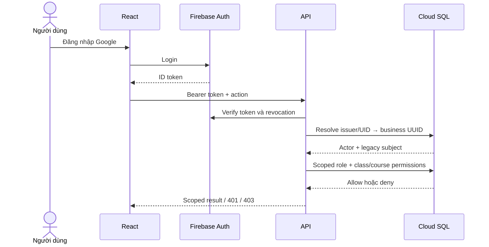
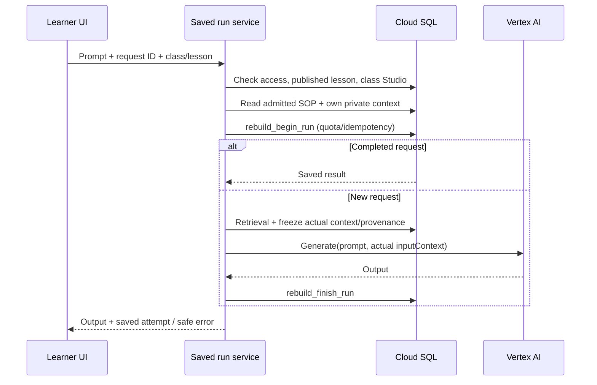
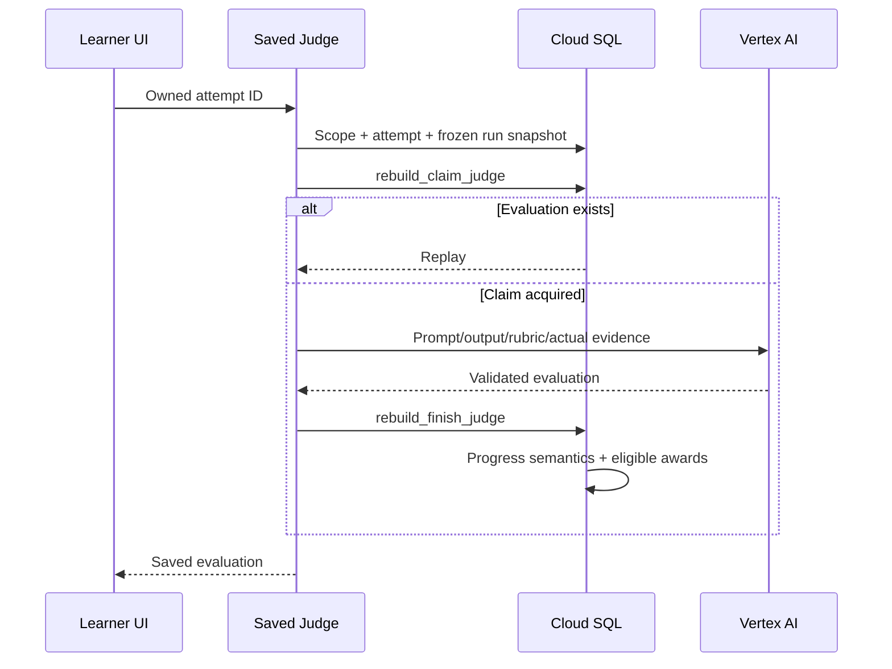
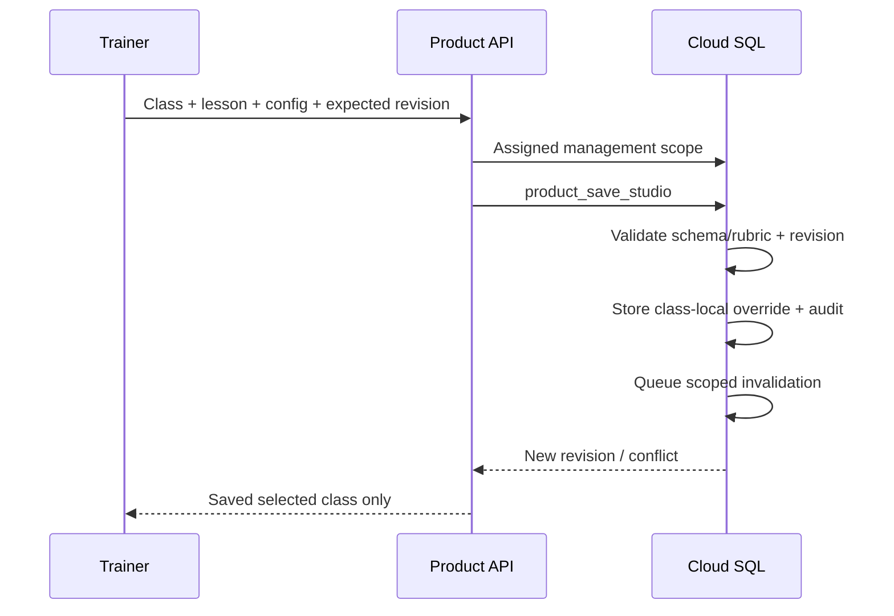
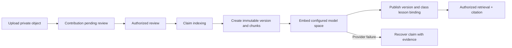
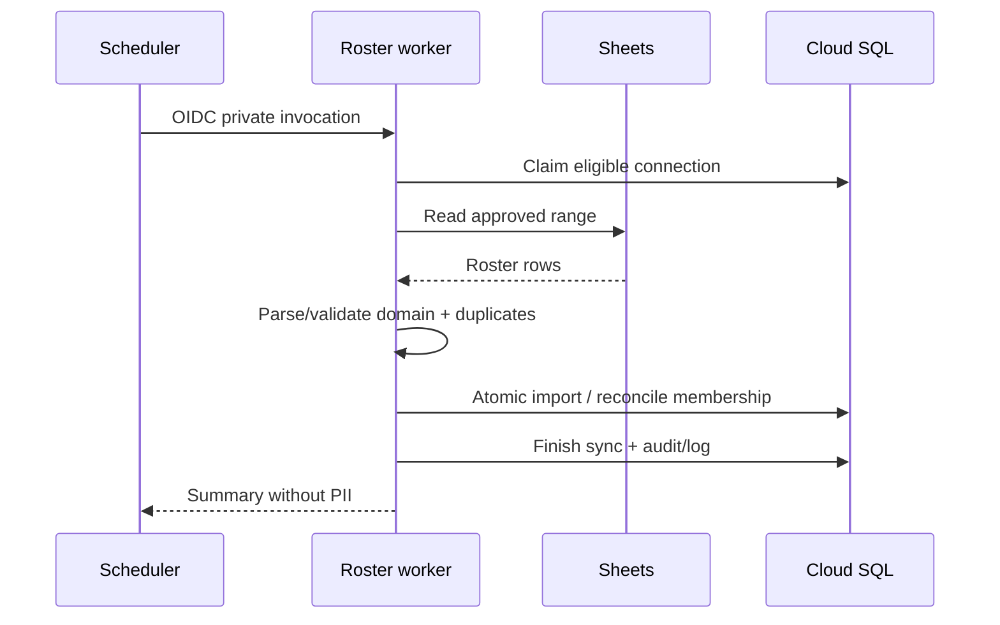
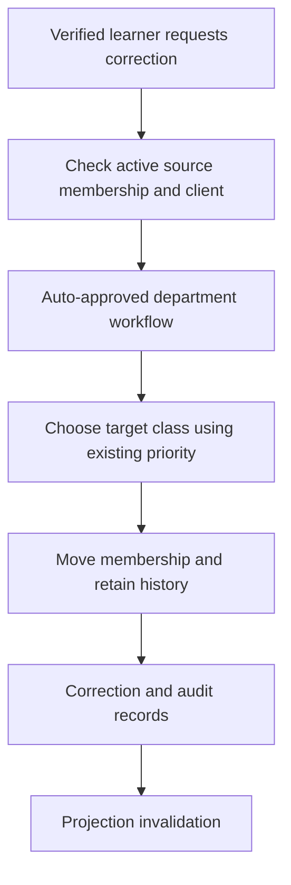
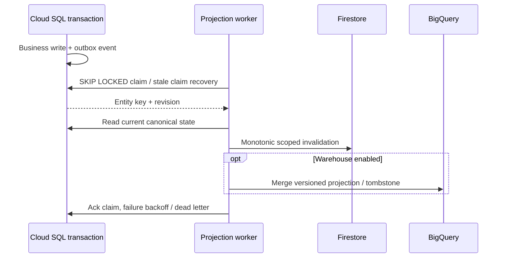
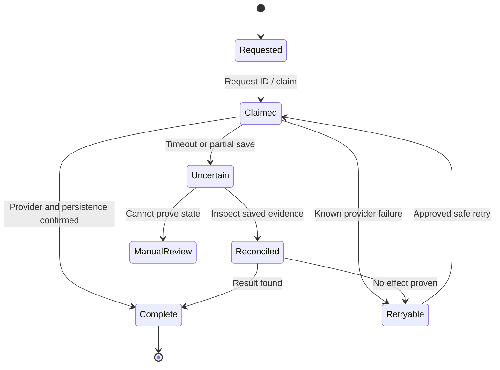

# Mười luồng nghiệp vụ và runtime

Các diagram dưới đây là source-derived. `build_intrepid_docs.py` render bằng Mermaid CLI local; không dùng CDN. Studio class-local và Trainer scope là quyết định user đã phê duyệt, xem migration mới để đối chiếu bản thực thi. Provider/GCP edges cần staging, chưa đồng nghĩa VERIFIED STAGING.

## 1. Login → identity → permissions

[firebaseServerIdentityService](../../../apps/promptify-intrepid/src/services/firebaseServerIdentityService.ts), [apiAuthorizationService](../../../apps/promptify-intrepid/src/services/apiAuthorizationService.ts), [cloudPostgresService](../../../apps/promptify-intrepid/src/services/cloudPostgresService.ts). Firebase UID không tự tạo quyền lớp; email roster mơ hồ phải chặn.

## 2. Learner Generate

[rebuildRunService](../../../apps/promptify-intrepid/src/services/rebuildRunService.ts), [cloudSopRetrievalService](../../../apps/promptify-intrepid/src/services/cloudSopRetrievalService.ts), [productionAiService](../../../apps/promptify-intrepid/src/services/productionAiService.ts). N01 yêu cầu lưu context thực đã gửi provider và Judge dùng cùng evidence; không coi retrieval metadata là proof Generate đã dùng nội dung đó.

## 3. Judge → progress → certificate

[rebuildRunService](../../../apps/promptify-intrepid/src/services/rebuildRunService.ts), [weightedRubricService](../../../apps/promptify-intrepid/src/services/weightedRubricService.ts), [baseline SQL](../../../apps/promptify-intrepid/gcp/sql/001_baseline.sql). Award issuance/refresh còn phụ thuộc attendance và class config, không phải mọi Judge tự cấp certificate.

## 4. Trainer chỉnh Studio

[ProductionStudioSource](../../../apps/promptify-intrepid/src/components/rebuild/ProductionStudioSource.tsx), [006 Studio scope](../../../apps/promptify-intrepid/gcp/sql/006_studio_class_scope.sql). Hai lớp cùng course cần negative test; không ghi toàn bộ lesson canonical vì UI đang chọn một class.

## 5. SOP → publish → embeddings → retrieval

[sopIngestionService](../../../apps/promptify-intrepid/src/services/sopIngestionService.ts), [cloudSqlVectorService](../../../apps/promptify-intrepid/src/services/cloudSqlVectorService.ts), [cloudStorageService](../../../apps/promptify-intrepid/src/services/cloudStorageService.ts). Native/vector/service modes không được trộn dimensions/model provenance; file retention và DB rollback là hai việc riêng.

## 6. Google Sheets roster sync

[rosterWorkerService](../../../apps/promptify-intrepid/src/services/rosterWorkerService.ts), [googleRosterService](../../../apps/promptify-intrepid/src/services/googleRosterService.ts). Removed enrollment không tự re-add: giữ ON CONFLICT semantics và report batch failure; không tạo quyền bằng cách bỏ validation.

## 7. Department correction

[005 correction](../../../apps/promptify-intrepid/gcp/sql/005_department_correction_auto_approval.sql), [productionServerService](../../../apps/promptify-intrepid/src/services/productionServerService.ts). Latest autoapproval supersedes old pending flow. Same course là ordering preference theo source, không tự thay thành restriction mới.

## 8. SQL outbox → Firestore / BigQuery

[cloudProjectionService](../../../apps/promptify-intrepid/src/services/cloudProjectionService.ts), [002 outbox](../../../apps/promptify-intrepid/gcp/sql/002_projection_outbox.sql), [cloudBigQueryService](../../../apps/promptify-intrepid/src/services/cloudBigQueryService.ts). `position` key là column name, không được chứa SQL quote characters. At-least-once delivery cần consumer idempotency, không chỉ worker retry.

## 9. Supabase → Cloud SQL migration

```mermaid
flowchart LR
 A[Approve Intrepid tenant scope] --> B[Read-only source export manifest]
 B --> C[Allowed FK closure + identity mapping]
 C --> D[Checksums / files / model provenance]
 D --> E[Import isolated target]
 E --> F[Constraints + rows + IDs + histories reconcile]
 F --> G[Parity and role negative tests]
 G --> H[User approves cloud cutover]
 H --> I[Observe / rollback if gates fail]
```

[export script](../../../apps/promptify-intrepid/scripts/export_intrepid_data.mjs), [safe migration plan](../../gcp-database-clean-audit/SAFE_CLOUD_SQL_REFACTOR_PLAN.md). Root scope must be explicit; FK closure cannot quietly add another tenant to make import pass. Synthetic dry-run precedes real data handling.

## 10. Failure / retry / rollback

[backend failure tests](../../../apps/promptify-intrepid/tests/verify_backend_failure_recovery.ts), [rebuildRunService](../../../apps/promptify-intrepid/src/services/rebuildRunService.ts), [cloudProjectionService](../../../apps/promptify-intrepid/src/services/cloudProjectionService.ts). Đây là invariant tổng hợp, không khẳng định mọi subsystem có cùng status enum. Sequence rollback không đảo external provider calls; claim uncertainty cần evidence thay vì reset mù.
