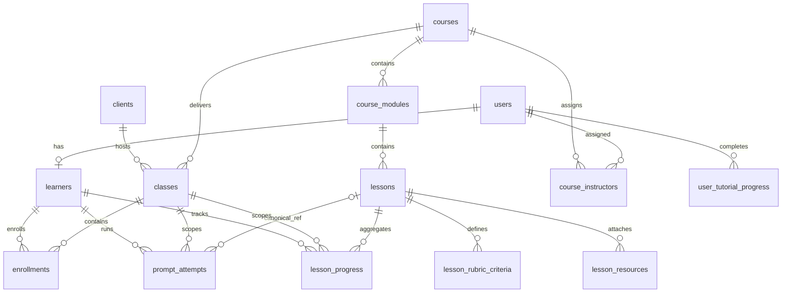

# As-Is Database and SQL Audit

> Audit ngày 2026-10-05 · local `main` · commit `06a45056dac2cd0f1c7396b675495fd34364f4c9`. Local chậm hơn tracking `origin/main` 4 commit tại thời điểm audit; không fetch/checkout. Đây là trạng thái code và SQL trong repo, không phải chứng nhận DB/deployment production. Không sử dụng Refined BRD hoặc tài liệu future/proposal.

## 1. Schema trong repo và schema live

Có **14 bảng public được khai báo** sau baseline + migrations 002–017. Supabase `auth.users` là bảng dịch vụ Auth ngoài DDL repo; không tính thêm vào 14. Không có query catalog DB production trong audit này, nên “schema thật” ở đây nghĩa là schema code/SQL khai báo; những object có trong production ngoài repo chưa biết.

| Table | Purpose | PK | Important FK/relationship |
| --- | --- | --- | --- |
| users | Profile/role nghiệp vụ | id UUID | Email unique; auth_provider_id TEXT nullable, không FK auth.users/unique |
| learners | Định danh learner | id UUID | user_id unique NOT NULL → users CASCADE; learner_code unique |
| clients | Tổ chức/khách hàng | id UUID | Không FK về tenant membership |
| courses | Khóa học tái sử dụng | id UUID | created_by nullable → users SET NULL |
| classes | Triển khai course cho client/department | id UUID | course_id/client_id NOT NULL RESTRICT |
| enrollments | Learner ↔ Class và lifecycle | id UUID | learner_id/class_id NOT NULL CASCADE; unique pair |
| course_modules | Chương trong course | id UUID | course_id NOT NULL CASCADE; unique course/position |
| lessons | Bài học và prompt/context/reference | id UUID | module_id NOT NULL CASCADE; unique module/key & position |
| lesson_rubric_criteria | Rubric mô tả cho lesson | id UUID | lesson_id NOT NULL CASCADE; unique key/position per lesson |
| lesson_resources | Text/data/reference/URL metadata | id UUID | lesson_id NOT NULL CASCADE; unique position; content/url nullable |
| course_instructors | Assignment + permission metadata | course_id,user_id | Cả hai NOT NULL FK CASCADE; permission owner/editor/viewer |
| prompt_attempts | Lịch sử run và evaluation | id UUID | learner/class NOT NULL CASCADE; lesson_ref_id nullable SET NULL, lesson_id TEXT legacy |
| lesson_progress | Aggregate learner/class/lesson | id UUID | 3 FK NOT NULL CASCADE; last_attempt nullable SET NULL; unique triplet |
| user_tutorial_progress | Hoàn thành hướng dẫn theo screen | user_id,tutorial_key | user_id NOT NULL CASCADE; tutorial key regex |

## 2. Relationship và source of truth



`users` chứa profile/role nghiệp vụ; Supabase Auth chứng thực identity. `learners.user_id` unique tạo quan hệ 0 hoặc 1 learner trên user; instructor không cần learner để vào shell. `enrollments` là quan hệ nhiều-nhiều có lifecycle; biết class_code không cấp quyền. `classes.course_id` là một course cụ thể; course tái sử dụng cho nhiều class/client. `lessons.module_id` nối lên course. Attempt được scope learner/class và cần canonical lesson thuộc course; FK độc lập không tự đảm bảo toàn bộ triplet, RPC/trigger kiểm tra thêm.

DB published content là nguồn bài học chính. Generated TS seed có source Markdown và SQL copy; static fallback/adapter làm UI có thêm metadata không hoàn toàn từ DB. `prompt_attempts` là event history; `lesson_progress` là materialized current aggregate; tutorial theo account/screen. History/library toàn trang lại dùng browser storage (không bảng SQL).

## 3. Ordered migrations

Không có 001; baseline là schema.sql. Bảng dưới diễn giải thứ tự, không chỉ dẫn thực thi ở phase audit.

| Step | Delta |
| --- | --- |
| schema.sql | Baseline 6 business tables, code sequence, timestamp/protection triggers, seeds, grants/RLS |
| 002 | Hardening grants/RLS và identity helpers; trùng baseline security |
| 003 | prompt_attempts + indexes + SELECT/INSERT/DELETE policies |
| 004 | Course publishing metadata, 5 content/assignment tables, nullable lesson_ref_id, RLS/index/timestamps |
| 005 | Generated seed 8 LAB specs + modules/rubrics/resources vào courses hiện có |
| 006 | Active enrollment helpers, course/class/content SELECT và attempt INSERT tightening |
| 007 | user_tutorial_progress + own-account RLS |
| 008 | Seed Internal client, tester course/class, 6 tester lessons/rubrics; không enroll user |
| 009 | Điền reference prompts tester; sau đó bị 013 sửa nội dung |
| 010 | UPDATE attempt evaluation policy cho owner active hoặc instructor |
| 011 | Reapply 8 LAB curriculum đã sửa; data migration lớn tương tự 005 |
| 012 | enrollment_mode, self_enroll RPC; public class/course metadata discovery |
| 013 | Sửa 6 tester solution prompts cho đúng input/task |
| 014 | Sửa theory content 6 tester lessons |
| 015 | DELETE 4 seed identities cụ thể chỉ khi chưa auth-linked; cascade effects cần hiểu, không chạy |
| 016 | lesson_progress, evaluation validator (có missing-key NULL gap), sync triggers, deterministic backfill, atomic create/retry RPCs, read RLS |
| 017 | REVOKE INSERT/UPDATE prompt_attempts authenticated; SELECT/DELETE giữ nguyên |

## 4. Attempt/progress semantics

Create RPC resolves user/learner từ auth hiện tại, không tin learner_id gửi từ browser; kiểm active enrollment/class/course, publication course/module/lesson, nonempty prompt/output. Advisory transaction lock theo learner/class/lesson serialize tính max(attempt_number)+1. INSERT attempt làm AFTER trigger sync aggregate; RPC SELECT lại attempt+progress và trả JSON. Lỗi trigger khiến cả transaction rollback.

Trigger map lesson_ref_id, legacy UUID text hoặc lesson_key trong course của class; yêu cầu đúng 1 candidate. INSERT đặt status=completed, attempts_count+1, last_attempt=new id, started/completed timestamp đầu tiên; best_score là max hợp lệ. **Chạy thành công và lưu được là completed, không cần đạt 7/10 hay Judge thành công.** not_started/in_progress có enum nhưng canonical runtime writer hiện đi thẳng completed; absence thường biểu thị chưa bắt đầu.

Retry RPC locks owned canonical attempt; yêu cầu active access, update evaluation_json; AFTER UPDATE trigger chỉ cập nhật best_score theo max và updated_at, không tăng attempts_count. Vì dùng max tăng dần, chấm lại thấp hơn không hạ best_score. DELETE attempt không có sync trigger giảm counts/recompute best. Lesson deletion cascade xóa progress và SET NULL attempt.lesson_ref_id; legacy text vẫn còn.

Backfill 016 chỉ map được lesson duy nhất trong class course, gom count/max(valid score)/latest attempt, không tự đoán ambiguous/unmapped. Có NOTICE unmapped samples. Số fixture 9 attempts/7 progress trong staging README là expected test data, không production counts.

`valid_evaluation_total` kiểm JSON object, total integer 0–10, đủ 5 integer criteria 0–2 và sum khớp. JSON bị validator trả NULL vẫn được lưu ở attempt nhưng không góp best_score; không phải mọi malformed payload đều bị SQL validator bắt (xem SQL-01 dưới đây). Validator không chứng minh evaluation đến từ AI: authenticated owner có thể gọi RPC tự gửi evaluation hợp lệ 10/10. Lưu score là client-supplied, không server-attested.

## 5. Constraints, nullable và duplicated concepts

- Identity bridge `auth_provider_id TEXT` nullable, không unique/FK. Helpers dùng `auth_provider_id = auth.uid OR email = JWT email`, current_user_id LIMIT 1. Đây là weak link khi dữ liệu bị duplicate/misbound.
- Course có `status` active/archived và `publication_status` draft/published/archived; class có lifecycle riêng; enrollment completed khác lesson completed và UI currentStep=3.
- Legacy attempt `lesson_id TEXT` tồn tại song song `lesson_ref_id UUID nullable`; lesson_key chỉ unique trong module, có thể ambiguous giữa modules. Trigger chống map sai thay vì tự đoán.
- Attempt model/latency/output/evaluation client-supplied. Không unique triplet+attempt_number constraint được khai báo; serialization nằm trong RPC.
- last_attempt_id là FK đơn, không composite FK ép cùng learner/class/lesson; runtime trigger làm matching.
- resources `file` là enum metadata, không đủ chứng minh file upload/storage; content/url có thể cùng null. Hints/focus JSON chỉ kiểm array, không element schema.
- classes không CHECK end_date > start_date trong DDL đã kiểm. helpers active không enforce date. enrollment expired là state, không thấy scheduled transition job.
- Base timestamp DEFAULT nullable ở một số bảng, khác content tables NOT NULL. courses.slug nullable unique partial index.

## 6. Security boundaries

RLS enabled cho 14 public tables. Anon bị revoke business access; authenticated grants không đủ để bypass RLS. SECURITY DEFINER helpers/RPC có fixed search_path và limited EXECUTE; body phải tự enforce ownership, access và published state. Instructor/admin là global role: RLS content/classes/users/enrollment/attempt visibility dùng is_instructor, không filter course_instructors/client. Assignment viewer/editor metadata hiện không giới hạn quyền.

017 revoke INSERT/UPDATE attempts mặc dù policies cũ còn tồn tại; grant kiểm trước RLS. Delete vẫn granted nhưng policy chỉ instructor. lesson_progress authenticated SELECT only. Chính sách SELECT attempts vẫn owner/instructor và không yêu cầu active enrollment, khác progress SELECT có active class requirement.

Chi tiết effective RLS và grants ở 07; full SQL object inventory bên dưới giúp review đúng mã, không suy diễn từ docs.

## 7. Exact table declarations và ALTER sau baseline

### users

Nguồn: `supabase/schema.sql:7`

```sql
CREATE TABLE IF NOT EXISTS users (
  id UUID PRIMARY KEY DEFAULT gen_random_uuid(),
  email TEXT UNIQUE NOT NULL,
  full_name TEXT NOT NULL,
  role TEXT NOT NULL DEFAULT 'learner' CHECK (role IN ('learner', 'instructor', 'admin')),
  auth_provider_id TEXT,
  created_at TIMESTAMPTZ DEFAULT now(),
  updated_at TIMESTAMPTZ DEFAULT now()
);
```

### clients

Nguồn: `supabase/schema.sql:19`

```sql
CREATE TABLE IF NOT EXISTS clients (
  id UUID PRIMARY KEY DEFAULT gen_random_uuid(),
  name TEXT NOT NULL,
  industry TEXT NOT NULL,
  created_at TIMESTAMPTZ DEFAULT now()
);
```

### courses

Nguồn: `supabase/schema.sql:28`

```sql
CREATE TABLE IF NOT EXISTS courses (
  id UUID PRIMARY KEY DEFAULT gen_random_uuid(),
  title TEXT NOT NULL,
  description TEXT,
  status TEXT NOT NULL DEFAULT 'active' CHECK (status IN ('active', 'archived')),
  created_by UUID REFERENCES users(id) ON DELETE SET NULL,
  created_at TIMESTAMPTZ DEFAULT now(),
  updated_at TIMESTAMPTZ DEFAULT now()
);
```

### classes

Nguồn: `supabase/schema.sql:40`

```sql
CREATE TABLE IF NOT EXISTS classes (
  id UUID PRIMARY KEY DEFAULT gen_random_uuid(),
  class_code TEXT UNIQUE NOT NULL,
  course_id UUID NOT NULL REFERENCES courses(id) ON DELETE RESTRICT,
  client_id UUID NOT NULL REFERENCES clients(id) ON DELETE RESTRICT,
  department TEXT NOT NULL,
  start_date TIMESTAMPTZ NOT NULL,
  end_date TIMESTAMPTZ NOT NULL,
  status TEXT NOT NULL DEFAULT 'active' CHECK (status IN ('active', 'upcoming', 'completed', 'archived')),
  enrollment_mode TEXT NOT NULL DEFAULT 'instructor' CHECK (enrollment_mode IN ('instructor', 'self_enroll')),
  created_at TIMESTAMPTZ DEFAULT now()
);
```

### learners

Nguồn: `supabase/schema.sql:64`

```sql
CREATE TABLE IF NOT EXISTS learners (
  id UUID PRIMARY KEY DEFAULT gen_random_uuid(),
  learner_code TEXT UNIQUE NOT NULL DEFAULT generate_learner_code(),
  user_id UUID UNIQUE NOT NULL REFERENCES users(id) ON DELETE CASCADE,
  created_at TIMESTAMPTZ DEFAULT now()
);
```

### enrollments

Nguồn: `supabase/schema.sql:73`

```sql
CREATE TABLE IF NOT EXISTS enrollments (
  id UUID PRIMARY KEY DEFAULT gen_random_uuid(),
  learner_id UUID NOT NULL REFERENCES learners(id) ON DELETE CASCADE,
  class_id UUID NOT NULL REFERENCES classes(id) ON DELETE CASCADE,
  status TEXT NOT NULL DEFAULT 'active' CHECK (status IN ('active', 'completed', 'removed', 'expired')),
  joined_at TIMESTAMPTZ DEFAULT now(),
  updated_at TIMESTAMPTZ DEFAULT now(),
  CONSTRAINT unique_learner_class UNIQUE (learner_id, class_id)
);
```

### prompt_attempts

Nguồn: `supabase/migrations/003_create_prompt_attempts.sql:9`

```sql
CREATE TABLE IF NOT EXISTS public.prompt_attempts (
  id UUID PRIMARY KEY DEFAULT gen_random_uuid(),
  learner_id UUID NOT NULL REFERENCES public.learners(id) ON DELETE CASCADE,
  class_id UUID NOT NULL REFERENCES public.classes(id) ON DELETE CASCADE,
  lesson_id TEXT NOT NULL,
  attempt_number INT NOT NULL DEFAULT 1,
  prompt_text TEXT NOT NULL,
  ai_output TEXT NOT NULL,
  evaluation_json JSONB,
  model TEXT NOT NULL DEFAULT 'gemini-2.5-flash',
  latency_ms INT DEFAULT 0,
  created_at TIMESTAMPTZ DEFAULT now()
);
```

### course_modules

Nguồn: `supabase/migrations/004_course_content_management.sql:46`

```sql
CREATE TABLE IF NOT EXISTS public.course_modules (
  id UUID PRIMARY KEY DEFAULT gen_random_uuid(),
  course_id UUID NOT NULL REFERENCES public.courses(id) ON DELETE CASCADE,
  title TEXT NOT NULL,
  description TEXT,
  position INT NOT NULL DEFAULT 1 CHECK (position > 0),
  status TEXT NOT NULL DEFAULT 'draft' CHECK (status IN ('draft', 'published', 'archived')),
  created_at TIMESTAMPTZ NOT NULL DEFAULT now(),
  updated_at TIMESTAMPTZ NOT NULL DEFAULT now(),
  CONSTRAINT unique_module_position_per_course UNIQUE (course_id, position)
);
```

### lessons

Nguồn: `supabase/migrations/004_course_content_management.sql:62`

```sql
CREATE TABLE IF NOT EXISTS public.lessons (
  id UUID PRIMARY KEY DEFAULT gen_random_uuid(),
  module_id UUID NOT NULL REFERENCES public.course_modules(id) ON DELETE CASCADE,
  lesson_key TEXT NOT NULL,
  title TEXT NOT NULL,
  badge TEXT,
  focus_skill TEXT,
  scenario TEXT,
  task_goal TEXT,
  concept_title TEXT,
  concept_content TEXT,
  system_instruction TEXT,
  starter_prompt TEXT,
  baseline_prompt TEXT,
  improved_prompt TEXT,
  sample_input_context TEXT,
  prompt_placeholder TEXT,
  expected_output_format TEXT,
  hints JSONB NOT NULL DEFAULT '[]'::jsonb,
  focus_components JSONB NOT NULL DEFAULT '[]'::jsonb,
  position INT NOT NULL DEFAULT 1 CHECK (position > 0),
  status TEXT NOT NULL DEFAULT 'draft' CHECK (status IN ('draft', 'published', 'archived')),
  created_at TIMESTAMPTZ NOT NULL DEFAULT now(),
  updated_at TIMESTAMPTZ NOT NULL DEFAULT now(),
  CONSTRAINT unique_lesson_key_per_module UNIQUE (module_id, lesson_key),
  CONSTRAINT unique_lesson_position_per_module UNIQUE (module_id, position),
  CONSTRAINT lessons_hints_is_array CHECK (jsonb_typeof(hints) = 'array'),
  CONSTRAINT lessons_focus_components_is_array CHECK (jsonb_typeof(focus_components) = 'array')
);
```

### lesson_rubric_criteria

Nguồn: `supabase/migrations/004_course_content_management.sql:96`

```sql
CREATE TABLE IF NOT EXISTS public.lesson_rubric_criteria (
  id UUID PRIMARY KEY DEFAULT gen_random_uuid(),
  lesson_id UUID NOT NULL REFERENCES public.lessons(id) ON DELETE CASCADE,
  criterion_key TEXT NOT NULL,
  label TEXT NOT NULL,
  description TEXT NOT NULL,
  max_score NUMERIC(5,2) NOT NULL DEFAULT 2 CHECK (max_score > 0),
  position INT NOT NULL DEFAULT 1 CHECK (position > 0),
  created_at TIMESTAMPTZ NOT NULL DEFAULT now(),
  updated_at TIMESTAMPTZ NOT NULL DEFAULT now(),
  CONSTRAINT unique_rubric_key_per_lesson UNIQUE (lesson_id, criterion_key),
  CONSTRAINT unique_rubric_position_per_lesson UNIQUE (lesson_id, position)
);
```

### lesson_resources

Nguồn: `supabase/migrations/004_course_content_management.sql:114`

```sql
CREATE TABLE IF NOT EXISTS public.lesson_resources (
  id UUID PRIMARY KEY DEFAULT gen_random_uuid(),
  lesson_id UUID NOT NULL REFERENCES public.lessons(id) ON DELETE CASCADE,
  resource_type TEXT NOT NULL DEFAULT 'text'
    CHECK (resource_type IN ('text', 'data', 'url', 'file', 'reference')),
  title TEXT NOT NULL,
  content TEXT,
  url TEXT,
  position INT NOT NULL DEFAULT 1 CHECK (position > 0),
  created_at TIMESTAMPTZ NOT NULL DEFAULT now(),
  updated_at TIMESTAMPTZ NOT NULL DEFAULT now(),
  CONSTRAINT unique_resource_position_per_lesson UNIQUE (lesson_id, position)
);
```

### course_instructors

Nguồn: `supabase/migrations/004_course_content_management.sql:132`

```sql
CREATE TABLE IF NOT EXISTS public.course_instructors (
  course_id UUID NOT NULL REFERENCES public.courses(id) ON DELETE CASCADE,
  user_id UUID NOT NULL REFERENCES public.users(id) ON DELETE CASCADE,
  permission TEXT NOT NULL DEFAULT 'editor'
    CHECK (permission IN ('owner', 'editor', 'viewer')),
  assigned_at TIMESTAMPTZ NOT NULL DEFAULT now(),
  PRIMARY KEY (course_id, user_id)
);
```

### user_tutorial_progress

Nguồn: `supabase/migrations/007_user_tutorial_progress.sql:2`

```sql
CREATE TABLE IF NOT EXISTS public.user_tutorial_progress (
  user_id UUID NOT NULL REFERENCES public.users(id) ON DELETE CASCADE,
  tutorial_key TEXT NOT NULL CHECK (tutorial_key ~ '^[a-z0-9_]+$'),
  completed_at TIMESTAMPTZ NOT NULL DEFAULT now(),
  PRIMARY KEY (user_id, tutorial_key)
);
```

### lesson_progress

Nguồn: `supabase/migrations/016_add_server_backed_lesson_progress.sql:10`

```sql
CREATE TABLE IF NOT EXISTS public.lesson_progress (
  id UUID PRIMARY KEY DEFAULT gen_random_uuid(),
  learner_id UUID NOT NULL REFERENCES public.learners(id) ON DELETE CASCADE,
  class_id UUID NOT NULL REFERENCES public.classes(id) ON DELETE CASCADE,
  lesson_id UUID NOT NULL REFERENCES public.lessons(id) ON DELETE CASCADE,
  status TEXT NOT NULL DEFAULT 'not_started'
    CHECK (status IN ('not_started', 'in_progress', 'completed')),
  attempts_count INTEGER NOT NULL DEFAULT 0 CHECK (attempts_count >= 0),
  best_score NUMERIC CHECK (best_score IS NULL OR (best_score >= 0 AND best_score <= 10)),
  last_attempt_id UUID REFERENCES public.prompt_attempts(id) ON DELETE SET NULL,
  started_at TIMESTAMPTZ,
  completed_at TIMESTAMPTZ,
  updated_at TIMESTAMPTZ NOT NULL DEFAULT now(),
  CONSTRAINT lesson_progress_learner_class_lesson_key
    UNIQUE (learner_id, class_id, lesson_id)
);
```

Nguồn: `supabase/migrations/004_course_content_management.sql:8`

```sql
ALTER TABLE public.courses
  ADD COLUMN IF NOT EXISTS slug TEXT,
  ADD COLUMN IF NOT EXISTS publication_status TEXT NOT NULL DEFAULT 'draft',
  ADD COLUMN IF NOT EXISTS version INT NOT NULL DEFAULT 1,
  ADD COLUMN IF NOT EXISTS published_at TIMESTAMPTZ;
```

Nguồn: `supabase/migrations/004_course_content_management.sql:145`

```sql
ALTER TABLE public.prompt_attempts
  ADD COLUMN IF NOT EXISTS lesson_ref_id UUID REFERENCES public.lessons(id) ON DELETE SET NULL;
```

Nguồn: `supabase/migrations/012_public_testing_class_self_enrollment.sql:6`

```sql
ALTER TABLE public.classes
  ADD COLUMN IF NOT EXISTS enrollment_mode TEXT NOT NULL DEFAULT 'instructor'
  CHECK (enrollment_mode IN ('instructor', 'self_enroll'));
```

## 8. Index inventory

`supabase/schema.sql:84`

```sql
CREATE INDEX IF NOT EXISTS idx_classes_course ON classes(course_id);
```

`supabase/schema.sql:85`

```sql
CREATE INDEX IF NOT EXISTS idx_classes_client ON classes(client_id);
```

`supabase/schema.sql:86`

```sql
CREATE INDEX IF NOT EXISTS idx_enrollments_learner ON enrollments(learner_id);
```

`supabase/schema.sql:87`

```sql
CREATE INDEX IF NOT EXISTS idx_enrollments_class ON enrollments(class_id);
```

`supabase/schema.sql:88`

```sql
CREATE INDEX IF NOT EXISTS idx_users_email ON users(email);
```

`supabase/migrations/003_create_prompt_attempts.sql:24`

```sql
CREATE INDEX IF NOT EXISTS idx_prompt_attempts_learner ON public.prompt_attempts(learner_id);
```

`supabase/migrations/003_create_prompt_attempts.sql:25`

```sql
CREATE INDEX IF NOT EXISTS idx_prompt_attempts_class_lesson ON public.prompt_attempts(class_id, lesson_id);
```

`supabase/migrations/003_create_prompt_attempts.sql:26`

```sql
CREATE INDEX IF NOT EXISTS idx_prompt_attempts_created ON public.prompt_attempts(created_at DESC);
```

`supabase/migrations/004_course_content_management.sql:32`

```sql
CREATE UNIQUE INDEX IF NOT EXISTS idx_courses_slug_unique
  ON public.courses(slug) WHERE slug IS NOT NULL;
```

`supabase/migrations/004_course_content_management.sql:58`

```sql
CREATE INDEX IF NOT EXISTS idx_course_modules_course
  ON public.course_modules(course_id, position);
```

`supabase/migrations/004_course_content_management.sql:92`

```sql
CREATE INDEX IF NOT EXISTS idx_lessons_module
  ON public.lessons(module_id, position);
```

`supabase/migrations/004_course_content_management.sql:110`

```sql
CREATE INDEX IF NOT EXISTS idx_lesson_rubrics_lesson
  ON public.lesson_rubric_criteria(lesson_id, position);
```

`supabase/migrations/004_course_content_management.sql:128`

```sql
CREATE INDEX IF NOT EXISTS idx_lesson_resources_lesson
  ON public.lesson_resources(lesson_id, position);
```

`supabase/migrations/004_course_content_management.sql:141`

```sql
CREATE INDEX IF NOT EXISTS idx_course_instructors_user
  ON public.course_instructors(user_id);
```

`supabase/migrations/004_course_content_management.sql:148`

```sql
CREATE INDEX IF NOT EXISTS idx_prompt_attempts_lesson_ref
  ON public.prompt_attempts(lesson_ref_id);
```

`supabase/migrations/016_add_server_backed_lesson_progress.sql:29`

```sql
CREATE INDEX IF NOT EXISTS idx_lesson_progress_learner_class
  ON public.lesson_progress(learner_id, class_id);
```

`supabase/migrations/016_add_server_backed_lesson_progress.sql:31`

```sql
CREATE INDEX IF NOT EXISTS idx_lesson_progress_class_lesson
  ON public.lesson_progress(class_id, lesson_id);
```

Unique/PK constraints cũng tạo indexes PostgreSQL; danh sách trên là các CREATE INDEX explicit. Không đo query plans hoặc workload thực tế.

## 9. Functions và triggers

| Function | Current purpose | Latest definition |
| --- | --- | --- |
| generate_learner_code | LRN sequence code | supabase/schema.sql:57 |
| trigger_set_timestamp | updated_at on update | supabase/schema.sql:91 |
| is_instructor | global role from identity bridge | supabase/migrations/002_add_grants_and_rls.sql:41 |
| current_user_id | resolve public profile from auth | supabase/migrations/002_add_grants_and_rls.sql:53 |
| check_user_privilege_escalation | block learner role/email/id/bound provider changes on UPDATE | supabase/migrations/002_add_grants_and_rls.sql:77 |
| has_active_class_enrollment | active enrollment and class status, no dates | supabase/migrations/006_enforce_course_enrollment_access.sql:9 |
| has_active_course_enrollment | active enrollment/class/course published, no dates | supabase/migrations/006_enforce_course_enrollment_access.sql:25 |
| lesson_belongs_to_class | lesson->module->course match class | supabase/migrations/006_enforce_course_enrollment_access.sql:44 |
| self_enroll_public_class | learner-only, public active in dates + published course; upsert active enrollment | supabase/migrations/012_public_testing_class_self_enrollment.sql:15 |
| valid_evaluation_total | validate numeric 5-criteria score contract | supabase/migrations/016_add_server_backed_lesson_progress.sql:37 |
| sync_lesson_progress_from_prompt_attempt | map canonical lesson and aggregate insert/eval update | supabase/migrations/016_add_server_backed_lesson_progress.sql:91 |
| record_prompt_attempt_and_progress | owned atomic attempt + trigger progress | supabase/migrations/016_add_server_backed_lesson_progress.sql:335 |
| update_prompt_attempt_evaluation_and_progress | owned canonical retry + trigger best score | supabase/migrations/016_add_server_backed_lesson_progress.sql:429 |
`supabase/schema.sql:100`

```sql
CREATE TRIGGER set_timestamp_users
BEFORE UPDATE ON users
FOR EACH ROW EXECUTE PROCEDURE trigger_set_timestamp();
```

`supabase/schema.sql:105`

```sql
CREATE TRIGGER set_timestamp_courses
BEFORE UPDATE ON courses
FOR EACH ROW EXECUTE PROCEDURE trigger_set_timestamp();
```

`supabase/schema.sql:110`

```sql
CREATE TRIGGER set_timestamp_enrollments
BEFORE UPDATE ON enrollments
FOR EACH ROW EXECUTE PROCEDURE trigger_set_timestamp();
```

`supabase/migrations/002_add_grants_and_rls.sql:105`

```sql
CREATE TRIGGER trg_check_user_privilege_escalation
BEFORE UPDATE ON public.users
FOR EACH ROW EXECUTE PROCEDURE public.check_user_privilege_escalation();
```

`supabase/migrations/004_course_content_management.sql:153`

```sql
CREATE TRIGGER set_timestamp_course_modules
BEFORE UPDATE ON public.course_modules
FOR EACH ROW EXECUTE PROCEDURE public.trigger_set_timestamp();
```

`supabase/migrations/004_course_content_management.sql:158`

```sql
CREATE TRIGGER set_timestamp_lessons
BEFORE UPDATE ON public.lessons
FOR EACH ROW EXECUTE PROCEDURE public.trigger_set_timestamp();
```

`supabase/migrations/004_course_content_management.sql:163`

```sql
CREATE TRIGGER set_timestamp_lesson_rubrics
BEFORE UPDATE ON public.lesson_rubric_criteria
FOR EACH ROW EXECUTE PROCEDURE public.trigger_set_timestamp();
```

`supabase/migrations/004_course_content_management.sql:168`

```sql
CREATE TRIGGER set_timestamp_lesson_resources
BEFORE UPDATE ON public.lesson_resources
FOR EACH ROW EXECUTE PROCEDURE public.trigger_set_timestamp();
```

`supabase/migrations/016_add_server_backed_lesson_progress.sql:170`

```sql
CREATE TRIGGER trg_sync_prompt_attempt_progress_insert
AFTER INSERT ON public.prompt_attempts
FOR EACH ROW EXECUTE FUNCTION public.sync_lesson_progress_from_prompt_attempt();
```

`supabase/migrations/016_add_server_backed_lesson_progress.sql:175`

```sql
CREATE TRIGGER trg_sync_prompt_attempt_progress_evaluation
AFTER UPDATE OF evaluation_json ON public.prompt_attempts
FOR EACH ROW
WHEN (NEW.evaluation_json IS DISTINCT FROM OLD.evaluation_json)
EXECUTE FUNCTION public.sync_lesson_progress_from_prompt_attempt();
```

## 10. Migration debt

Baseline is not consolidated final schema; rerunning older baseline/002/004 after newer migrations can restore broad policies, even if DDL is idempotent. 005/011 duplicate long data seed; generator writes historical 005, so regeneration is not evidence applied DB changed. 016/017 coupling requires deployment/application version verification outside audit. Rollback files are manual DB mutations and were read as artifacts only, never executed.

## SQL-01 — HIGH: Missing-key gap trong valid_evaluation_total

Nguồn: `supabase/migrations/016_add_server_backed_lesson_progress.sql:48` và `:62`. Đây là phân tích static theo SQL NULL/PLpgSQL IF, **chưa thực thi trên Postgres**.

Các checks `jsonb_typeof(payload -> 'scores') <> 'object'` và `jsonb_typeof(payload -> 'scores' -> score_key) <> 'number'` không dùng `IS DISTINCT FROM` hoặc presence check. Key không tồn tại cho SQL NULL; phép `NULL <> value` trả NULL. PL/pgSQL IF chỉ vào nhánh khi điều kiện TRUE, không khi NULL. score_value/score_total trở thành NULL; final `declared_total <> score_total` cũng NULL và không RAISE/RETURN NULL. Nếu total hợp lệ được khai báo (ví dụ `{ "total": 10 }`, hoặc scores thiếu một key), function có đường RETURN declared_total=10.

Client/server validator TypeScript từ chối payload này, nhưng authenticated caller có thể bỏ qua frontend và gọi record/retry RPC trực tiếp. SQL function vì vậy không là contract gate tương đương TypeScript; có thể góp best_score từ incomplete evaluation. Đây là rủi ro riêng với score provenance: ngay cả shape gate còn có lỗ missing-key. JSON explicit null bị jsonb_typeof trả string 'null' và khác missing SQL NULL; không trộn hai trường hợp.

Không sửa SQL, không gọi RPC để kiểm trên production. Cần human xác nhận migration deployed và disposable Postgres runtime verification ở pha được phép. Static regex test progress đang assert có câu check, không kiểm semantics NULL.
