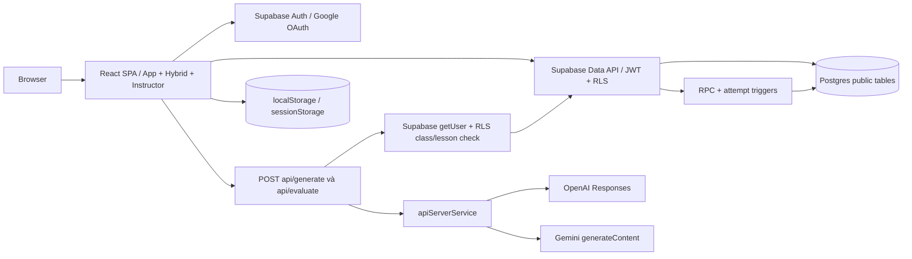
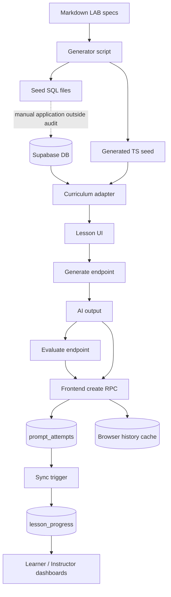

# Current Architecture

> Audit ngày 2026-10-05 · local `main` · commit `06a45056dac2cd0f1c7396b675495fd34364f4c9`. Local chậm hơn tracking `origin/main` 4 commit tại thời điểm audit; không fetch/checkout. Đây là trạng thái code và SQL trong repo, không phải chứng nhận DB/deployment production. Không sử dụng Refined BRD hoặc tài liệu future/proposal.

## 1. Architecture thực thi

Edges thể hiện call/data flow, không phải mọi request phải đi qua tất cả nodes. API dùng Supabase để kiểm quyền và provider để generate/evaluate; API không lưu attempt. Frontend gửi RPC trực tiếp tới Supabase sau khi nhận kết quả AI. Browser storage phục vụ library/history/UI state; không là permission source.

Vercel production có static frontend + serverless API entrypoints theo cấu hình repo. Local Vite inject middleware cho cùng API services. Không có worker/queue/cache service/retrieval DB được nối trong graph current code. Google là OAuth provider và Gemini AI provider là hai luồng độc lập.

## 2. Frontend boundaries

App sở hữu session/role/class/current screen/labs/global telemetry và coach context. HybridView sở hữu editor/system prompt/output/evaluation/versions/runs/assistance. InstructorViewShell tải nhiều DB collections rồi map KPI/activities. dbService là dual repository Supabase/local. curriculumAdapter chuyển DTO DB sang LabStep, vừa map published content vừa thêm sample output từ generated seed.

Không có router/store layer chuyên dụng; có browser events `promptify:tutorial-step` cho demonstration. Notebook/Playground components vẫn tồn tại nhưng không mount bởi App. component existence không là reachable feature.

## 3. Data flow

## 4. Observability hiện có

console warnings/errors, attempts model/latency/created_at và browser token estimate. Không thấy central trace/request correlation/metrics exporter, usage billing ledger hoặc provider result provenance. Không gọi graph trên là deployment inventory production đã xác minh.

Nguồn: `src/App.tsx`, `src/components/hybrid/HybridView.tsx`, `src/components/instructor/InstructorViewShell.tsx`, `src/services/*`, `api/*`, `vite.config.ts`, `vercel.json`, migrations 004/016/017.
