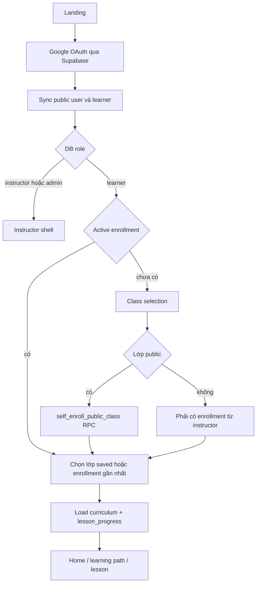
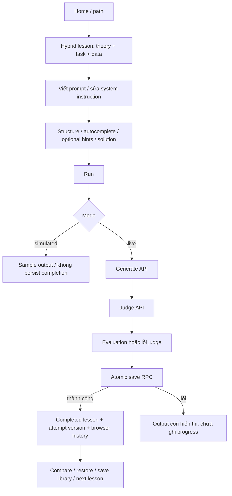
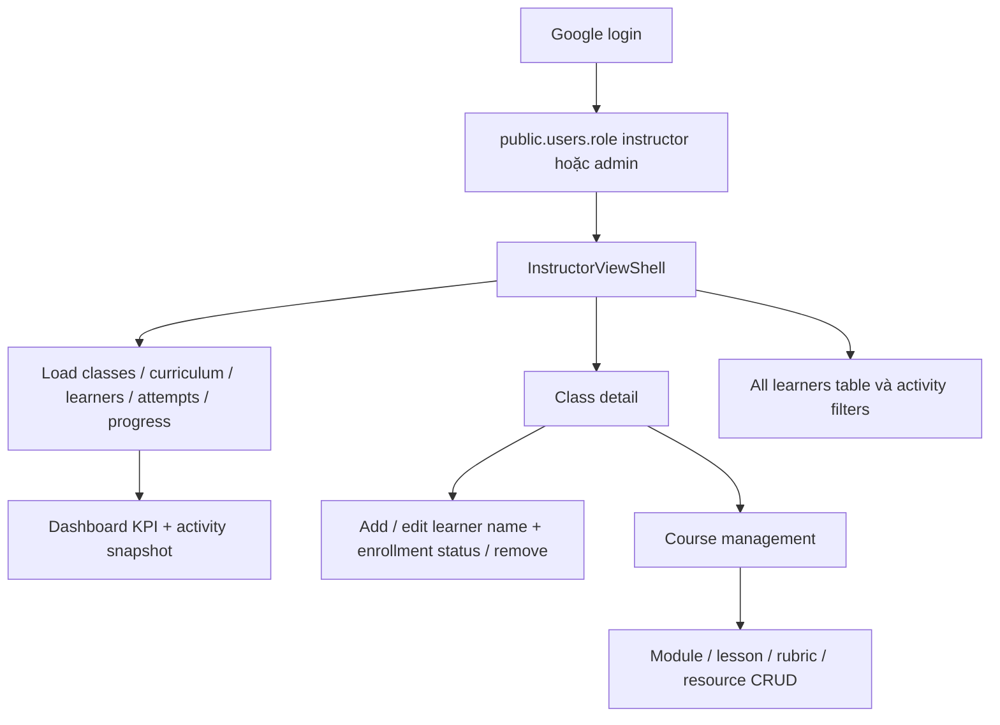

# As-Is User Flows

> Audit ngày 2026-10-05 · local `main` · commit `06a45056dac2cd0f1c7396b675495fd34364f4c9`. Local chậm hơn tracking `origin/main` 4 commit tại thời điểm audit; không fetch/checkout. Đây là trạng thái code và SQL trong repo, không phải chứng nhận DB/deployment production. Không sử dụng Refined BRD hoặc tài liệu future/proposal.

## 1. Learner login và vào lớp

Google OAuth dùng PKCE, Supabase persistent session/auto refresh/detect callback URL. App resolve public profile theo email/provider id, role chỉ từ DB. Không có chọn demo account trong landing hiện tại. Không enrollment thì class_select; cached navigation không tự cấp quyền. URL lesson chỉ resolve sau đúng user/class curriculumReadyKey, giới hạn ID vào labs đã load.

Class/course/client join cung cấp tên course, organization/industry/department. Lớp thường được instructor thêm enrollment theo email; người đó có thể có profile trước OAuth, rồi được sync/bind khi login. Public class RPC tạo learner nếu cần và upsert enrollment active. Một user có nhiều active class, navbar đổi lớp. VITE_REVIEW_CLASS_CODE lọc class UI; RLS vẫn là auth boundary.

## 2. Làm bài và Run

Editor mặc định không prefill hoàn chỉnh; baseline/improved có thể xem tham khảo. Theory/task/sample input thuộc lesson hiện tại. Prompt structure là regex browser; autocomplete chèn snippet khi Tab. Hints/solution có confirm mở và lưu assistance browser; đó không phải exam proctoring hay score penalty được lưu server.

Live generation hiển thị output trước judge; judge lỗi vẫn có thể persist run với evaluation=null. DB completion dựa vào event lưu, trong khi local UI currentStep có threshold >=7 cho một transition. Không nên đồng nhất step badge với lesson_progress hoặc enrollment completed.

Versions hydrate từ server attempts theo learner/class/lesson. Restore chọn prompt/output cũ; edit draft có thể làm feedback stale, PromptComposer chỉ gợi ý diff khi prompt bằng lastEvaluatedPrompt. Attempt không lưu system_instruction/input context snapshots; hydrate systemText dùng current lesson state.

## 3. Compare, history, library, tutorial

- Hybrid A/B chọn hai version, so prompt/output và heuristic business checks. App-level DiffCompareModal khi không truyền versions dùng baseline/improved sample: hình minh họa không là hai live runs.
- History toàn trang nhận App history browser; copy/export Markdown/clear chỉ thay cache. Không hydrate list từ DB, không filter user/class; logout không xóa history/library/assistance.
- Library save title/business use case/technique/prompt/output/score metadata vào localStorage; seed khi cache rỗng. Search/category/star/copy thực sự chạy. “Open in Playground” hiện set App.activePrompt và navigate lesson nhưng không truyền editor prop vào HybridView; không đảm bảo prompt được nạp vào editor.
- Coach đọc activeLab/currentPrompt, tạo câu hỏi/gợi ý qua rules và clipboard. Không gọi conversational API. Lesson context sync có thể ghi đè App.activePrompt ngay sau library action.
- Tutorial theo account/screen qua DB; close handler ghi completed (không chỉ sau finish cuối). Tour có demo actions set output/compare sample, không chạy AI/persist attempt thật.

## 4. Instructor/Admin

Instructor nhìn các class RLS cho global role, không chỉ assignments. Shell gom curriculum theo unique courseIds, learners theo class và all attempts/progress. Started learners=distinct learner có attempts_count>0; progress mỗi learner=published lessons có completed row / số published lessons, avg qua enrollment chưa removed. Completed learners dùng enrollment.status=completed; không tự set status này khi học hết bài.

Activity sort created_at, chỉ mô tả run_prompt; không realtime event bus. Enrollment CRUD tạo/tìm user→learner→enrollment, sửa full_name và status, remove status=removed giữ identity. Course in use được archive; course không reference class có thể delete. Publication riêng lifecycle status. Editor CRUD module/lesson và replace rubric/resources nhiều request.

Không có distinct admin screen, class creation UI, assignment editor hoặc email reminder workflow được mount. LearnerDetailModal code cũ không được LearnerTableView dùng và chứa toast giả “đã gửi email”; không là capability gửi email hiện tại.

Nguồn: `App.tsx` resolveUserSession/handleSelectClass/handleStartLesson; `HybridView.tsx` handleRun/handleRetryEvaluation; `InstructorViewShell.tsx` mapDbClassToInstructorClass/buildActivities/reloadClasses; `dbService.ts`; `LessonBriefPanel.tsx`; `PromptComposer.tsx`.
