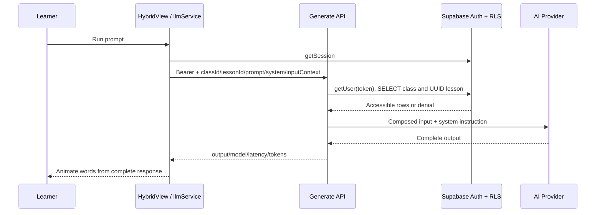

# As-Is AI Flow

> Audit ngày 2026-10-05 · local `main` · commit `06a45056dac2cd0f1c7396b675495fd34364f4c9`. Local chậm hơn tracking `origin/main` 4 commit tại thời điểm audit; không fetch/checkout. Đây là trạng thái code và SQL trong repo, không phải chứng nhận DB/deployment production. Không sử dụng Refined BRD hoặc tài liệu future/proposal.

## 1. Generate technical flow

Frontend POST `/api/generate`: lessonId, classId, learner prompt, editable systemText, currentLab.sampleInputContext. No direct browser key. `getAuthenticatedApiHeaders` rejects absent session. API only POST (405 otherwise), parses req.body string if needed, assertAiLessonAccess then handleGenerateRequest. Guard getUser verifies JWT; checks class visible by token RLS. UUID lesson must be visible and course match class. Missing/non-UUID lesson returns after class SELECT, accepting static fallback path.

Server generation requires nonempty string prompt, composes `CONTEXT / INPUT DATA` and `USER PROMPT` when inputContext nonempty. System instruction is supplied client or default assistant rule. Server **does not fetch canonical lesson content/rubric** to assemble provider request. Context/system instruction can be changed by request caller. No retrieval/search/tool execution in generate path; curricular RAG/ReAct/tool-calling topics do not mean RAG/agent runtime exists.

## 2. Provider/model selection

OpenAI when OPENAI_API_KEY exists, even if Gemini also configured. Responses `/v1/responses`, OPENAI_MODEL default gpt-4.1-mini, max_output_tokens=2048, store=false, timeout30s. OpenAI failure does not switch to Gemini. Judge OpenAI timeout20s/max_output_tokens600/strict json_schema.

Else Gemini key from GEMINI_API_KEY then GOOGLE_API_KEY. Generate candidate order GEMINI_MODEL(default gemini-3-flash-preview), gemini-2.5-flash, gemini-1.5-flash, gemini-2.0-flash, gemini-flash-lite-latest (dedup). Each up to 2 attempts, 12s timeout; retry transient429/503 or network with 750ms delay; then next model. Other HTTP errors break per-model retry but still proceed next candidate. Generate temperature0.3/maxOutputTokens2048. Modal stored temperature does not control this payload.

Gemini judge candidates fixed gemini-2.5-flash, gemini-1.5-flash, gemini-3-flash-preview, gemma-4-26b-a4b-it; does not use GEMINI_MODEL ordering. Thinking config filtered by model supports prefix; JSON schema removed for gemma. Judge temperature0.1/max4096/thinkingBudget0; non-thought text parts concatenated and parsed. Provider/model strings are code configuration, not assurance those models currently available to project.

No key =>503. OpenAI auth/other upstream errors =>502, rate limit=>503. Gemini400=>400, auth=>502, transient/network=>503; empty Gemini output throws generic Error and API =>500. Exhaustive retry can consume long wall time with multiple models; no global time budget/circuit breaker in code.

## 3. Evaluation

Frontend POST `/api/evaluate` includes lessonId/classId/scenario/controlData/taskRequirement/lessonRubric/learnerPrompt/generatedOutput. Same auth guard. Service nonempty learnerPrompt check; weak type checking on other fields. Model judge sees all provided values interpolated into judging prompt, not canonical DB values. Output empty is represented as “Không có output”.

Five criteria taskCompletion, groundedness, formatAdherence, constraintCompliance, businessUsability, each integer0–2. Client/server contract derives total sum0–10; requires scores object, strengths/improvements string arrays, nonempty nextHint. Parser removes optional markdown and slices first `{` to last `}`. Wrong contract=>502, no silent default score. Validator normalizes known fields; application parser does not reject all unknown fields even when OpenAI request schema does.

UI maps total x10 and individual criteria x10 to old RubricAudit field names: groundedness→variableScore, businessUsability→personaScore. Separately `evaluatePromptRubric`/evaluateBusinessMetrics are heuristic local feedback, not judge fallback score for failed live evaluation. DB lesson rubric max_score can differ but judge always 5x2; adapter passes four description fields by positional criteria and drops explicit max_score weighting. This is a current mismatch, not future requirement.

## 4. Persistence and trust

After live generation and optional judge, frontend calls record RPC with output/prompt/model/latency/evaluation JSON. API does not sign evaluation or persist it itself. DB cố validate score shape nhưng có missing-key NULL gap; không validate provenance: owner could submit invented prompt/output/10 score to RPC. This affects integrity of KPI/learning evidence despite ownership/RLS boundaries. No authenticated quota/rate limit or request size validation implemented in AI entrypoints.

Judge failure: output remains, evaluation=null, error displayed, attempt still saved; retry only evaluate existing prompt/output, then update owned attempt RPC. Retry catch for DB error only logs warning while UI already updates score, so displayed and persisted evaluation may diverge.

UI sets isRunning=false when generation done before judge/save; run button only disabled for isRunning/empty prompt. Another Run can start while previous judge/save unfinished; async state may interleave. No abort controller on lesson navigation/provider request from frontend.

## 5. Simulated and illustration

executeSimulatedPromptStream chooses baseline/improved sample via local prompt heuristics and animates text. Hybrid sees mode=simulated and returns before judge/DB/onRecordRun. Default mode is live, simulation explicitly selected. Live response also arrives whole then word animation; neither is actual provider streaming/SSE. Token UI uses output length/3.8 and ignores returned server usage tokens.

Tutorial demo output and App reference compare are illustrative. Coach/autocomplete/PII rules use no AI provider call. LLM credentials never read from VITE_* in provider functions; legacy ApiConfig geminiApiKey field reset to empty.

Nguồn: `src/services/llmService.ts`, `apiServerService.ts`, `apiAuthorizationService.ts`, `aiEvaluationContract.ts`, `HybridView.tsx:532`, `HybridView.tsx:715`, `api/generate.ts`, `api/evaluate.ts`, `curriculumAdapter.ts`.

## SQL-01 — HIGH: Missing-key gap trong valid_evaluation_total

Nguồn: `supabase/migrations/016_add_server_backed_lesson_progress.sql:48` và `:62`. Đây là phân tích static theo SQL NULL/PLpgSQL IF, **chưa thực thi trên Postgres**.

Các checks `jsonb_typeof(payload -> 'scores') <> 'object'` và `jsonb_typeof(payload -> 'scores' -> score_key) <> 'number'` không dùng `IS DISTINCT FROM` hoặc presence check. Key không tồn tại cho SQL NULL; phép `NULL <> value` trả NULL. PL/pgSQL IF chỉ vào nhánh khi điều kiện TRUE, không khi NULL. score_value/score_total trở thành NULL; final `declared_total <> score_total` cũng NULL và không RAISE/RETURN NULL. Nếu total hợp lệ được khai báo (ví dụ `{ "total": 10 }`, hoặc scores thiếu một key), function có đường RETURN declared_total=10.

Client/server validator TypeScript từ chối payload này, nhưng authenticated caller có thể bỏ qua frontend và gọi record/retry RPC trực tiếp. SQL function vì vậy không là contract gate tương đương TypeScript; có thể góp best_score từ incomplete evaluation. Đây là rủi ro riêng với score provenance: ngay cả shape gate còn có lỗ missing-key. JSON explicit null bị jsonb_typeof trả string 'null' và khác missing SQL NULL; không trộn hai trường hợp.

Không sửa SQL, không gọi RPC để kiểm trên production. Cần human xác nhận migration deployed và disposable Postgres runtime verification ở pha được phép. Static regex test progress đang assert có câu check, không kiểm semantics NULL.
