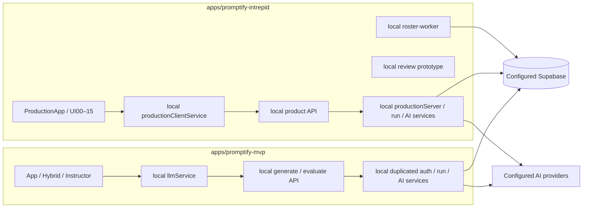

# Promptify: two independent applications

Current architecture, 12/10/2026. Supersedes the shared-package proposal in repository-audit/09.

```text
apps/
  promptify-mvp/
    src/                 App, HybridView, learner/instructor UI and local service copies
    api/                 generate, evaluate
    public/              brand assets
    tests/               offline allowlist, original tests, immutable SQL fixtures
    scripts/             app-local checks and owned maintenance tools
    curriculum-specs/    local curriculum sources for existing MVP tests/generator
    curriculum-levels/
    package.json, package-lock.json, .env.example
    index.html, vite.config.ts, tsconfig.json, tailwind.config.js, vercel.json
  promptify-intrepid/
    src/                 ProductionApp, WorkspaceV7, UI00–15 and local service copies
    api/                 product, roster-worker, generate, evaluate compatibility endpoints
    public/              brand assets and PDF font/license
    tests/               offline allowlist, original tests, immutable SQL fixtures
    scripts/             app-local checks and owned maintenance tools
    curriculum-specs/    public Basic source
    package.json, package-lock.json, .env.example
    index.html, vite.config.ts, tsconfig.json, tailwind.config.js, vercel.json
supabase/                original migration/rollback history, untouched
scripts/                 repository orchestration/audit and explicit relocation notices
docs/                    product sources, architecture, separation evidence
design-drafts/           design sources and verbatim pre-separation archive
```

No shared internal packages, workspaces, source symlinks or cross-app imports. Existing `components/common` directories are private to each app. External npm dependencies may be the same, but each app installs its own lockfile and node_modules. Root package is maintenance/orchestration tooling, not an application or deployment root.



MVP owns the current legacy UI snapshot, including earlier rebuild upgrades. It is not a rollback to a historical commit. Intrepid owns the newer ProductionApp UI; native fallback JSX is retained because the original audit's dead-code claim was false. Three genuinely unused import declarations were removed from the copied ProductionApp by AST; render/business logic is unchanged.

Internal code previously used by both is physically duplicated: Markdown/brand, auth helpers and client, language dictionaries, diff utilities, persisted run/Judge, provider, authorization, PII/settings/rubric/lifecycle and their types. A change in one copy does not change the other. If both need a fix, create two explicitly reviewed changes and run each app's checks; do not reintroduce imports or automatic synchronization.

MVP always selects App. Intrepid selects ProductionApp for normal URLs and `/production`; `/rebuild` is its local review prototype when `VITE_REBUILD_PRODUCTION` is not true. Setting that flag true preserves original production precedence over review. Endpoint contracts, UI query parameters, and `/production` OAuth redirects are preserved. Intrepid's generate/evaluate entries are retained for API compatibility, implemented with its own server copies.

Both apps own their global CSS/token config. The original compiled global CSS utility set is frozen in each app's `tailwind-safelist.json`; build output has the same baseline CSS hash. This avoids visual changes caused by narrowing Tailwind's scan scope. Remove obsolete tokens only in a separate visual cleanup.

## External coupling that remains intentionally

Source isolation does not isolate Supabase URLs, Auth users, classes/lessons, attempts/progress, RLS/RPCs, Storage, Realtime, Google integrations, AI credentials or provider quotas. Using the same env values continues to use the same resources. Migration history remains root-owned; app-local SQL fixtures are test copies, not another migration authority. No schema, roster, production data, credentials, aliases or cloud settings were changed.

## Guardrails and their limits

Each app's `npm run lint` runs AST/config/file-reference checks and Dependency Cruiser. They reject relative source escape, exports/dynamic imports outside the app, unresolved modules, hidden TS/Vite aliases, internal package/file/workspace references, archive imports and source symlinks. Negative tests exercise these rules. Computed module imports are rejected unless a future explicit allowlist/check is added. Arbitrary user-provided filenames or dynamically constructed external URLs cannot be proven safe statically; review the actual code and test those flows when changing them.

Dependency Cruiser shows one inherited type cycle in Intrepid: Workspace wrapper → V7 → wrapper Props. It is a warning, not a cross-app edge. Knip is advisory: do not delete files solely from its output. MVP keeps historical notebook/playground/telemetry components; review/generator inputs remain preserved.

CI installs and verifies each app in a separate matrix job. It does not deploy. Legacy flaky access tests remain visible as failures, not converted to passes. No ESLint style suite existed; `lint` means architecture/dependency lint here.

## Deployment and debugging

Vercel Root Directory must be the selected app; build `npm run build`, output `dist`, Node 24. Each app's api/config/assets are local to that root. Existing domains can stay on their current project when its root is changed; this repository change does not change that live setting. Root `vercel.json` deliberately refuses deployment until an app root is selected. Preview and live authenticated flows/aliases were not deployed or verified in this task.

Local Vite stack traces point into the selected app; dev ports default to 5173/5174. Vite dev source maps and local production sourcemaps are available with `npm run build:debug`. Console/API logs are separated by dev process/app working directory; offline runner prefixes every test with app name. No server from the other app is required.
