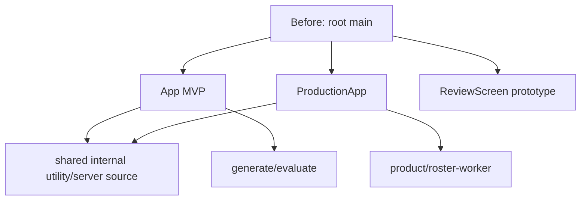

# Repository audit and two-app ownership — 12/10/2026

Audit performed against the dirty working copy, not just HEAD. Canonical remote: ElysiaTheElysier/Promptify---Prompt_Engineering_For_Non-techs. Starting branch rebuild, HEAD d7ac9d1; origin/main bf1d194 was fetched during the preceding verification. Implementation branch: codex/two-app-isolation. Numerous production UI/API/migration/test files were untracked before this task; they were preserved and used as source.

## Stack and original entry

React 19, TypeScript 5, Vite 6.4.3 (locked), Tailwind 3, Supabase Auth/Postgres/Storage/Realtime, Vercel TypeScript functions, Gemini/legacy OpenAI handlers, Google integrations, PDF/Word/XLSX utilities. Existing tests are tsx/Node scripts and SQL contracts; no ESLint/Vitest/Jest or existing GitHub Actions workflow. No new runtime framework was introduced.

Original root main selected ProductionApp for `/production` or VITE_REBUILD_PRODUCTION=true, prototype for `/rebuild` when production was not selected, and App otherwise. It declared three lazy imports; this did not mean three apps loaded simultaneously. Root Vite dev middleware and api functions contained both old and new API entry paths. Global CSS and index metadata were shared through the single build.

## Module inventory and ownership

| Area | MVP | Intrepid |
| --- | --- | --- |
| Entry/UI | App, classes, dashboard, HybridView, lesson/prompt/history/library, InstructorViewShell, existing notebook/playground history | ProductionApp, ProductionEntry1–3, Hub, Workspace wrapper/V7, compare/Judge/SOP, facilitator/head/admin UI00–15, local review prototype |
| API | generate, evaluate | product, roster-worker, generate/evaluate compatibility |
| Data/client services | dbService, llmService, curriculumAdapter, labCompliance, lessonUrlState, CSV roster/SOP/messaging clients | productionClient/productionServer, roster worker/Sheets, private SOP ingestion/storage, Studio validation, governance telemetry, PDF awards |
| Types | index/instructor/database and its own needed production AI types | production/database and its own needed AI contracts |
| Config/assets | private main/index/Vite/TS/Tailwind/Vercel/public/lock/env | private main/index/Vite/TS/Tailwind/Vercel/public/lock/env, PDF font/license |
| Tests | source contracts, mock provider/access/curriculum tests, own SQL fixtures | source/handler/UI contracts, mock provider/roster/SOP/PDF tests, own SQL fixtures |

Detailed old-to-new file lists/hashes are in [file manifest](../../separation/file-manifest.json). Initial closure copy: MVP 102 source/API/resource files, Intrepid 78; 22 original paths used by both and duplicated. Manual main/global CSS/config/test/assets additions are included in finalInventory. Counts include types/resources and do not represent browser downloads.

Internal overlap: Markdown/brand, staging auth/errors, Supabase client, language selection/dictionaries, text diff, authorization, AI contracts/provider, persisted run/Judge, PII, settings, lifecycle, weighted rubric and supporting types. They now have independent copies; there is no shared package. `HybridView` appeared in a naive raw graph through unused Combined imports but is not an Intrepid dependency after removing those unused declarations.

## Graphs

After: see the isolated graph in [architecture](ARCHITECTURE-two-apps-2026-10-12.md). Dependency Cruiser analyzed 181 original modules in the first graph; enabling type dependencies also found the inherited Workspace/V7 Props cycle. After separation: MVP 109 modules/345 edges, Intrepid 93 modules/348 edges, zero boundary errors. One type cycle warning in Intrepid existed before separation. Raw JSON graphs are retained in [evidence](../../separation/README.md).

## Auth, data and environment

Each app builds/serves its own API and source. Browser Supabase config is separate per app env. JWT/enrollment/lesson checks and service-role server persistence remain the same implementation copied locally. No keys/env credential values were moved into app source. `.env.example` contains names/empty values; existing root secret files remain ignored and are not silently loaded by app dev servers.

Both source copies can continue to target the same Supabase project/provider. Users/learners/enrollments/classes/lessons, attempts/progress, run/Judge RPCs, SOP/private content, roster and quotas can therefore remain externally coupled. Root migration/rollback bytes were verified unchanged. SQL fixtures are test-local copies. Environment setup, OAuth redirect domains, service accounts and production resources still require explicit per-project configuration; this task did not provision them.

## Unused and historical source

Knip before/after used explicit main/API/test entries and src/api project patterns. Before: 13 unused file candidates and 9 unused exports. MVP after: 11 historical file candidates, 8 unused exports and 5 unused dependency candidates. Intrepid after: no unused file candidates, 4 unused exports and one unused dependency candidate (@floating-ui/react). No automated deletion was performed. The first unscoped Knip run also included scratch/backups; it is not used for these comparisons.

Historical MVP notebook/playground/telemetry/common components were retained in its app. Intermediate ProductionStudio/WorkspaceSource/Combined adapters remain in the verbatim archive and design sources. Review JSON is also compiler input, not disposable demo-only data. Native fallback components were retained because early returns depend on class/lesson presence; the prior audit's dead-code-100% claim was false.

## Scripts, tests and delivery risks

Forty source/API/DB-related maintenance scripts have explicit app destinations and preserved original copies; root commands provide relocation notices. SQL/Word/design sources were not regenerated. Historical tools can still require optional document/browser runtimes, credentials or source preparation, and were not executed. Review generator effects before use; no migration/apply/rotation/roster/deploy script was run in this separation.

Baseline build passed. A 41-test original offline sweep found one stale menu source assertion. Its app-local test was updated to the already-existing greeting/enrollment-filter behavior, keeping route separation checks intact. The independently reproduced Date.now local ID collision can make access tests fail intermittently; it is not an introduced separation bug and business logic was not changed. Final actual results are in the report.

Build output continues to warn about large chunks. Removing the other application does not necessarily shrink a named chunk: previously shared chunks can be folded into the one-app bundle. No performance claim is made from named chunk size alone. Global CSS has the same baseline hash and four public browser screens matched pixels/text, but authenticated live workflows were not verified.

Cloud readiness is not inferred from local pass results. Vercel app Root Directory/env/alias, live DB/RLS/schema ledger, OAuth, Sheets/Drive/SOP and actual AI calls remain NOT VERIFIED. New CI validates each app separately and does not deploy. Root deployment is explicitly blocked to prevent accidentally deploying the wrong entry.
