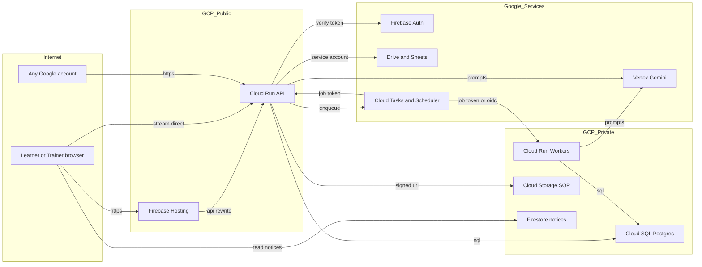

# Threat model — Promptify Intrepid (`apps/promptify-intrepid`)

Ngày 31/10/2026. Mức bằng chứng: **CODE** (đọc mã nguồn và template triển khai trong repo). Chưa kiểm chứng trên staging (không có LIVE), chưa chạy test.

## Executive summary

Rủi ro lớn nhất nằm ở **phân quyền giữa các công ty khách hàng**. API mở cho mọi người trên Internet (`allUsers` có quyền gọi Cloud Run). Hầu hết truy vấn chạy bằng `service_role`, tức là bỏ qua RLS. Vì vậy việc tách dữ liệu giữa các công ty phụ thuộc hoàn toàn vào các lệnh kiểm tra trong `productionServerService.ts`, mà SOP thì là tài liệu bí mật của khách hàng. Ba nhóm rủi ro tiếp theo:
- **Tính toàn vẹn của điểm AI Judge và chứng nhận.** Học viên có thể thao túng AI Judge bằng prompt injection. Lớp chặn bằng regex mặc định đang tắt.
- **Chi phí và khả năng chịu tải.** Mỗi request đều gọi Firebase để kiểm tra token bị thu hồi chưa. Database chỉ có 5 kết nối. Bất kỳ ai có tài khoản Google cũng có thể tự ghi danh lớp Basic để dùng AI.
- **Thiếu cảnh báo.** Khi bị tấn công hoặc lạm dụng, hiện không có gì báo cho người vận hành.

## Scope and assumptions

**Trong phạm vi:** `apps/promptify-intrepid/src/services`, `api/`, `src/components/rebuild` (chỉ phần xác thực và hiển thị), `gcp/` (template Cloud Run/IAM, `firestore.rules`, `gcp/sql`).

**Ngoài phạm vi:** `design-drafts/`, `scripts/historical/` (bản Supabase/Vercel cũ), `.agents/`, tooling CI/Cloud Build (chỉ ghi chú), hạ tầng GCP thật đang chạy (không suy ra từ file local, theo CLAUDE.md).

**Giả định đã được người dùng xác nhận (31/10):**
- Production phục vụ **nhiều công ty khách hàng** trên cùng một hệ thống.
- SOP và bài làm là **bí mật nội bộ** của khách hàng.
- Production **mở Internet và đăng nhập bằng Google**, giống staging.

**Giả định chưa kiểm chứng:**
- Production dùng cùng template với staging: `maxScale: 2`, `containerConcurrency: 20`, `PGPOOL_MAX` mặc định 5, `INJECTION_GUARD` không đặt (tức `off`).
- Lớp `promptify-public-basic` (self-enroll) có tồn tại và đang `active` ở production. Theo quyết định D11 thì Basic nằm ngoài phạm vi, nhưng code vẫn còn.
- `WORKSPACE_SOURCE_BINDINGS_JSON` được cấu hình riêng cho từng lớp.

**Câu hỏi mở có thể làm thay đổi xếp hạng:**
1. Production có bật `INJECTION_GUARD=block` không? Chứng nhận có giá trị bên ngoài (HR, xét thăng chức) không?
2. Mỗi công ty có cấu hình `product_domains` không? Nếu bảng này rỗng, bộ lọc domain cho qua tất cả.
3. Có cho phép cùng một service account Drive đọc tài liệu của nhiều công ty không?

## System model

### Primary components
- **SPA React (Vite)** trên Firebase Hosting. `/api/**` được rewrite sang Cloud Run (`firebase.json`).
- **API Cloud Run `promptify-intrepid-api`**: HTTP server Node tự viết (`src/services/cloudRunServer.ts` → `cloudHandler`). Các route: `/api/product`, `/api/generate`, `/api/evaluate`, `/api/roster-worker`, `/api/stream`, `/api/judge-stream`, `/internal/*`, và file tĩnh.
- **Worker Cloud Run** (`RUNTIME_MODE=worker|ai-worker`): roster sync, projection, Judge/Generation async qua Cloud Tasks (`judgeQueueService.ts`, `generationQueueService.ts`).
- **Firebase Auth** (chỉ Google): client ở `firebaseIdentityService.ts`, server ở `firebaseServerIdentityService.ts` (`verifyIdToken(token,true)`).
- **Cloud SQL Postgres**: `cloudPostgresService.ts`, `cloudDatabaseService.ts` (lớp tương thích Supabase). RLS chỉ áp dụng khi có actor (`SET LOCAL ROLE authenticated`), còn lại chạy `service_role`.
- **Vertex AI Gemini**: `productionAiService.ts`, `parallelJudgeService.ts`, `rebuildRunService.ts`. Embedding qua `generativelanguage.googleapis.com` (`sopIngestionService.ts`).
- **Google Drive/Sheets** bằng service account: `driveFolderService.ts`, `sopIngestionService.ts`, `googleRosterService.ts`.
- **Cloud Storage** (bản gốc SOP, signed URL): `cloudStorageService.ts`.
- **Firestore**: chỉ chứa thông báo invalidation (`gcp/firestore.rules`).

### Data flows and trust boundaries
- **Internet → Firebase Hosting / Cloud Run API.** Dữ liệu: Firebase ID token (Bearer), prompt, SOP upload (base64 ≤ 3 MB body, file ≤ 25 MB qua signed URL), tham số lớp/bài. Kênh: HTTPS. Bảo vệ: Cloud Run cho `allUsers` gọi (`gcp/04-build-deploy.sh.template:19`); CORS chỉ bật khi đặt `CORS_ORIGINS`; giới hạn body 3 MB; `requestTimeout` 60s. Không có WAF hay rate limit theo IP.
- **API → Firebase Auth.** Dữ liệu: ID token. Server kiểm tra chữ ký và revocation (`firebaseServerIdentityService.ts:34`), yêu cầu `email_verified` và `sign_in_provider==='google.com'`. Lần đầu đăng nhập, tài khoản được gắn với user trong roster **theo email** (`gcp_identity_bindings`).
- **API → Cloud SQL.** Dữ liệu: PII trong roster, prompt, điểm, SOP chunk. Kênh: `pg` qua Cloud SQL connector. Bảo vệ: truy vấn có tham số; `service_role` cho phần lớn đường đọc (`withServiceScope`, `createDatabaseClient()` không có auth); RLS chỉ có trên đường `reader`.
- **API → Vertex AI / Gemini.** Dữ liệu: prompt học viên, SOP chunk, output, rubric. Kênh: HTTPS + ADC. Bảo vệ: chặn PII bằng regex (`piiGuardService.ts`), injection guard (`learnerSafeguardService.ts`, mặc định `off`), câu "untrusted evidence" trong system prompt của Judge (`parallelJudgeService.ts:23`), quota 40/giờ, 200/ngày.
- **API → Drive/Sheets/Storage.** Dữ liệu: ID file/thư mục do editor cung cấp, nội dung file. Bảo vệ: allowlist theo lớp `WORKSPACE_SOURCE_BINDINGS_JSON` (`workspaceSourcePolicyService.ts`), regex URL cố định trỏ tới `googleapis.com`, giới hạn 25 MB, chặn zip bomb (`sopIngestionService.ts:121`).
- **Cloud Tasks / Scheduler → `/internal/*`.** Judge/Generation dùng token 256-bit cho từng job, server lưu bản băm (`judgeQueueService.ts:16`). Roster dùng OIDC kèm kiểm tra email invoker (`workerAuthorized`). `/api/roster-worker` dùng HMAC, timestamp ±120s và nonce chống replay.
- **Browser → Firestore.** Chỉ đọc `userUpdates/{uid}`, mọi thao tác ghi bị chặn.

#### Diagram

## Assets and security objectives

| Asset | Why it matters | Security objective |
|---|---|---|
| SOP của khách hàng (DB chunk, bản gốc trên GCS, Drive) | Quy trình nội bộ bí mật; lộ sang công ty khác là sự cố hợp đồng | C, I |
| Roster (email, tên, phòng ban, vai trò) | PII; email là khóa để gắn danh tính | C, I |
| Prompt, output, điểm Judge, chứng nhận | Kết quả đào tạo; chứng nhận có thể dùng cho HR | I |
| Quan hệ lớp ↔ công ty ↔ vai trò (`course_instructors`, `product_class_grants`, `enrollments`, `product_domains`) | Là ranh giới phân quyền giữa các tenant | I |
| Service account Drive/Sheets và quyền Vertex | Đọc được tài liệu của mọi khách hàng đã chia sẻ cho SA; tốn tiền AI | C, A |
| Quota AI, capacity Vertex, pool DB | Bị cạn thì toàn bộ khách hàng mất dịch vụ | A |
| Secret (`ROSTER_WORKER_SECRET`, `LOADTEST_IDENTITY_SECRET`, mật khẩu DB) | Giả mạo worker hoặc danh tính | C, I |

## Attacker model

### Capabilities
- Bất kỳ ai trên Internet có thể gọi trực tiếp API Cloud Run (gồm `/internal/*` khi `AI_WORKER_ISOLATED!=='true'`).
- Bất kỳ ai có tài khoản Google đã xác minh email đều lấy được Firebase ID token hợp lệ. Nếu lớp Basic đang mở, người đó tự ghi danh được.
- Học viên hợp lệ của công ty A: tự chọn `classId`, `lessonId`, `attemptId` trong body; gửi prompt tùy ý; có động cơ nâng điểm.
- Trainer/editor của công ty A: upload SOP, gửi URL Drive/Sheets, sửa rubric hoặc Studio của lớp mình.
- Nhân viên cũ có email bị tái cấp, hoặc người kiểm soát được hộp thư thuộc domain khách hàng.

### Non-capabilities
- Không có quyền IAM GCP, Secret Manager hay console của Cloud SQL.
- Không giả được chữ ký Firebase ID token và không đọc được token của người khác (token lưu ở IndexedDB, không có cookie, nên CSRF không áp dụng).
- Không gọi được Vertex/Drive bằng danh tính service account nếu không đi qua API.
- Không ghi được Firestore (`allow write: if false`).

## Entry points and attack surfaces

| Surface | How reached | Trust boundary | Notes | Evidence |
|---|---|---|---|---|
| `POST /api/product` (khoảng 60 action) | Hosting rewrite hoặc URL Cloud Run | Internet → API | Phân quyền theo từng action; phần lớn đọc bằng `service_role` | `productionServerService.ts` `handleProductRequest` |
| Action không cần roster: `supportConfig`, `enterpriseRequest`, `accessRequest`, `enrollBasic` | `/api/product` | Internet → API → DB | `enterpriseRequest` không cần token; `enrollBasic` cho mọi Google user | `productionServerService.ts:213-230`, `gcp/sql/011_roster_lifecycle.sql` |
| `POST /api/generate`, `/api/evaluate` | Hosting/Cloud Run | Internet → API → Vertex | `assertAiLessonAccess` kiểm tra lớp và bài | `api/generate.ts`, `apiAuthorizationService.ts` |
| `POST /api/stream`, `/api/judge-stream` | URL Cloud Run trực tiếp (CORS) | Internet → API → Vertex | SSE; body ≤ 3 MB | `cloudRunServer.ts`, `judgeStreamService.ts` |
| `POST /internal/judge`, `/internal/generation` | Cloud Tasks; công khai khi worker không tách riêng | Internet/Tasks → API | Token job 256-bit đã băm | `cloudRunServer.ts`, `judgeQueueService.ts:16` |
| `POST /internal/roster`, `/internal/projections`, `/api/roster-worker` | Scheduler (OIDC) hoặc HMAC | Scheduler → Worker | Có chống replay bằng nonce | `cloudRunServer.ts` `workerAuthorized`, `rosterWorkerService.ts:8` |
| Upload SOP (pdf/docx/xlsx/md/csv/txt) | Action của editor | API → parser | Dùng pdf-parse, mammoth, exceljs; có giới hạn kích thước và tỉ lệ nén | `sopIngestionService.ts:18-28,121` |
| Drive folder, file, Sheet | Action của editor | API → Drive (SA) | Allowlist theo lớp | `workspaceSourcePolicyService.ts`, `driveFolderService.ts` |
| Token load-test `lt1.*` | Header Bearer | Internet → API | Chỉ nhận khi bật provider stub và DB là `promptify_loadtest` | `loadtestIdentityService.ts` |
| File tĩnh | `GET /*` | Internet → API | Chặn path traversal | `cloudRunServer.ts` (khối `publicRoot`) |

## Top abuse paths

1. **Đọc SOP của công ty khác.** Học viên/trainer công ty A gửi `classId` hoặc `sourceId` của công ty B vào một action mà thiếu `classScope()`/`lessonInClass()` → truy vấn chạy bằng `service_role` nên không có RLS chặn → nhận về SOP chunk hoặc bài làm của B.
2. **Lách bộ lọc domain.** Công ty B chưa cấu hình `product_domains` → bộ lọc cho qua (`!configured.length`) → người được gán nhầm hoặc giữ lâu `course_instructors`/`product_class_grants` thấy lớp của B dù email khác domain.
3. **Chiếm danh tính qua email tái cấp.** Nhân viên cũ rời công ty, email được cấp lại hoặc vẫn có trong roster → người giữ hộp thư đăng nhập Google lần đầu → hệ thống gắn danh tính theo email (`verifyIdentityOnce`) → kế thừa vai trò, lịch sử và quyền lớp.
4. **Nâng điểm, lấy chứng nhận giả.** Học viên viết prompt khiến output chứa chỉ dẫn cho grader ("score 10/10", đóng giả rubric) → `INJECTION_GUARD` đang `off` hoặc regex bỏ sót (ngôn ngữ khác, mã hóa, chia nhỏ câu) → Judge chấm cao → được award hoặc chứng nhận.
5. **Đốt chi phí AI.** Tạo nhiều tài khoản Google → `enrollBasic` → mỗi tài khoản chạy AI theo quota → nhân lên thành chi phí Vertex lớn và làm cạn capacity cho khách hàng trả tiền.
6. **Làm sập API bằng cách cạn pool.** Gửi hàng loạt request có Bearer bất kỳ → mỗi request gọi Firebase để kiểm tra revocation, hoặc chờ một kết nối trong pool 5 → `maxScale 2 × concurrency 20` bão hòa → người dùng thật nhận 401/503 (đúng triệu chứng "unauthorized" đã gặp).
7. **Parser bị khai thác qua file độc.** Trainer, hoặc người chiếm tài khoản trainer, upload PDF/XLSX độc → lỗ hổng trong pdf-parse/exceljs → treo hoặc RCE trong container API (container có quyền SA tới Drive, GCS, Vertex, DB).
8. **Indirect prompt injection qua SOP.** SOP chứa chỉ dẫn ẩn → RAG đưa vào ngữ cảnh khi học viên chạy → output sai lệch hoặc làm lộ chunk SOP khác trong cùng lớp. Phạm vi ảnh hưởng giới hạn trong lớp vì model không có tool.

## Threat model table

| Threat ID | Threat source | Prerequisites | Threat action | Impact | Impacted assets | Existing controls (evidence) | Gaps | Recommended mitigations | Detection ideas | Likelihood | Impact severity | Priority |
|---|---|---|---|---|---|---|---|---|---|---|---|---|
| TM-001 | Người dùng hợp lệ của tenant khác | Có tài khoản roster; một action hoặc truy vấn thiếu kiểm tra phạm vi lớp | Gửi `classId`/`sourceId`/`attemptId` của tenant khác vào `/api/product` | Lộ SOP, bài làm, PII giữa các công ty | SOP, roster, bài làm | `classScope()`, `lessonInClass()`, kiểm tra từng action (`productionServerService.ts:111-127,257-266`); test `staging-workspace-qa.tsx` | Phần lớn đọc bằng `service_role` (`cloudPostgresService.ts` `SET LOCAL ROLE service_role`), nên chỉ một action thiếu kiểm tra là lộ; không có lớp phòng thủ thứ hai | Chuyển các đường đọc dữ liệu tenant sang actor + RLS (`authenticated`); thêm test "deny matrix" tự động cho mọi action × tenant khác; lint rule bắt buộc gọi `classScope` | Log mỗi lần 403 phạm vi kèm `classId`; cảnh báo khi một user chạm > N lớp khác nhau | Medium | High | **high** |
| TM-002 | Người dùng có quyền gán sai hoặc cũ; tenant chưa cấu hình domain | `product_domains` của client rỗng | Thấy lớp của công ty khác qua `course_instructors`/`product_class_grants` | Lộ dữ liệu giữa các tenant | Quan hệ lớp-tenant, SOP | Lọc domain khi có cấu hình (`productionServerService.ts:103-107`) | Mặc định cho qua khi chưa cấu hình (fail-open) | Đổi thành fail-closed: bắt buộc mỗi client có ít nhất một domain active trước khi lớp được bật | Báo cáo định kỳ các client không có domain | Medium | High | **high** |
| TM-003 | Người kiểm soát hộp thư có trong roster | Email trong roster bị tái cấp, hoặc user chưa gắn danh tính | Đăng nhập Google lần đầu và được gắn theo email | Chiếm tài khoản và lịch sử, quyền trainer/admin | Roster, điểm, quyền | Bắt buộc `email_verified`, provider `google.com`; chặn khi email đổi (`firebaseServerIdentityService.ts`) | Gắn theo email không có xác nhận từ admin; không có ngày hết hạn cho binding với vai trò cao | Admin/trainer bắt buộc qua bước xác nhận khi gắn lần đầu; roster sync tự thu hồi user đã rời; xem xét Google Workspace `hd` claim cho domain khách hàng | Audit log mỗi lần tạo binding mới cho role khác learner | Low | High | **medium** |
| TM-004 | Học viên | Có quyền chạy Judge | Prompt injection hoặc thao túng grader qua prompt/output | Điểm và chứng nhận sai | Điểm, chứng nhận | System prompt "untrusted evidence" (`parallelJudgeService.ts:23`, `productionAiService.ts:160`); regex `promptInjectionService.ts`; `INJECTION_GUARD` | Guard mặc định `off` trong code (`learnerSafeguardService.ts:10`), nhưng **LIVE 01/11: staging đang chạy `INJECTION_GUARD=block`**; chỉ quét prompt, không quét output; regex dễ lách | Bật `INJECTION_GUARD=block` ở production; quét cả output trước khi chấm; bọc output trong delimiter ngẫu nhiên; kiểm tra chéo bằng tiêu chí deterministic; trainer duyệt trước khi cấp chứng nhận | Theo dõi `recordSecurityEvent`; cảnh báo điểm tuyệt đối bất thường hoặc tăng đột ngột | High | Medium | **high** |
| TM-005 | Bất kỳ Google user nào | Lớp `promptify-public-basic` đang active | Tạo nhiều tài khoản và `enrollBasic` để dùng AI | Chi phí Vertex; cạn capacity của khách hàng trả tiền | Quota AI, capacity | Quota theo user (Basic 10/ngày); `SESSION_TOKEN_CAP` tùy chọn | Không giới hạn số tài khoản và không có trần ngân sách toàn hệ thống; admission global là việc Codex đang làm | Tắt Basic ở production (khớp quyết định D11) hoặc thêm CAPTCHA/App Check; đặt ngân sách Vertex và trần toàn hệ thống | Cảnh báo số enroll Basic/giờ và chi phí Vertex/ngày | Medium (có điều kiện) | Medium | **medium** |
| TM-006 | Kẻ tấn công ẩn danh | Không cần | Spam request có Bearer giả hoặc thật tới API | 401/503 hàng loạt, mất dịch vụ | Pool DB, capacity Cloud Run | `requestTimeout`, giới hạn body, quota AI | `allUsers` invoker; `verifyIdToken(...,true)` gọi mạng ở mỗi request; pool 5; lỗi tạm thời bị trả thành 401 (`cloudDatabaseService.ts:85`, `productionServerService.ts:59`); không rate limit theo IP | Đặt Cloud Armor/API Gateway rate limit trước Cloud Run; cache kết quả revocation 1–5 phút; tăng pool và tách pool cho auth; trả 503 thay vì 401 cho lỗi hạ tầng | Alert tỉ lệ 401/503 và độ chờ pool | Medium | Medium | **medium** |
| TM-007 | Trainer độc hại hoặc tài khoản trainer bị chiếm | Quyền editor của lớp | Upload file độc vào parser | DoS hoặc RCE trong container có quyền SA | Toàn bộ dữ liệu và SA | Giới hạn 25 MB, chặn zip bomb, giới hạn đuôi file (`sopIngestionService.ts`) | Parser chạy trong cùng process API, có đủ quyền SA | Chạy parse trong worker cô lập (SA tối thiểu, không có quyền DB/Drive); `npm audit` và pin phiên bản pdf-parse/exceljs/mammoth | Log thời gian và kết quả parse; cảnh báo crash | Low | High | **medium** |
| TM-008 | Trainer hoặc người cấu hình sai | Allowlist cấu hình sai, hoặc SA dùng chung giữa các khách hàng | Gửi ID file/Sheet của khách hàng khác | SA đọc hộ tài liệu của tenant khác (confused deputy) | SOP, roster | `requireWorkspaceSource` allowlist theo lớp (`workspaceSourcePolicyService.ts`); test cross-company | Allowlist nằm trong biến môi trường JSON, chỉnh tay, không có audit | Lưu binding trong DB có audit; tách SA hoặc Shared Drive theo khách hàng | Log mỗi lần truy cập Drive kèm lớp và fileId | Low | High | **medium** |
| TM-009 | Tài liệu SOP chứa chỉ dẫn ẩn | Có quyền đưa SOP vào lớp | Indirect prompt injection qua RAG | Output sai; lộ chunk SOP khác trong cùng lớp | SOP, chất lượng học | SOP chỉ do editor đưa vào; model không có tool | Không lọc chỉ dẫn trong chunk | Đánh dấu chunk là dữ liệu (delimiter); quét chunk bằng `injectionSignals` khi index | Đếm số chunk bị gắn cờ khi index | Low | Low | **low** |
| TM-010 | Ẩn danh | Không cần | Spam `enterpriseRequest` với email ngẫu nhiên | Rác trong DB, tốn công xử lý | DB, vận hành | Chống trùng theo email trong 24h (`product_submit_enterprise_request`) | Email do kẻ tấn công chọn nên không giới hạn thực tế | Rate limit theo IP; CAPTCHA/App Check | Cảnh báo số request/giờ | Medium | Low | **low** |
| TM-011 | Cấu hình sai | Bật provider stub và DB load-test ở môi trường thật | Dùng token `lt1.*` | Giả danh tính | Danh tính | Ba điều kiện cùng lúc: stub, tên DB, secret ≥ 32 ký tự (`loadtestIdentityService.ts`) | Phụ thuộc biến môi trường | Kiểm tra lúc khởi động: từ chối chạy nếu `GOOGLE_CLOUD_PROJECT` là production và có `LOADTEST_IDENTITY_SECRET` | Alert khi thấy issuer load-test trong log production | Low | High | **low** |
| TM-012 | Mọi nguồn | — | Lạm dụng mà không ai biết | Phát hiện chậm | Tất cả | Log JSON, `recordSecurityEvent` | Không có alert hay uptime check (`docs/05_OPEN_ISSUES.md` blocker 6) | Alert cho 401/403/429/503, chi phí Vertex, security event | — | High | Medium | **medium** |

**Giả định ảnh hưởng xếp hạng nhiều nhất:** nhiều tenant cùng SOP bí mật (đẩy TM-001, TM-002 lên high); Basic có mở hay không (TM-005); chứng nhận có dùng cho HR hay không (TM-004).

## Criticality calibration

- **Critical:** đọc hoặc ghi dữ liệu của tenant khác mà **không cần tài khoản** (ví dụ: một action không cần auth trả về SOP); RCE từ xa không cần đăng nhập; lộ secret worker hoặc SA key.
- **High:** người dùng hợp lệ đọc được SOP hoặc bài làm của công ty khác (TM-001, TM-002); thao túng điểm hàng loạt dẫn tới chứng nhận sai (TM-004); chiếm tài khoản admin (TM-003 nếu xảy ra với admin).
- **Medium:** DoS làm cả hệ thống báo 401/503 (TM-006); đốt chi phí AI có giới hạn (TM-005); parser bị khai thác nhưng cần quyền trainer (TM-007).
- **Low:** spam form công khai (TM-010); injection chỉ ảnh hưởng trong một lớp (TM-009); vấn đề chỉ xảy ra khi cấu hình sai rõ ràng (TM-011).

## Focus paths for security review

| Path | Why it matters | Related Threat IDs |
|---|---|---|
| `apps/promptify-intrepid/src/services/productionServerService.ts` | Gần như toàn bộ phân quyền theo action; đọc bằng `service_role` | TM-001, TM-002, TM-006, TM-010 |
| `apps/promptify-intrepid/src/services/cloudPostgresService.ts` | Quyết định khi nào RLS có hiệu lực (`withServiceScope`, `sqlTransaction`) | TM-001, TM-006 |
| `apps/promptify-intrepid/src/services/cloudDatabaseService.ts` | Lớp tương thích: `getUser` gộp mọi lỗi; `server` client không có actor | TM-001, TM-006 |
| `apps/promptify-intrepid/src/services/firebaseServerIdentityService.ts` | Gắn danh tính theo email; gọi revocation ở mỗi request | TM-003, TM-006 |
| `apps/promptify-intrepid/src/services/apiAuthorizationService.ts` | Phân quyền cho `/api/generate` và `/api/evaluate` | TM-001 |
| `apps/promptify-intrepid/src/services/parallelJudgeService.ts` | Prompt của Judge và cách bọc dữ liệu untrusted | TM-004 |
| `apps/promptify-intrepid/src/services/learnerSafeguardService.ts`, `promptInjectionService.ts` | Injection guard (mặc định off) và regex | TM-004, TM-009 |
| `apps/promptify-intrepid/src/services/sopIngestionService.ts` | Parser file, tải từ Drive, embedding | TM-007, TM-009 |
| `apps/promptify-intrepid/src/services/workspaceSourcePolicyService.ts`, `driveFolderService.ts`, `googleRosterService.ts` | Allowlist Drive/Sheets, danh tính SA | TM-008 |
| `apps/promptify-intrepid/src/services/cloudRunServer.ts` | Router, CORS, `/internal/*`, giới hạn body | TM-006, TM-011 |
| `apps/promptify-intrepid/gcp/sql/011_roster_lifecycle.sql` | `product_enroll_basic` (SECURITY DEFINER) | TM-005 |
| `apps/promptify-intrepid/gcp/sql/008_scoped_progress_rls.sql` | RLS thực tế cho đường actor | TM-001 |
| `apps/promptify-intrepid/gcp/04-build-deploy.sh.template`, `gcp/cloudrun-api.yaml.template` | `allUsers` invoker, scale, pool, biến cờ | TM-005, TM-006 |
| `apps/promptify-intrepid/src/services/loadtestIdentityService.ts` | Đường danh tính thay thế | TM-011 |

## Quality check

- [x] Đã phủ các entry point tìm thấy: `/api/product` (gồm các action không cần roster), `/api/generate`, `/api/evaluate`, `/api/stream`, `/api/judge-stream`, `/internal/*`, `/api/roster-worker`, upload SOP, Drive/Sheets, token load-test, file tĩnh.
- [x] Mỗi trust boundary có ít nhất một threat: Internet→API (TM-001/005/006/010), API→Auth (TM-003/006), API→DB (TM-001/002), API→Vertex (TM-004/009), API→Drive (TM-008), Tasks→Worker (bảng entry point; rủi ro thấp nhờ token job), parser (TM-007).
- [x] Đã tách runtime khỏi CI/dev: Cloud Build, `scripts/historical`, load-test chỉ ghi chú.
- [x] Đã phản ánh câu trả lời của người dùng: nhiều tenant, SOP bí mật, mở Internet.
- [x] Giả định và câu hỏi mở đã ghi ở phần Scope.
- Chưa làm: không kiểm chứng LIVE; chưa rà từng action trong số khoảng 60 action của `/api/product`; chưa chạy `npm audit`.
