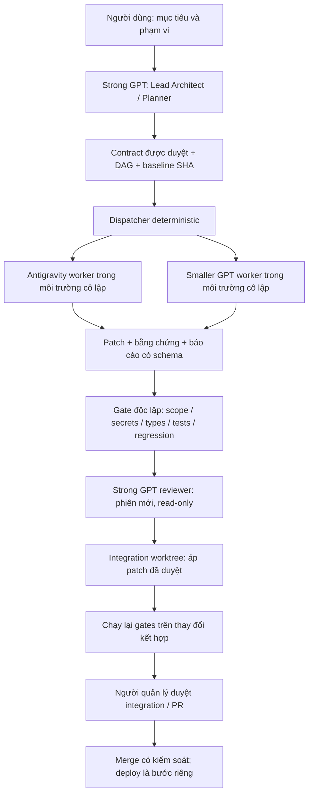

# Đề xuất workflow multi-agent có kiểm soát — Promptify

Ngày audit: 10/10/2026. Trạng thái: **đề xuất, chưa triển khai**. Chưa chạy worker, tạo worktree, cài công cụ, thay runtime, commit, push hay deploy. Tài liệu này không xác nhận ứng dụng đã đạt nghiệm thu production.

## 1. Kết quả audit và baseline phải bảo toàn

Audit checkout hiện tại trên nhánh `rebuild`, HEAD `d7ac9d1fa28a4038cc922daea8ce20e27a13afd6`. Đã đọc AGENTS.md, REPOSITORY_GUIDE, entry point, package scripts, runner offline, một số service/test thuần và handoff. Không so sánh với remote main; chưa fetch trong lượt này. Đây là audit kiến trúc tĩnh, không phải kiểm thử lại toàn bộ ứng dụng.

| Phát hiện | Hệ quả cho thiết kế |
|---|---|
| Checkout có nhiều thay đổi và source untracked, gồm production rebuild, API, test và migrations 027–047 | Worktree từ HEAD hiện tại sẽ thiếu chức năng đang chạy. Phải chốt baseline chứa source đã duyệt trước pilot; không tự stash/reset hoặc commit tất cả. |
| `src/main.tsx` phục vụ App cũ, `/rebuild`, `/production` và lựa chọn production bằng env | Regression phải bảo vệ cả ba entry point, UI kết hợp, EN/VI và các luồng phân quyền hiện có. |
| `npm run build` chạy TypeScript rồi Vite; TS strict nhưng tsconfig hiện chỉ include `src` | Build không chứng minh mọi file `api`, `scripts`, `test` được typecheck. Cần phạm vi kiểm tra riêng đã xác minh cho từng nhóm. |
| Không có script lint/typecheck riêng; chưa thấy `.github/workflows` | Chưa có quality gate thống nhất. Không thể ghi “lint đã pass” khi chưa thiết lập baseline. |
| Test phần lớn là file TS/SQL độc lập; runner offline dùng danh sách loại trừ | Không chạy tất cả test theo glob. Dùng manifest cho phép rõ từng test; tách offline, live, paid, mutating. |
| Có generator và source UI kết hợp; `curriculumSeed.ts` được sinh tự động | Contract phải bao gồm quan hệ source → generated file. Không sửa trực tiếp generated artifact hoặc rewrite migration đã áp dụng. |
| Có một worktree cũ được Git đánh dấu prunable | Không xóa/prune trong pilot; chỉ quản lý worktree có ownership của run mới. |
| `agy.exe` đã cài, version 1.0.0 | Local help có print, timeout, sandbox, conversation; không liệt kê output-format/model/json-schema như docs online. Phải kiểm tra tương thích trước khi chọn adapter. |

Handoff ghi nhận build và một số QA đã pass trong lượt trước, đồng thời còn nghiệm thu 16 UI, external Google learner, Drive/scheduled sync, recovery và thu hồi khóa cũ. Đây là bằng chứng lịch sử; workflow mới không được tự đánh dấu các việc đó hoàn tất. Không đọc hoặc đưa nội dung file secret vào audit.

**Baseline bắt buộc:** người quản lý repo chọn một commit chứa đúng source muốn bảo toàn, sau khi rà soát secret và diff. Nếu chưa muốn commit lên nhánh chính, có thể dùng commit snapshot cục bộ trên nhánh riêng đã duyệt, không push. Ghi SHA, lockfile hash, Node/npm version và manifest fixture. Dependency cache chỉ tái sử dụng theo lockfile hash; không chia sẻ `node_modules` có quyền ghi giữa workers. Không tạo snapshot từ toàn bộ checkout một cách tự động.

## 2. Kiến trúc đề xuất

Control plane sở hữu Git, hợp đồng, lịch chạy, gates, log và state. Worker chỉ tạo thay đổi trong phạm vi được giao. Reviewer không viết code, không nhận quyền cloud và không phải cùng phiên hội thoại với worker. Planner và reviewer có thể cùng họ model mạnh nhưng phải dùng context riêng.

**Git worktree chỉ cô lập file, không phải security sandbox.** Workers không được truy cập checkout chính, thư mục home thật, Git credential, Supabase/Vercel session, service account, `.env*` hoặc network production. Dùng container/WSL hoặc account Windows hạn chế với filesystem và network policy đã kiểm thử. Chọn cơ chế cụ thể ở preflight; `--sandbox` của CLI chỉ là lớp bổ sung, không thay thế việc cô lập host.

Nếu Git worktree nằm trong vùng mà worker có thể truy cập common Git directory, không đạt yêu cầu an toàn: controller giữ metadata Git ngoài vùng worker, chỉ expose working files theo policy và thu patch từ diff đáng tin cậy. Kiểm tra symlink/junction/reparse point trước và sau run. Worker không được chạy Git commands sửa refs, commit, push hay merge.

## 3. Task contract

Contract là dữ liệu versioned, schema-validated, immutable trong một attempt. Mỗi contract phải có:

| Nhóm | Nội dung bắt buộc |
|---|---|
| Identity | task ID, run ID, contract version/hash, baseline SHA, owner, mục tiêu |
| Scope | file được đọc/ghi, file cấm, generated-file dependencies, hành vi cần bảo toàn, non-goals |
| Dependencies | task IDs, artifact hashes, thứ tự DAG, khóa tài nguyên/file |
| Risk | low/medium/high/critical; lý do, yếu tố auth/data/cloud/generator |
| Acceptance | điều kiện quan sát được, negative cases, yêu cầu regression |
| Gates | test IDs trong manifest tin cậy; command IDs, timeout, fixture IDs; không nhận shell text tùy ý từ model |
| Routing | adapter, model alias đã resolve, effort, sandbox profile, quyền tối thiểu |
| Budget | max attempts, wall time, concurrency, token/cost cap nếu provider cung cấp; fallback khi không đo được |
| Delivery | patch hash, files changed, test evidence, unresolved issues, status, conversation ID nếu có |

Ví dụ pilot: `PILOT-T01` chỉ được thêm `test/verify_governance_telemetry_edges.ts`; đọc telemetry service/types và test hiện có. Không sửa service, package, lockfile, config, migration hoặc fixture production. Acceptance kiểm tra ngày Việt Nam ở biên tháng/năm, unknown khác zero và telemetry không bao gồm run chưa hoàn tất. Nếu phát hiện bug runtime, báo blocker để Lead tạo contract khác, không tự mở rộng scope.

Model không được tự hạ risk hoặc đổi acceptance. Thay đổi contract tạo version/hash mới và làm mất hiệu lực review/gates cũ. Contract thất bại do dependency không chạy worker tiếp.

## 4. Dispatcher Antigravity và routing

Dispatcher là process supervisor deterministic, không để LLM viết lệnh rồi thực thi nguyên văn. Resolve executable theo đường dẫn và version được pin; spawn bằng argument array, `shell=false`, cwd rõ ràng và env allowlist. Windows timeout phải kết thúc cả process tree. Không gọi CLI update/install trong run.

Tài liệu chính thức mô tả print mode, structured output và conversation ID; đồng thời approval bị soft-denied có thể vẫn trả exit 0. Vì vậy exit code hoặc thông báo SUCCESS không chứng minh task hoàn tất. [Antigravity headless documentation](https://antigravity.google/docs/cli/headless/)

**Compatibility gate trước pilot:** chạy probe vô hại trong workspace rỗng cô lập để xác minh flags, format, auth, permissions, cancellation và resume của binary 1.0.0. Chưa thực hiện probe này. Không truyền các cờ không được xác minh, không giả định model GPT có trong Antigravity. Nếu cần phiên bản khác, đề xuất upgrade riêng. Nếu chỉ có text mode, controller vẫn có thể validate báo cáo JSON trong text, nhưng phải chứng minh result parsing và interruption; không đủ thì dừng pilot.

Adapter ưu tiên JSON/NDJSON khi được hỗ trợ; đọc stdout/stderr đồng thời, hạn chế dung lượng và redact trước persistence. Resume bằng conversation ID của đúng task, không dùng `--continue` lấy phiên gần nhất. CLI chỉ có credential phục vụ coding riêng, không kế thừa cloud credential của chủ repo. Không dùng `--dangerously-skip-permissions` trên máy chủ repo. Khi permission thiếu, ghi BLOCKED_PERMISSION thay vì tự cấp quyền rộng hơn.

| Công việc | Model / cơ chế | Quyết định |
|---|---|---|
| Architecture, chia task, thay đổi cross-feature | Strong GPT Lead | Tạo contract, không tự merge |
| Coding mức vừa, scope rõ | Antigravity coding worker | Model hợp lệ từ capability registry |
| Test thuần hoặc sửa docs lặp lại, không đổi policy | Smaller GPT worker qua adapter riêng | Cùng sandbox/gates như worker khác |
| Auth/RLS, migrations, secret rotation, data mutation, routing production | Strong GPT + specialist review | Ngoài pilot; chạy tuần tự với approval phù hợp |
| Lint/types/tests/diff/secret scan | Deterministic tools | Không giao quyền quyết định pass cho model |
| Final review | Strong GPT, context mới | Read-only, độc lập với tác giả |

Chọn model ID từ provider đang cấu hình và đã xác minh; không hardcode tên model online vào contract. Escalation sang model mạnh tạo attempt mới trong cùng tổng budget, không thành vòng lặp vô hạn.

## 5. Quality gates và integration

Gate runner và policies phải nằm ngoài phần worker được sửa. Test/output do worker báo chỉ là tham khảo; gate runner thực thi lại trên candidate tree sạch. Manifest test khai báo network, secrets, paid calls và mutation. Offline gates chặn network và không mount env/home production; chỉ xóa env theo denylist là chưa đủ.

Thứ tự bắt buộc:

1. Contract schema/DAG hợp lệ; baseline/lockfile/environment khớp; sandbox preflight pass.
2. Diff scope, file mode, symlink, secret scan, kích thước patch; cấm sửa gates hoặc giảm coverage/skip tests để pass.
3. Lint baseline và typecheck `src`, cùng kiểm tra API/scripts/tests theo cấu hình đã thiết kế riêng. Không dùng build hiện tại làm chứng nhận toàn repo.
4. Build và offline manifest: giữ test cũ liên quan, chạy test mới độc lập. Known failures phải ghi baseline waiver có owner/hạn hết hiệu lực; không cho regression mới.
5. Regression theo phạm vi: routing cũ/rebuild/production, EN/VI, role/class isolation và generated-source consistency. Browser test dùng fixtures/local mocks; live staging là gate riêng được cấp quyền, không production.
6. Independent review: mục tiêu gốc, contract, baseline, diff, logs đã redact, kết quả gates và limitations. Verdict APPROVE / REVISE / REJECT; nêu evidence và severity, không dựa vào lời tác giả “đã pass”.
7. Controller áp patch vào integration worktree. Conflict không tự giải bởi worker ngoài scope; Lead tạo task giải conflict riêng. Chạy gates trên combined candidate và review tương tác giữa hai patch.
8. Người quản lý duyệt integration/PR. Pilot **không automatic merge kể cả đã pass**. Deploy không nằm trong workflow pilot.

Attestation gắn contract hash + base SHA + candidate tree/patch hash + gate suite/version + environment hash + verdict + reviewer identity. Bất kỳ sửa đổi sau review, đổi dependency hoặc rebase đều invalidates attestation và phải chạy lại gates/review. CI/branch protection là lớp enforcement sau pilot, không chỉ là lời hứa của agent.

## 6. Retry, audit và resume

State machine: `PLANNED → READY → RUNNING → CANDIDATE → GATING → REVIEWING → APPROVED → INTEGRATION_PENDING → INTEGRATED`. Nhánh lỗi: `REPAIR_PENDING`, `FAILED`, `BLOCKED`, `CANCELED`. INTEGRATED chỉ do controller ghi sau integration đã duyệt, không từ báo cáo worker.

- Pilot tối đa 2 workers; mỗi task 2 attempts tổng cộng, mỗi attempt 15 phút; gate timeout cấu hình theo loại. Retry launch do lỗi transient tối đa 1 lần và vẫn tính trong budget thời gian/chi phí tổng.
- Auth thiếu, scope violation, secret leak, permission denial và policy violation không auto-retry. Test failure chỉ cho một repair theo contract; không cho phép bỏ test hoặc sửa acceptance.
- Budget initial pilot: 60 phút toàn run, gồm gates/review; model tokens có hard cap khi adapter hỗ trợ. Nếu không có usage/cost đáng tin cậy, ghi unknown và không gọi đó là monetary hard cap; giới hạn attempts/time/output và cấu hình spending limit phía provider trước run.
- State lưu trong SQLite ở vùng controller, transaction/CAS và lease có TTL; events append-only. Lưu IDs, model/version, timestamps, hashes, lifecycle, exit/errors, costs nếu biết, gates/review/human decision. Không lưu raw secret hoặc prompt chứa credential. Log retention mặc định 30 ngày, thay đổi bằng policy.
- Resume kiểm tra state, lease, process cũ, baseline, diff và artifact hashes. RUNNING sau crash chuyển INTERRUPTED trước khi reconcile, không tự chạy lại khi process còn sống. Không reset file để “làm sạch”. Conversation chỉ dùng lại khi adapter hỗ trợ và đúng task/context.
- Gate đang dở không được xem pass; integration đang dở kiểm tra tree hiện tại trước khi áp lại. Cleanup chỉ archive worktree thuộc run đã kết thúc sau khi bảo toàn patch/log; không đụng worktree người dùng.

## 7. Rủi ro và biện pháp

| Rủi ro | Mức | Kiểm soát / bằng chứng cần có |
|---|---|---|
| Mất source rebuild do baseline chỉ có HEAD cũ | Critical | Rà source untracked, snapshot được duyệt, smoke baseline trước pilot |
| Lộ khóa / worker thao tác production | Critical | Không mount secret/home; network deny; test sandbox đọc path cấm thất bại; gate scan |
| Worktree truy cập Git chung hoặc file ngoài scope | High | Controller giữ metadata, filesystem policy, kiểm tra junction/symlink; thử scope violation |
| CLI local khác docs, soft-denied nhưng exit 0 | High | Pin version; capability probe; parse result+stderr và gates thực tế |
| Hai workers sửa cùng file / generator ghi đè | High | DAG, path locks, source/generated ownership; serialized integration |
| Test live bị gắn nhãn offline sai | High | Manifest allowlist được review; network bị chặn; staging credential tách riêng |
| Worker sửa gate để làm pass hoặc reviewer chịu prompt injection | High | Gates ngoài scope, coi code/docs/tool output là dữ liệu; fresh read-only reviewer |
| Review pass nhưng candidate thay đổi sau đó | High | Attestation theo tree hash; branch protection; rerun trên combined candidate |
| Retry làm tăng chi phí / resume chạy trùng | Medium–High | Global budget, attempts cap, lease/CAS, process reconciliation, unknown usage minh bạch |
| Existing technical debt làm toàn suite fail | Medium | Baseline evidence + waiver hẹp; không dùng waiver để bỏ qua regression mới |
| Multi-agent chậm hơn single-agent | Medium | Pilot đo elapsed time, repair rate, review effort và cost; không hứa tiết kiệm trước đo |

Lead chịu trách nhiệm scope/baseline; controller chịu enforcement và evidence; reviewer chịu đánh giá độc lập; chủ repo chịu quyết định integration. Model không tự cấp quyền cho vai trò khác.

## 8. Kế hoạch triển khai sau khi đề xuất được duyệt

| Giai đoạn | Deliverable | Điều kiện qua bước |
|---|---|---|
| 0. Baseline và compatibility | Source snapshot đã duyệt; inventory tests; CLI/sandbox capability report | Baseline chạy được, source/secret phân loại rõ, không mất chức năng |
| 1. Contracts và policy | Schema, routing aliases, DAG/path locks, test manifest | Reject contract sai, dependency cycle, overlap và scope thiếu |
| 2. Dispatcher + durable state | Antigravity/small-GPT adapters, supervisor, SQLite/events, budgets | Timeout/cancel/crash/resume/permission lỗi được kiểm thử |
| 3. Gates + reviewer | Trusted runner, attestation, review schema, integration staging | Không thể bypass bằng exit 0, sửa gate hoặc đổi tree sau review |
| 4. Pilot hai workers | Hai task bên dưới, fault injection và báo cáo đo lường | Mọi acceptance và policy tests pass; không push/merge/deploy |
| 5. Mở rộng có kiểm soát | CI/branch protection, thêm low-risk contracts | Human signoff pilot; chỉ tăng scope khi có evidence |

Phụ thuộc tuần tự 0→1→2→3→4→5. Chỉ các task có scope độc lập mới chạy song song. Ước lượng ban đầu 4–7 ngày kỹ thuật cho controller/pilot, cần điều chỉnh sau capability/sandbox preflight; không tính xử lý production backlog hay nâng cấp dependency lớn.

Vị trí dự kiến: reusable orchestration ở `scripts/multi-agent/`, schema/policy ở thư mục workflow riêng, tài liệu ở `docs/`, state/log/worktree output trong thư mục ignored ngoài vùng workers. Đây là đề xuất vị trí, chưa tạo cấu trúc hoặc code.

## 9. Pilot tối thiểu hai workers

Lead và reviewer dùng GPT mạnh; **hai coding workers** là Antigravity và smaller GPT qua hai adapters. Không giả định Antigravity có hỗ trợ model GPT.

| Contract | Worker | Scope duy nhất | Acceptance có ý nghĩa |
|---|---|---|---|
| PILOT-T01 | Antigravity, complexity medium / risk low | Thêm `test/verify_governance_telemetry_edges.ts` | Biên tháng/năm theo UTC+7; đo zero hợp lệ khác thiếu measurement; không cộng incomplete runs; input không bị mutate |
| PILOT-T02 | Smaller GPT, complexity low / risk low | Thêm `test/verify_weighted_rubric_edges.ts` | Rebalance giữ tổng 100 và không mutate rubric gốc; inactive weight=0; reject malformed/non-finite judge scores; total được tính từ criteria thay vì payload total |

Workers đọc service và tests cần thiết, không sửa runtime/generator hoặc package scripts. Lead chuẩn bị expected outcomes từ yêu cầu hành vi; tránh test chỉ chép công thức implementation. Gate controller chạy test mới trực tiếp bằng toolchain đã pin và test cũ liên quan; test mới bị phát hiện mirror/duplicate không tạo giá trị thì reviewer yêu cầu revise. Giới hạn tests này không thay cho full production QA.

**Pilot thành công khi:** cả hai patch trong scope; tests/gates/review độc lập pass; candidate kết hợp pass; có đủ hash/log/state/budget evidence; baseline/runtime/lockfile không đổi; owner nhận diff để duyệt. Không gọi đó là “100% production”.

**Fault injection bắt buộc cho workflow:** thử thay file ngoài scope, approval soft-denied, gate fail, reviewer REJECT, timeout và crash/resume. Từng trường hợp phải chặn integration, không leak secret và không chạy lại task ngoài budget. Có thể dùng simulated worker adapter cho lỗi để không tốn thêm model calls; vẫn cần một smoke tương thích Antigravity thật.

Đo số attempts, thời gian worker/gates/review, cost hoặc unknown, số lỗi bị chặn và công sức con người so với làm hai task tuần tự. Nếu overhead vượt lợi ích, giữ dispatcher cho task phù hợp thay vì áp multi-agent cho toàn repo.

**Quyết định trước khi triển khai:** baseline nào được duyệt; cơ chế sandbox khả dụng trên máy Windows; binary Antigravity tương thích; model/provider và spending limit; ai duyệt integration. Chưa có quyết định nào được tự suy thành quyền chạy worker hay merge trong lượt thiết kế này.
