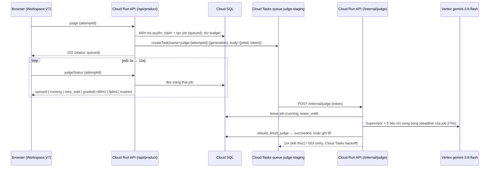

# Kế hoạch: chuyển AI Judge sang bất đồng bộ (queue + polling)

**Ngày:** 22/10/2026. **Trạng thái:** đã duyệt; **Giai đoạn 1 xong ở local 23/10** (xem cuối file). Giai đoạn 2–5 chưa làm. Phạm vi: Intrepid staging trước; production là quyết định riêng.

## 1. Vì sao phải làm

Kiểm chứng live ngày 22/10 trên staging (`jr3`/`jr4`/`jr5-1022`, learner `demo.biz`): 3/3 lần Judge đều trả **504**.
- Metric Vertex cho `gemini-3.8-flash` (endpoint `global`, shared): p95 độ trễ **79s và 341s** cho request nhỏ; mã 499 là do app tự hủy ở mốc 50s. Không có 429 hay 404. Evidence: `apps/promptify-intrepid/outputs/staging-release-2026-10-22-judge-repair/live-judge-findings.md`.
- Request đi qua Firebase Hosting → Cloud Run bị giới hạn **60s**. Judge đồng bộ (deadline 50s) vì vậy không thể hoàn thành khi provider chậm hơn 60s. Không còn tham số nào trong app có thể chỉnh để khắc phục.
- Nếu chạy async, request từ trình duyệt chỉ mất vài trăm ms (nhận job, rồi poll trạng thái). Phần chấm điểm chạy phía server với thời gian chờ tối đa khoảng 270s cho mỗi lần thử, và được retry có kiểm soát.

## 2. Những gì KHÔNG đổi

- Model `gemini-3.8-flash`, Judge `parallel-v1` (Supervisor + 5 tiêu chí, prompt và schema giữ nguyên), hợp đồng `weighted-v1` 0–10, rubric, trọng số, ngưỡng 8/10.
- Quy tắc một attempt chỉ có một điểm: điểm vẫn lưu qua `rebuild_finish_judge` (bắt buộc khớp `claim_id`). Không bao giờ bịa điểm hay lưu điểm từng phần.
- Phân quyền: chỉ chủ attempt mới yêu cầu chấm và xem trạng thái; payload gửi vào queue chỉ chứa ID.
- Budget `ai.judge` 40 lượt/giờ: trừ **một lần cho mỗi hành động của người dùng**, các lần retry nội bộ không bị trừ thêm.
- Generation (Run) vẫn chạy đồng bộ trong đợt này (xem mục 12).

## 3. Kiến trúc đề xuất (phương án A: Cloud Tasks)



- **Worker dùng lại chính service API**, qua route nội bộ `/internal/judge` (giống pattern route roster), để không phải tạo service hay IAM invoker mới. Request do Cloud Tasks gửi thẳng tới URL `run.app`, nên không đi qua giới hạn 60s của Hosting; giới hạn còn lại là timeout 300s của Cloud Run.
- **Xác thực task không dùng OIDC**, để tránh phải cấp quyền `actAs`. Mỗi job có một token ngẫu nhiên 256-bit, DB chỉ lưu SHA-256 của token. Task gửi token trong header, worker so khớp với đúng job đó. Route chỉ bật khi có cờ `JUDGE_MODE=async` và đúng project/service, tương tự cách `stagingRosterRouteEnabled`.
- **Cloud Tasks là nơi duy nhất quyết định retry.** Bên trong một lần thử, mỗi lời gọi provider được dùng hết thời gian còn lại; không có retry lồng nhau giữa browser, worker và provider.

## 4. Dữ liệu: migration `gcp/sql/012_judge_jobs.sql` (chỉ thêm, có file rollback)

```sql
CREATE TABLE public.product_judge_jobs (
  attempt_id uuid PRIMARY KEY REFERENCES public.prompt_attempts(id),
  subject uuid NOT NULL,                     -- giống rebuild_judge_claims.subject
  claim_id uuid NOT NULL UNIQUE,             -- claim trong rebuild_judge_claims
  generation integer NOT NULL DEFAULT 1,     -- tăng mỗi lần người dùng bấm chấm lại
  status text NOT NULL CHECK (status IN ('queued','running','retry_wait','succeeded','failed','expired')),
  token_sha256 text NOT NULL,
  dispatch_count integer NOT NULL DEFAULT 0,
  lease_until timestamptz,
  last_error_code text, last_upstream_status integer,
  created_at timestamptz NOT NULL DEFAULT now(), updated_at timestamptz NOT NULL DEFAULT now(),
  expires_at timestamptz NOT NULL            -- created_at + 15 phút
);
-- RLS bật; REVOKE từ anon/authenticated; chỉ service_role được truy cập (giống rebuild_judge_claims).
```

Kèm 3 RPC `SECURITY DEFINER`, chỉ cấp cho service_role:
- `product_enqueue_judge(subject, attempt, claim, token_sha)`: khóa attempt; nếu đã có điểm thì trả `complete`; nếu job đang `queued`/`running` thì trả job hiện có (gọi lặp không tạo job mới); nếu job đã kết thúc mà chưa có điểm thì tăng `generation` và tạo lại.
- `product_lease_judge(attempt, token_sha, lease_seconds)`: chỉ lease khi token khớp, `status IN ('queued','retry_wait')` (hoặc `running` mà lease đã hết hạn) và chưa quá `expires_at`. Cập nhật `dispatch_count`.
- `product_settle_judge(attempt, generation, outcome, error_code, upstream_status)`: ghi trạng thái kết thúc. Thành công vẫn đi qua `rebuild_finish_judge` trước, theo đúng thứ tự khóa hiện có.

Lưu ý: áp migration cần **credential owner của Cloud SQL** (login runtime không có quyền tạo bảng), giống lần 011.

## 5. Thay đổi API

| Action / route | Hành vi |
| --- | --- |
| `judge` (khi `JUDGE_MODE=async`) | Giữ nguyên các bước kiểm tra như `evaluateSavedRun` hiện tại (quyền sở hữu, snapshot, hash ngữ cảnh), rồi claim, trừ budget, gọi `product_enqueue_judge`, tạo task và trả **202** `{status:'queued'}`. Nếu tạo task lỗi thì đánh dấu job `failed` và nhả claim. Gọi lặp trả lại cùng job. |
| `judgeStatus` (mới) | Chỉ chủ attempt được gọi. Trả `{status, updatedAt, evaluation?}`. Không trừ budget. |
| `snapshot` | Mỗi attempt chưa có điểm kèm thêm `judgeStatus`, để giao diện tự poll tiếp sau khi tải lại trang. |
| `/internal/judge` | Xác thực token → lease → `productionEvaluate` với deadline 270s → `rebuild_finish_judge` → settle. Trả **2xx** khi đã có kết quả cuối (succeeded, hoặc failed không thể retry như 400/404/rubric không hợp lệ). Trả **503** với 429/503/504 để Cloud Tasks retry. Job hết hạn thì ghi `expired`, nhả claim và trả 2xx. |
| `JUDGE_MODE=sync` | Giữ nguyên hành vi hiện tại (dùng để rollback ngay lập tức). |

Code bị ảnh hưởng: `rebuildRunService.ts` (tách bước chuẩn bị với bước chấm), `productionAiService.ts` (cho phép truyền deadline vào `productionEvaluate`; `evaluateParallel` đã có tham số `deadlineMs`), `cloudRunServer.ts` (route mới), `productionServerService.ts` (2 action mới), service mới `judgeQueueService.ts` (dùng client Cloud Tasks, gói `@google-cloud/tasks` hoặc gọi REST bằng ADC), cùng `cloudSchema.json`.

## 6. Cấu hình queue (giá trị khởi đầu cho staging, chỉnh sau khi đo)

| Tham số | Giá trị | Lý do |
| --- | --- | --- |
| `maxConcurrentDispatches` | 3 | Mỗi job gồm 6 lời gọi provider → tối đa 18 lời gọi đồng thời. Shared pool đang chậm, nên không dồn thêm tải |
| `maxDispatchesPerSecond` | 1 | Làm mượt các đợt dồn request |
| `maxAttempts` | 3 | Một lần đầu + 2 lần retry |
| `minBackoff` / `maxBackoff` | 30s / 120s | Tôn trọng tình trạng provider đang quá tải |
| `maxRetryDuration` | 15 phút | Khớp với `expires_at` |
| `dispatchDeadline` | 300s | Bằng timeout của Cloud Run |

## 7. Giao diện (Workspace V7)

- Sau Run: hiển thị "Đã lưu câu trả lời · AI Judge đang xếp hàng…" rồi "đang chấm…". Poll mỗi 3s trong 30s đầu, sau đó 10s/lần, và **dừng ở trạng thái kết thúc** hoặc sau 15 phút. Tab bị ẩn thì tạm dừng poll (giống snapshot polling).
- `retry_wait`: "AI đang quá tải, hệ thống tự thử lại." Không cho bấm chấm lại trong lúc này.
- `failed`/`expired`: hiện lý do kèm nút **Thử chấm lại AI Judge** (tạo job mới và trừ budget).
- Tải lại trang hoặc chuyển tab: tiếp tục poll dựa trên `judgeStatus` trong snapshot.
- Sandbox Judge của Trainer: **giai đoạn 2**, dùng cùng cơ chế.

## 8. Thay đổi trên cloud và IAM (mỗi mục cần duyệt riêng)

1. Bật API `cloudtasks.googleapis.com` cho project `ai-transformation-510302` (hiện **chưa bật**).
2. Tạo queue `promptify-judge-staging` ở `asia-southeast1` theo mục 6.
3. IAM: cấp `roles/cloudtasks.enqueuer` **trên riêng queue này** cho `promptify-api@…`. Không cần `actAs` hay `run.invoker`, vì task gọi tới service public và tự xác thực bằng token của job.
4. Áp migration 012, cần credential owner.
5. Env mới cho revision API: `JUDGE_MODE`, `JUDGE_QUEUE`, `JUDGE_WORKER_URL`. Không đổi env hiện có.
6. Cân nhắc đặt `min-instances=1` để worker phản hồi nhanh. Không bắt buộc, có phát sinh chi phí.

Chi phí Cloud Tasks: khoảng 2–3 thao tác cho mỗi lần Judge, nằm trong mức miễn phí (1 triệu thao tác mỗi tháng). Chi phí Gemini không đổi so với hiện nay.

## 9. Kiểm thử offline (bắt buộc trước khi deploy)

- PGlite + SQL thật cho 012:
  - Gọi enqueue lặp không tạo job mới.
  - Lease đúng token mới được; token sai bị từ chối.
  - Lease hết hạn thì cho lease lại; task bị giao trùng không chấm hai lần.
  - Job hết hạn chuyển `expired` và nhả claim.
  - Settle thành công lưu đúng một điểm; claim cũ không thể lưu điểm.
  - Learner khác hoặc lớp khác bị từ chối khi gọi `judge`/`judgeStatus`.
- Handler worker với provider mock:
  - 429/503/504 → trả 503, job sang `retry_wait`.
  - 404/400/rubric không hợp lệ → `failed`, trả 2xx.
  - Provider trả về sau 120s → vẫn chấm được trong deadline 270s.
- Contract giao diện: chuỗi trạng thái poll, dừng ở trạng thái kết thúc, tiếp tục poll sau khi tải lại trang, nút chấm lại chỉ hiện ở `failed`/`expired`.
- Toàn bộ allowlist offline (hiện 61/61), typecheck, lint, boundaries, build, smoke.

## 10. Triển khai và tiêu chí nghiệm thu

| Giai đoạn | Nội dung | Tiêu chí đạt |
| --- | --- | --- |
| 0 (tùy chọn, rẻ) | Thử endpoint theo vùng thay cho `global` (chỉ đổi `VERTEX_LOCATION`, revision no-traffic, 1 lần chấm) | Biết được pool `global` có phải nguyên nhân hay không |
| 1 | Code + test offline, `JUDGE_MODE=sync` mặc định | Offline PASS, code review |
| 2 | Cloud: bật API, tạo queue, IAM enqueuer, migration 012 (owner) | Governance before/after chỉ khác đúng các mục đã duyệt |
| 3 | Revision no-traffic với `JUDGE_MODE=async`, kiểm tra HTTP, promote; Hosting mới | Env/SA/SQL giống bản trước, chỉ thêm biến mới |
| 4 | Kiểm chứng live: tối đa 2 lần chấm có đăng nhập thật | Có điểm 0–10 đủ 5 tiêu chí, lưu đúng một lần, UI hiện đúng trạng thái; hoặc nếu provider vẫn quá chậm thì lần thử hết hạn sạch sẽ, không 409, không bịa điểm |
| 5 | Sandbox Judge + quan sát (job age, tỉ lệ retry, p95) | Có số liệu thật để chốt SLO |

Rollback: đặt `JUDGE_MODE=sync` (revision mới), hoặc chuyển traffic về `jr5-1022`/`life-1021`. Bảng job và queue được giữ lại, không xóa.

## 11. Rủi ro và câu hỏi cần chốt

- **Provider vẫn có thể chậm hơn 270s.** Async giúp tránh lỗi 60s, nhưng nếu p95 vẫn khoảng 340s thì một phần job sẽ phải retry hoặc hết hạn. Vì vậy nên chạy Giai đoạn 0 song song. Nếu shared pool tiếp tục chậm, cần cân nhắc capacity riêng (Provisioned Throughput) hoặc đổi model/endpoint; mỗi phương án là một quyết định riêng.
- **SLO:** thời gian chờ chấm bao lâu là chấp nhận được (ví dụ p95 dưới 3 phút)? Có hiện nút hủy chấm không?
- **Chi phí:** nếu một lần thử bị timeout sau khi provider đã xử lý xong, lần retry sẽ bị tính tiền thêm. Số lần thử tối đa là 3 cho mỗi hành động.
- **Generation (Run) vẫn đồng bộ:** nếu provider chậm hơn 50s thì Run cũng sẽ lỗi. Có thể áp dụng cùng cơ chế sau khi Judge async ổn định.

## 12. Ước lượng công việc

Khoảng 3–4 ngày phát triển cho code và test (Giai đoạn 1), cộng 0,5–1 ngày cho staging (Giai đoạn 2–4), chưa tính thời gian chờ duyệt IAM/migration.

## Phương án đã cân nhắc nhưng không chọn

- **B: bảng job + Cloud Scheduler gọi worker mỗi phút.** Không cần bật Cloud Tasks, nhưng job có thể chờ thêm tới 60s mới được nhận. Ngoài ra, việc Scheduler gửi OIDC tới worker chưa từng được kiểm chứng (route roster tới nay chưa quan sát được lần gửi OIDC nào). Chỉ nên dùng nếu Cloud Tasks không được duyệt.
- **C: chạy nền trong cùng instance sau khi đã trả response.** Cần bật CPU always-on (tốn chi phí), job không bền vững khi instance bị tắt, và không có cơ chế retry. Không đề xuất.

## Trạng thái Giai đoạn 1 (23/10/2026: chỉ ở local, chưa deploy, chưa đổi cloud/IAM)

- **Đã làm:**
  - SQL `gcp/sql/012_judge_jobs.sql` + `rollback/012_judge_jobs.sql`: bảng `product_judge_jobs` có RLS và policy `service_only`; 3 RPC `product_enqueue_judge`, `product_lease_judge`, `product_settle_judge`. Đã chạy thử áp, rollback rồi áp lại trên PGlite.
  - `judgeQueueService.ts`: cờ `JUDGE_MODE`, token riêng cho từng job, tạo Cloud Tasks qua REST + ADC (không thêm dependency).
  - `rebuildRunService.ts`: thêm `enqueueJudge`, `judgeStatus`, `runJudgeJob`.
  - `productionAiService.ts`: `productionEvaluate` nhận deadline (sync 50s, worker 270s).
  - Route `/internal/judge` trong `cloudRunServer.ts`.
  - Action `judge`/`judgeStatus` và trạng thái job trong snapshot, ở `productionServerService.ts`.
  - UI: `requestJudge`/`waitForJudge`, trạng thái xếp hàng/đang chấm/tự thử lại, tự tiếp tục chờ khi tải lại trang.
- **Mặc định vẫn là sync:** khi không có `JUDGE_MODE=async` cùng queue và URL hợp lệ, toàn bộ hành vi giữ nguyên như hiện tại. Snapshot không đọc bảng 012, nên chế độ sync vẫn chạy được khi chưa áp migration.
- **Khác so với kế hoạch:**
  - Action `judge` ở chế độ async trả HTTP 200 với `{async:true,status}`, không phải 202 (tương thích với adapter API hiện có).
  - Worker chấm với `language:'vi'`: job không lưu ngôn ngữ. Feedback vẫn có đủ cả EN và VI; chỉ lý do chính của từng tiêu chí là tiếng Việt.
  - Phải thêm policy RLS `service_only` cho bảng mới. Test PGlite đã phát hiện thiếu sót này; nếu không có, worker sẽ không đọc được job nào.
- **Test:**
  - `verify_judge_async_jobs.ts`: SQL thật; gọi enqueue lặp không tạo job mới, dispatch phải đúng token, chỉ lưu một điểm, retry tối đa 3 lần, hết hạn và thất bại đều kết thúc sạch, lease bận, tôn trọng claim của chế độ sync, chỉ chủ attempt được xem, kiểm tra request gửi Cloud Tasks.
  - `verify_judge_async_contracts.mjs`.
  - Cập nhật `verify_workspace_recovery.ts`.
  - Offline **63/63 PASS**; lint, typecheck, boundaries, build, smoke đều PASS.
- **Cần cho Giai đoạn 2** (mỗi mục duyệt riêng): bật Cloud Tasks API, tạo queue, cấp IAM enqueuer trên queue, áp migration 012 bằng credential owner. Giai đoạn 3 cần thêm 3 biến env (`JUDGE_MODE`, `JUDGE_QUEUE`, `JUDGE_WORKER_URL`).

## Trạng thái Giai đoạn 2 (23/10/2026, staging)
- **Đã xong:**
  - Bật Cloud Tasks API.
  - Tạo queue `promptify-judge-staging` đúng cấu hình ở mục 6.
  - Áp migration 012 bằng phiên owner (preflight, apply và verify đều PASS; số liệu claim và attempt đã chấm không đổi).
- **Bị chặn:** cấp IAM enqueuer trên queue. Tài khoản `demo.biz@intrepid.asia` thiếu quyền `cloudtasks.queues.getIamPolicy`; mình không tự nâng quyền.
- **Governance:** 18/20 mục không đổi. Mục `enabled-apis` thêm Cloud Tasks. Mục `project-iam` có thêm service agent `roles/cloudtasks.serviceAgent` do Google tự tạo khi bật API.
- Evidence: `apps/promptify-intrepid/outputs/staging-release-2026-10-23-judge-async-p2/PHASE2_RESULT.md`.
- **Cập nhật:** người dùng đã duyệt cấp `roles/cloudtasks.enqueuer` ở **mức project** cho `promptify-api`; chỉ thêm đúng 1 binding, không gỡ binding nào. Giai đoạn 2 hoàn tất.

## Trạng thái Giai đoạn 3–4 (23/10/2026, staging)
- Overlay 10 file phía server, dựng từ image đang chạy. Danh sách file được chốt bằng cách so hash toàn bộ `src/` và `api/`.
- Revision `ja1-1023` gồm env của `jr5` cộng thêm `JUDGE_MODE`, `JUDGE_QUEUE`, `JUDGE_WORKER_URL`.
- Hosting `0d48ba25…` được release trước khi promote API.
- **Kiểm chứng live PASS:** 2 lần chấm có đăng nhập thật đều `succeeded` qua Cloud Tasks (131s và 43s). Điểm đã được lưu; không có lỗi 429/504; queue trống sau khi chấm.
- Governance: 19/20 mục không đổi; mục thay đổi duy nhất là 3 biến env.
- Rollback: chuyển API về `jr5-1022`, Hosting về `ecb5819…`.
