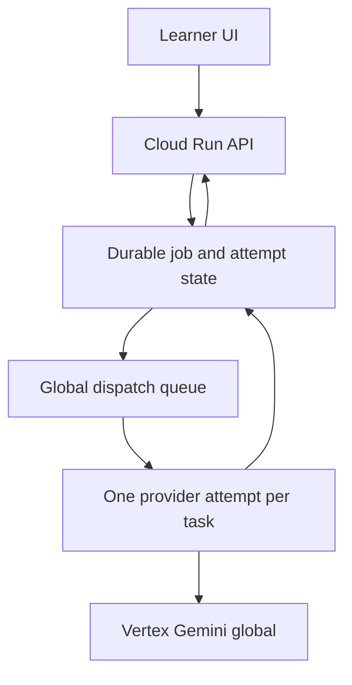

# Promptify Intrepid staging — Gemini capacity and latency proposal

**Date:** 2026-10-22. **Status:** design for review, no code or cloud changes. **Scope:** staging only; preserve the five-criterion weighted-v1 scoring contract, thresholds, frozen evidence, current `gemini-3.8-flash` model, and production state. No paid load test, IAM, billing, model, or deployment change is part of this proposal.

## 1. Baseline and decision gates

The [root-cause report](../evidence/STAGING_GEMINI_429_404_ROOT_CAUSE_2026-10-22.md) is the evidence baseline. A normal aligned learner Run makes one Generation call, one Judge Supervisor call and five concurrent criterion calls: seven provider attempts, up to thirteen after bounded timeout recovery. The isolated 100-pipeline job observed six actual provider 429s in 157 calls and halted 88 pipelines in its **harness-only** circuit breaker. This is not a signed 100-learner service benchmark. The most recent learner screenshots showed a saved output with an uncertain Judge result and then a busy claim; the exact upstream status of that learner request has **not** been proven. AI Studio API-key Usage is not interchangeable with the active Vertex AI `/v1` global ADC path.

Before selecting limits or changing the Judge, require these read-only gates:

1. **Single signed learner trace.** Correlate one existing or naturally occurring staging learner `Run` with API request ID, saved attempt ID, claim ID, Cloud Run revision/time, phase timings, each Vertex status/body code and `Retry-After`, and Vertex metrics. Redact prompt/output, token, key and identity. Do not trigger an extra paid request solely for diagnosis. Classify the browser 429 as app's `40 Judge/hour` budget, upstream Vertex 429, or another API response. Classify the 409 as active/uncertain claim. Confirm any 404's host, version, model and path; do not infer its cause from AI Studio's chart.
2. **Capacity envelope.** Read the selected project/model's Vertex quota framework, metrics and billing SKU, Cloud Run concurrency/timeout, database capacity and cost controls. Read AI Studio key tier, RPM/TPM/RPD and spend limits separately, solely to reconcile the 404/429 screenshot with its actual key/project. Do not invent a numeric Vertex RPM or map AI Studio limits onto Vertex Dynamic Shared Quota.
3. **SLO sign-off.** Suggested review targets, not promises: a single learner sees the saved response promptly; 95% of admitted Judge jobs finish within 90 seconds and 99% within 3 minutes under an agreed arrival profile; queue wait 95th percentile under 30 seconds; no duplicate scores and no fabricated grade. Define accepted burst size, sustained arrivals per minute, maximum queue age, and response if capacity is unavailable. Adjust from real provider latency and budget before implementation.

## 2. Proposed architecture

**Admission and state.** `Run` creates one idempotent generation job keyed by actor/class/lesson/request ID. After Generation saves its immutable output, it creates one Judge job keyed by attempt ID and frozen rubric/evidence hash. API returns the saved attempt and explicit `queued`, `running`, `retry_wait`, `graded`, `needs_review`, `expired` or `failed` state; UI reads state via an authenticated status endpoint with modest backoff and stops on terminal state. Refreshing a tab does not enqueue another job. Each operation checks learner ownership and class access again. Job payload contains only IDs and stage metadata; the worker reads approved evidence from the server. No prompt or SOP content in Cloud Tasks payload or logs.

**Deployment-wide control.** Preferred design is a Cloud Tasks queue per provider model/priority with `maxConcurrentDispatches`, `maxDispatchesPerSecond` and retry configuration, plus a transactional database job record/lease for idempotency and recovery. A dispatched task must perform **one** provider call (Generation, Supervisor or one criterion/group), not a hidden five-call fan-out. Separate low-priority maintenance or synthetic traffic so it cannot starve learners; both still consume the same model-level budget. Admission additionally checks bounded backlog, estimated tokens, age and per-learner fairness before accepting. Start conservatively with an operator-configurable concurrency of **2 provider calls globally** and a dispatch rate of **1/s**, as a staging *safety default only*, not a measured quota; tune downward/upward from 429 rate, p95 latency and queue age. If the current Cloud Tasks service identity/permissions cannot support this, review the necessary IAM/deployment changes in a later implementation approval; this proposal changes none.

Cloud Tasks has at-least-once delivery. The database claim/lease and unique `(attempt_id, judge_version)` completion must make repeated delivery harmless. A lease expiry after a network timeout does not prove the remote call failed: reconcile by job/attempt state and allow only bounded, accounted retries; never produce two scores. Keep Generation's immutable output and the existing once-only score RPC. A central breaker observes actual upstream 429/503 over a rolling window, pauses **new provider dispatches**, respects `Retry-After`, and resumes by half-open probes. Queue-level dispatch and app breaker must share one budget, not each independently retry. On outage/age expiry, record an explicit terminal or operator-review state instead of leaving an opaque permanent 409.

**Alternative:** a transactional Postgres job table and `FOR UPDATE SKIP LOCKED` workers can avoid Cloud Tasks' additional service, but a Cloud Run API instance is not a durable scheduler. It needs a separately supervised worker, lease and wakeup mechanism, increasing operational burden and duplicate-delivery risk. Cloud Tasks is preferred if the identity and cost review passes. Setting Cloud Run `max-instances` or per-instance semaphore alone cannot guarantee a global provider limit across revisions, jobs and instances.

## 3. Retry and deadline policy

| Result | Proposed behavior |
| --- | --- |
| Explicit 429 / 503 | One central retry policy with exponential backoff, full jitter and `Retry-After` lower bound; bounded age and attempts, counted against shared queue budget. Surface `retry_wait` and estimated next check. |
| 408 / connection abort / timeout | Mark outcome uncertain; retain immutable request/claim, wait for in-flight work to settle, reconcile persisted state. A repeat inference may be billable; cap and record it. No browser auto-retry. |
| 404 / 400 / auth/config error | Terminal configuration failure, no retry. Log sanitized upstream code, endpoint family, model and revision; alert operator. |
| Invalid rubric JSON / missing criterion | Fail closed; no fabricated or partial score. Whether one schema-repair inference is worth its extra call must be benchmarked, not silently added. |
| Duplicate task / reload | Return the same job/attempt state, never a second Generation or grade. |

Replace the current shared 50-second synchronous expectation with a queue age/deadline policy only after product SLO review. Keep a strict per-provider-call timeout and explicit retry budget. Avoid composing Cloud Tasks automatic retry, worker retry and browser retry into nested attempts; designate the queue scheduler as the sole retry owner and set HTTP outcomes accordingly. The current Judge's 12s + 24s timeout recovery is accounted for in the baseline but should be removed or reconciled with the new policy, not layered under it.

## 4. Judge call-reduction experiments

All candidates use **the same model**, generation output, authorized context, saved rubric/weights, five anchor levels, bilingual reasons and current `weighted-v1` validator. No candidate changes the score contract or passing threshold. A deterministic prefilter can only reject exact greetings already specified by policy; it must not award positive credit. Separate Generation remains one call.

| Candidate | Judge calls for aligned prompt | Total with Generation | Expected benefit | Main risk |
| --- | ---: | ---: | --- | --- |
| A: current Supervisor + five Workers | 6 (up to 12 after timeouts) | 7 (up to 13) | Independent criterion focus; proven signed example | Five-way fan-out, repeated evidence, capacity spikes |
| B: Supervisor + one consolidated five-criterion Judge | 2 | 3 | Cuts requests and peak fan-out; preserves independent task gate | One larger response may have higher p95/tokens and coupled rubric errors |
| C: one integrated alignment + five-criterion Judge | 1 | 2 | Lowest request count and serial stage count | Prompt-injection/task-alignment drift; all criteria fail together |
| D: Supervisor + two grouped Judges | 3 | 4 | Middle ground if B output is unstable | Group boundaries and aggregation complexity |

**Recommendation for benchmark:** B first, then C only if it passes every gate. Keep A as control and rollback path. No partial rubric or fallback to a different model. Do not automatically run both A and B for live users; that doubles traffic and cost. A small, bounded evaluation dataset can be processed sequentially after separate spend approval, while offline fixture/schema tests run without provider calls.

**Quality protocol.** Freeze 80–120 de-identified, approved synthetic attempts spanning greeting/unrelated and prompt-injection cases, borderline pass threshold, missing citation, wrong SLA, wrong format, one-shot, bilingual feedback and long SOP context. Include a human-scored subset reviewed independently by two instructors, with adjudication on disagreements. Split calibration/holdout before candidate prompt edits; run identical frozen evidence through A/B/C in randomized order at low concurrency. Compare each criterion's mean absolute error versus adjudicated labels, exact anchor agreement, total-score MAE, pass/fail flip rate, critical citation/SLA false passes, invalid/missing output rate, injection susceptibility and EN/VI semantic consistency. Proposed acceptance gates for review: zero critical false passes on holdout; no more than 2 percentage points added pass/fail flips against adjudicated labels; total MAE no worse than A by 0.25/10 and each criterion MAE no worse by 0.15; schema success at least 99%. Small samples cannot prove a 99% SLA; report confidence intervals and failures rather than declaring equivalence. Lock thresholds before any paid comparison.

**Performance protocol.** Record end-to-end Generation and Judge p50/p95, queue wait separately, provider attempts, input/output/**thinking** tokens, billed tokens if available, 429/504 and request cost per completed valid grade. Compare paired attempts, not only successful ones; charge timeout retries and invalid outputs to the candidate. Offline replay gives correctness of parsing and aggregation but cannot estimate provider latency or quality. A later sequential paid microbenchmark (not a load test) requires an explicit capped request/token/USD budget and review; **none is run now**.

## 5. Cost model and indicative envelope

Google's current published Gemini 3.8 Flash introductory rate through 2026-12-31 is **$0.75 per million input tokens and $3.75 per million output tokens**; its stated standard rate from 2027-01-01 is **$1.50/$7.50**. Verify the exact Vertex billing SKU, token categories and currency for this project before approving spend. Hidden thinking tokens and repeated/failed calls may add cost; the saved capacity job had 66,967 *known* tokens and 13 calls with missing usage, so it is not a complete bill. Formula per completed workflow: `sum(input_tokens × input_rate + output_and_billable_thinking_tokens × output_rate) / 1,000,000`, plus failed/retried attempts, queue/Cloud Run/database/logging costs.

Illustrative **assumptions, not measured Promptify usage**: 6,300 input + 1,000 output tokens for current seven-call workflow gives about **$0.00848** per completed Run at the introductory rate; a three-call B workflow at 5,800 input + 950 output gives **$0.00791** (about 7% less), while a longer consolidated output can erase that saving. For 10,000 completed Runs, these token-only examples are **$84.75 versus $79.13**; at the stated 2027 standard rate, double these token-only figures. The robust business case for B is lower request pressure and potentially lower queue wait, not an assumed large token discount. A's five Workers run concurrently, so B's serial two Judge calls may be slower at low traffic despite fewer requests; under 429 congestion, B may finish sooner. Measure both.

Cloud Tasks bills operations, including create and each push delivery: first 1 million billable operations per billing account/month are listed free, then $0.40 per million; tasks over 32 KB count in chunks. Two tasks per learner would be roughly 20,000 create + 20,000 deliveries for 10,000 Runs before retries, ordinarily within that free allowance if not consumed elsewhere. Per-provider-stage tasks can multiply operations, but remain small relative to inference in this illustration. Cloud Run CPU/memory, database writes/storage, monitoring/logging and idle/minimum instances depend on actual region and configuration and are **not estimated in dollars** without inventory. The queue can increase wall-clock wait while protecting capacity. Spend limits and alert thresholds should be designed from the project's real billing data, without changing billing here.

## 6. Observability and acceptance

Emit one structured event per job transition and provider attempt: correlation/request ID, hashed attempt ID, phase, model, endpoint family/API version, revision, queue wait, service time, ordinal, sanitized HTTP status/provider error code, `Retry-After`, token counts, result state, claim age and breaker state. Do not log prompt/output/SOP text, email, API key or bearer token. Distinguish upstream 429 from app budget 429, upstream 404 from local route 404, harness breaker stops from provider responses, and 504 uncertain from definite failure. Metrics: arrival/admission/rejection, backlog/oldest age, in-flight provider calls, actual RPM and token rate, 429/404 by phase/model, retries per completed grade, invalid score, p50/p95/p99 queue/provider/end-to-end, cost per valid grade, and stuck claims. Alert on sustained actual 429, terminal 404, oldest queue age, failed/uncertain claim age and cost trend. Reconcile metrics with Vertex PublisherModel and billing; AI Studio key dashboard remains a separate stream.

Offline tests should simulate 429 with `Retry-After`, 404, lost response after remote success, duplicate Cloud Tasks delivery, worker crash before/after persistence, lease expiry, cancellation, queue saturation, cross-class authorization, 5-worker fan-out limits and exact weighted-v1 scores. A staging canary later requires a signed learner flow with a strict call/spend cap, comparison of before/after governance state, and a rollback to the existing Judge. Do not run a 100-way paid test until the queue, provider envelope and SLO are approved.

## 7. Implementation phases for review

| Phase | Deliverable and review gate | State changes later, after approval |
| --- | --- | --- |
| 0. Evidence | Correlated one-learner 429 trace and AI Studio/Vertex separation; real quota/billing envelope; agreed SLO | Read-only |
| 1. Instrumentation | IDs, sanitized provider attempt logs and metrics; offline contract tests | App code, then staging release review |
| 2. Durable admission | Job schema, idempotency, global queue, backlog/fairness/cancellation, authenticated status/UI; Cloud Tasks identity and database migration review | Staging schema/service/IAM only if explicitly authorized in later execution |
| 3. Retry and recovery | One retry owner, breaker, `Retry-After`, uncertain-claim reconciliation, alarms, chaos tests | Staging code/config after review |
| 4. Judge evaluation | Frozen labeled set, offline validation, separately approved capped sequential microbenchmark of A/B/C, quality/cost decision | No scoring-contract/model change; candidate only if gates pass |
| 5. Canary and scale | Signed learner acceptance, queue and spend telemetry, rollback rehearsal, then gradual arrival-profile validation | Staging deployment only after explicit release review; production remains separate |

**Open decisions for the review:** SLO and acceptable queued time; max backlog/expiry; whether a later Cloud Tasks worker/IAM addition is acceptable; budget for a bounded sequential quality benchmark; adjudicated critical-error definitions; and the real Vertex capacity/billing envelope. No implementation should infer these from the AI Studio screenshot.

## Primary sources

- [Gemini 3.8 Flash Vertex pricing](https://cloud.google.com/gemini-enterprise-agent-platform/generative-ai/pricing)
- [Cloud Tasks queue routing, limits and retries](https://docs.cloud.google.com/tasks/docs/configuring-queues)
- [Cloud Tasks pricing](https://cloud.google.com/tasks/pricing)
- [Cloud Run pricing](https://cloud.google.com/run/pricing)
- [Vertex 429 guidance](https://cloud.google.com/vertex-ai/generative-ai/docs/error-code-429)
