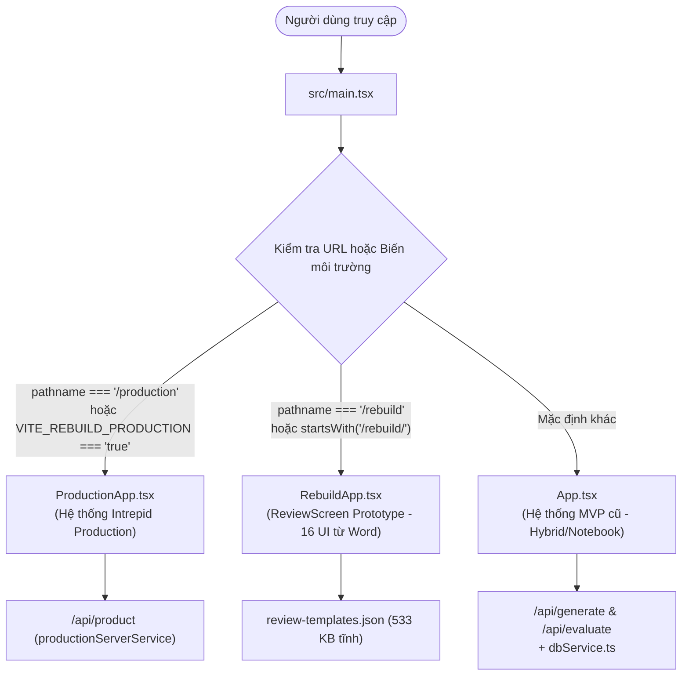
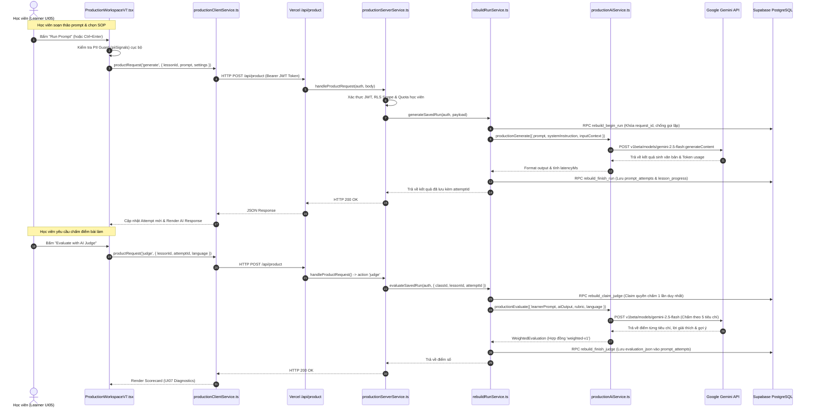
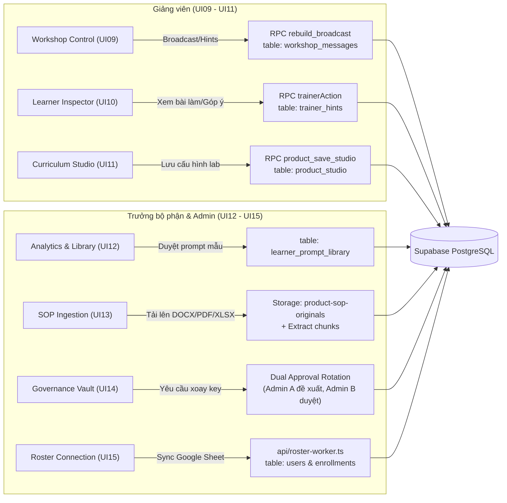

# 02 — KIẾN TRÚC HIỆN TẠI & BẢN ĐỒ CODEBASE (CURRENT ARCHITECTURE)
## Phân tích Chi tiết Cấu trúc Thực tế, Sơ đồ Dữ liệu và Giao tiếp Module

**Dự án:** Promptify — Intrepid Workspace  
**Tài liệu tham chiếu:** Source code thực tế tại commit `d7ac9d1` + untracked files  
**Ngày kiểm toán:** 11/10/2026  

---

## 1. Tổng quan Bản đồ Repository (Repository Inventory)

Repository hiện tại là một ứng dụng Fullstack Serverless triển khai trên nền tảng **Vercel** kết hợp cơ sở dữ liệu **Supabase (PostgreSQL)**.

### 1.1. Cấu trúc thư mục mức cao

```
c:\Ki_OJT\PromptforNontech\
├── api/                  # Vercel Serverless Functions (Entry points của backend production)
│   ├── product.ts        # Entry point chính xử lý toàn bộ các action của hệ thống Intrepid
│   ├── roster-worker.ts  # Worker chạy nền/cron đồng bộ danh sách học viên từ Google Sheet
│   ├── generate.ts       # Endpoint legacy sinh prompt (chuyển tiếp sang rebuildRunService)
│   └── evaluate.ts       # Endpoint legacy chấm điểm AI (chuyển tiếp sang rebuildRunService)
├── src/                  # Mã nguồn ứng dụng Frontend và Business Services
│   ├── components/       # Các React components (đang bị chia cắt giữa legacy và rebuild)
│   │   ├── auth/         # Giao diện đăng nhập, xác nhận profile, từ chối truy cập
│   │   ├── classes/      # Chọn lớp học (legacy)
│   │   ├── common/       # UI dùng chung (ProductDialog, MarkdownView, PromptifyMark, v.v.)
│   │   ├── dashboard/    # Màn hình Dashboard học viên (legacy)
│   │   ├── history/      # Lịch sử bài làm (legacy)
│   │   ├── hybrid/       # Không gian Codelab 2 cột HybridView (legacy - 1.337 dòng)
│   │   ├── instructor/   # Giao diện giảng viên InstructorViewShell (legacy)
│   │   ├── landing/      # Trang giới thiệu / Visuals
│   │   ├── lesson/       # Header, brief bài học (legacy)
│   │   ├── library/      # Thư viện prompt mẫu (legacy)
│   │   ├── navigation/   # Navbar điều hướng
│   │   ├── notebook/     # Giao diện học dạng Notebook tế bào (legacy)
│   │   ├── playground/   # Giao diện thử nghiệm tự do (legacy)
│   │   ├── prompt/       # Khung soạn thảo PromptComposer (legacy)
│   │   ├── rebuild/      # 41 file chứa toàn bộ 16 UI màn hình của bản Production Intrepid
│   │   └── telemetry/    # Drawer theo dõi lịch sử
│   ├── data/             # Dữ liệu tĩnh và seed giáo trình (curriculumSeed.ts, labsData.ts)
│   ├── services/         # 40 file dịch vụ xử lý logic nghiệp vụ, AI, DB, i18n, auth
│   ├── types/            # Định nghĩa kiểu dữ liệu (production.ts, database.ts, instructor.ts, index.ts)
│   ├── App.tsx           # Ứng dụng gốc (Legacy App - 1.080 dòng)
│   ├── main.tsx          # Điểm khởi tạo React (Mount 1 trong 3 App tùy biến môi trường/URL)
│   └── index.css         # CSS gốc Tailwind
├── supabase/             # Quản lý cơ sở dữ liệu
│   ├── migrations/       # 48 file migration SQL (từ 002 đến 049)
│   └── rollback/         # Script rollback an toàn cho các migration gần nhất
├── test/                 # 62 file script kiểm thử và xác minh hợp đồng (verification scripts)
├── scripts/              # 79 script tiện ích (generator giáo trình, audit i18n, build UI)
├── docs/                 # Tài liệu sản phẩm, quyết định, phân tích nghiệp vụ, handoff
├── design-drafts/        # Bản vẽ prototype, HTML trích xuất từ Word, mockup tham khảo
├── outputs/              # (Gitignored) File render tạm thời, trích xuất văn bản, zip
├── curriculum-specs/     # File cấu hình giáo trình gốc định dạng JSON
└── curriculum-levels/    # Nội dung bài học và lý thuyết theo cấp độ
```

---

## 2. Luồng Khởi động Tri-Modal (Tri-Modal Entry Points)

Điểm vào của frontend tại `src/main.tsx` hiện đang chứa logic phân nhánh chạy một trong 3 ứng dụng hoàn toàn tách biệt:



### Chi tiết các luồng:
1. **`ProductionApp` (`src/components/rebuild/ProductionApp.tsx`):**
   - Đây là ứng dụng thực tế đang chạy trên môi trường Vercel Production của Intrepid (`https://promptify-rebuild.vercel.app`).
   - Quản lý phiên đăng nhập SSO qua Supabase Auth, nạp snapshot trạng thái qua `/api/product`, điều hướng 16 màn hình (`UI00`–`UI15`) thông qua query param `?ui=00`..`15`.
2. **`RebuildApp` (`src/components/rebuild/RebuildApp.tsx`):**
   - Được xây dựng như một công cụ kiểm duyệt (review) 16 màn hình lấy trực tiếp từ tài liệu Word gốc.
   - Hoàn toàn dùng dữ liệu giả lập (mocked demo data), nạp file `review-templates.json` (533 KB). Không kết nối database thực.
3. **`App` (`src/App.tsx`):**
   - Ứng dụng gốc đầu tiên của Promptify trước tháng 10/2026.
   - Quản lý trạng thái học tập theo mô hình Codelab Hybrid/Notebook cũ, gọi trực tiếp `dbService.ts` và sử dụng bộ rubric 4 tiêu chí cũ không trọng số.

---

## 3. Kiến trúc Luồng Dữ liệu End-to-End (Data Flow Architecture)

### 3.1. Luồng Thực hành Codelab (Learner Codelab Practice Flow — UI05 & UI07)

Đây là luồng quan trọng nhất trong sản phẩm, diễn ra khi học viên thực hành viết prompt, gọi mô hình AI và nhận kết quả chấm điểm từ AI Judge.



---

### 3.2. Luồng Điều hành của Giảng viên & Quản trị viên (Facilitator & Admin Flows)



---

## 4. Danh mục 16 Màn hình Bản Production (UI00 – UI15 Screen Mapping)

| Mã UI | Tên màn hình | Component đang Active | Trách nhiệm chính | Quyền hạn truy cập |
| :---: | :--- | :--- | :--- | :--- |
| **UI00** | Landing Page | `ProductionLanding.tsx` | Giới thiệu nền tảng Promptify x Intrepid, nút bắt đầu học | Public / Chưa đăng nhập |
| **UI01** | Enterprise Sign-in | `ProductionEntry1.tsx` | Nút đăng nhập Google SSO doanh nghiệp (@intrepid.asia) | Public / Chưa đăng nhập |
| **UI02** | Profile Confirmation | `ProductionEntry2.tsx` | Học viên đối chiếu Email, Họ tên, Phòng ban từ Roster | Người dùng mới đăng nhập |
| **UI03** | Access Denied | `ProductionEntry3.tsx` | Thông báo từ chối nếu email không có trong Roster | Người dùng không hợp lệ |
| **UI04** | Learning Dashboard | `ProductionHub.tsx` | Danh sách Codelab, tiến độ bài học, thư viện SOP phòng ban | Học viên (`learner`) |
| **UI05** | Codelab Workspace | `ProductionWorkspaceV7.tsx` | Soạn prompt, chèn scaffolding, gọi AI, xem kết quả, lưu nháp | Học viên (`learner`) |
| **UI06** | Version Comparison | `ProductionCompareSource.tsx` | So sánh diff trực quan giữa các lần nộp bài (attempts) | Học viên (`learner`) |
| **UI07** | AI Judge Diagnostics | `ProductionJudgeSource.tsx` | Bảng điểm chi tiết 5 tiêu chí có trọng số, điểm mạnh/yếu | Học viên (`learner`) |
| **UI08** | SOP Inspector | `ProductionSopInspectorSource.tsx` | Đọc tài liệu SOP chuẩn, trích dẫn trực tiếp vào bài làm | Học viên (`learner`) |
| **UI09** | Workshop Control | `ProductionWorkshopSource.tsx` | Giảng viên điều hành workshop trực tiếp, phát thông báo | Giảng viên / Admin |
| **UI10** | Learner Inspector | `ProductionLearnerInspectorSource.tsx` | Xem chi tiết từng lần nộp của học viên, gửi coaching riêng | Giảng viên / Admin |
| **UI11** | Curriculum Studio | `ProductionStudioSource.tsx` | Thiết kế bài học, đặt rubric trọng số, duyệt yêu cầu SOP | Giảng viên / Admin |
| **UI12** | Learning Analytics | `ProductionAnalyticsSource.tsx` | Thống kê tiến độ phòng ban, duyệt prompt vào thư viện chung | Head of Dept / Admin |
| **UI13** | SOP Contribution | `ProductionSopSource.tsx` | Upload tài liệu SOP mới (PDF, DOCX, XLSX) hoặc liên kết Drive | Head of Dept / Học viên |
| **UI14** | System Governance | `ProductionGovernanceSource.tsx` | Quản trị API key, cơ chế Dual Approval xoay key, audit logs | Quản trị viên (`admin`) |
| **UI15** | Roster Connections | `ProductionRosterSource.tsx` | Cấu hình link Google Sheet, mapping cột, kích hoạt sync | Giảng viên / Admin |

---

## 5. Dịch vụ Bên ngoài & Tích hợp (External Integrations)

1. **Google Gemini Generative AI:**
   - Endpoint: `https://generativelanguage.googleapis.com/v1beta/models/{model}:generateContent`
   - Mô hình chính: `gemini-2.5-flash` (hoặc `gemini-3-flash-preview` khi được bật).
   - Mô hình dự phòng (Fallback): `process.env.GEMINI_FALLBACK_MODEL`.
   - Tính năng mở rộng: Google Search Grounding (`tools: [{ googleSearch: {} }]`), Thinking budget thấp (512 tokens).
2. **Supabase BaaS (Database, Auth, Storage):**
   - **Auth:** Quản lý Google OAuth SSO, cấp JWT token `access_token` cho client.
   - **PostgreSQL:** Lưu trữ 48 bảng/views/functions (RPCs).
   - **Storage:** Bucket `product-sop-originals` lưu trữ tài liệu SOP tải lên có phân quyền truy cập.
   - **Realtime:** Kênh `product-workshop-{classId}` lắng nghe sự kiện `INSERT` trên bảng `workshop_messages` và `trainer_hints`.
3. **Google Sheets API & Roster Sync:**
   - Đọc dữ liệu học viên từ link Google Sheet được chia sẻ theo cấu hình cột: `Email`, `Full Name`, `Department`, `Country`.
4. **Google Drive API (Folder Ingestion):**
   - Đọc danh sách tài liệu từ URL thư mục Drive công khai/được cấp quyền để trích xuất SOP.
5. **PDF Generator (`pdf-lib` + `@pdf-lib/fontkit`):**
   - Tạo file chứng chỉ hoàn thành khóa học (Certificate of Completion) định dạng PDF tiếng Việt/Anh trực tiếp trên máy chủ (`awardDocumentService.ts`).

