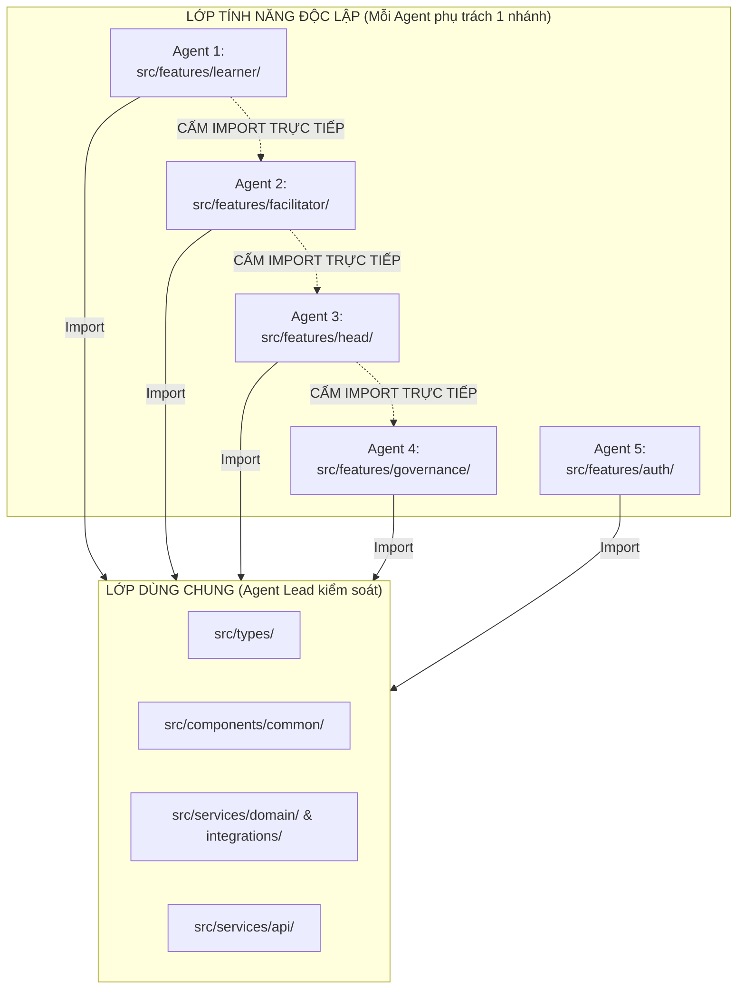

# 04 — ĐỀ XUẤT KIẾN TRÚC MỤC TIÊU (TARGET ARCHITECTURE)
## Thiết kế Kiến trúc Module theo Tính năng (Feature-Driven Modular Architecture)

**Dự án:** Promptify — Intrepid Workspace  
**Tác giả:** Senior Software Architect  
**Ngày lập kế hoạch:** 11/10/2026  

---

## 1. Triết lý & Nguyên tắc Thiết kế (Design Principles)

1. **Thực dụng & Tránh Over-engineering (Pragmatic & Anti-Overengineering):**  
   Không đưa vào các pattern phức tạp không cần thiết (không microservices, không Redux/Zustand nặng nề nếu React Context/hooks đã đủ, không chuyển đổi framework sang Next.js). Giữ nguyên stack: **React 19 + TypeScript 5.7 + Vite 6 + Tailwind CSS + Vercel Functions + Supabase**.
2. **Kiến trúc Module hóa theo Tính năng (Feature-Driven Architecture):**  
   Thay vì gom toàn bộ 41 màn hình và component vào một thư mục phẳng `rebuild/`, code sẽ được phân chia theo miền nghiệp vụ (Business Domains): `learner`, `facilitator`, `head`, `governance`, `auth`.
3. **Phân tách Trách nhiệm Rõ ràng (Separation of Concerns):**  
   - **UI Presentation:** Chỉ render giao diện, nhận props và gọi callbacks.
   - **Custom Hooks:** Quản lý state cục bộ, lifecycle, debounce, phím tắt.
   - **Domain Services:** Chứa business logic, validation, PII checks.
   - **API Clients:** Gửi HTTP request, xử lý timeout, parse lỗi.
4. **Sẵn sàng cho Multi-Agent Concurrency (Multi-Agent Readiness):**  
   - Phân định ranh giới file rõ ràng: Agent A làm việc trên `src/features/learner/` hoàn toàn độc lập với Agent B làm việc trên `src/features/facilitator/` hay Agent C làm việc trên `src/features/governance/`.
   - Giảm thiểu tối đa việc cùng sửa một file "God Object".
5. **Zero Regression Strategy (Bảo toàn 100% chức năng):**  
   - Giữ nguyên hợp đồng API `/api/product`.
   - Giữ nguyên 48 migration SQL của Supabase.
   - Không thay đổi hành vi nghiệp vụ của bản đang deploy.

---

## 2. Cây Thư mục Mục tiêu (Proposed Repository Structure)

```
c:\Ki_OJT\PromptforNontech\
├── api/                                # Vercel Serverless Functions
│   ├── product.ts                      # Route handler chính (giữ nguyên hợp đồng)
│   ├── roster-worker.ts                # Worker đồng bộ danh sách Google Sheet
│   └── legacy/                         # (Archive) generate.ts, evaluate.ts
│
├── src/
│   ├── main.tsx                        # Entry point tinh gọn (chỉ mount App chính)
│   ├── App.tsx                         # App Shell điều hướng chính của Intrepid
│   │
│   ├── features/                       # MODULE HÓA THEO TÍNH NĂNG NGHIỆP VỤ
│   │   ├── auth/                       # Phân hệ Xác thực & Quản lý Danh tính
│   │   │   ├── EnterpriseLoginView.tsx # UI01: Đăng nhập Google SSO
│   │   │   ├── ProfileConfirmView.tsx  # UI02: Xác nhận hồ sơ từ Roster
│   │   │   ├── AccessDeniedView.tsx    # UI03: Màn hình từ chối truy cập
│   │   │   └── hooks/useAuthSession.ts # Hook quản lý phiên đăng nhập Supabase
│   │   │
│   │   ├── learner/                    # Phân hệ Học viên (Learner Experience)
│   │   │   ├── LearnerDashboardView.tsx# UI04: Hub học tập, tiến độ, tài nguyên
│   │   │   ├── CodelabWorkspaceView.tsx# UI05: Không gian Codelab thực hành V7
│   │   │   ├── CompareDiffView.tsx     # UI06: So sánh các lần nộp bài
│   │   │   ├── AiJudgeScorecard.tsx    # UI07: Bảng điểm chẩn đoán AI Judge
│   │   │   ├── SopInspectorModal.tsx   # UI08: Tra cứu và trích dẫn SOP
│   │   │   ├── components/             # Sub-components riêng của learner
│   │   │   │   ├── PromptScaffolding.tsx   # Thanh chip chèn cấu trúc prompt
│   │   │   │   ├── PromptLibraryDrawer.tsx # Drawer mẫu prompt đã lưu
│   │   │   │   └── SopSearchDrawer.tsx     # Drawer tìm kiếm SOP
│   │   │   └── hooks/                  # Custom hooks riêng của learner
│   │   │       ├── usePromptDraft.ts       # Tự động lưu nháp (draft autosave)
│   │   │       └── useLearnerSettings.ts   # Quản lý cấu hình model/temperature
│   │   │
│   │   ├── facilitator/                # Phân hệ Giảng viên (Trainer / Facilitator)
│   │   │   ├── WorkshopControlView.tsx # UI09: Điều hành workshop, phát broadcast
│   │   │   ├── LearnerInspectorView.tsx# UI10: Kiểm tra bài làm học viên
│   │   │   ├── CurriculumStudioView.tsx# UI11: Thiết kế bài học & Rubric
│   │   │   ├── SopRequestReview.tsx    # Phê duyệt yêu cầu cập nhật SOP
│   │   │   └── hooks/useWorkshopRealtime.ts # Hook lắng nghe sự kiện giảng viên
│   │   │
│   │   ├── head/                       # Phân hệ Trưởng bộ phận (Head of Dept)
│   │   │   ├── DepartmentAnalyticsView.tsx # UI12: Thống kê & duyệt prompt library
│   │   │   └── SopContributionView.tsx     # UI13: Tải lên & đề xuất SOP mới
│   │   │
│   │   └── governance/                 # Phân hệ Quản trị Hệ thống (Admin)
│   │       ├── SystemGovernanceView.tsx# UI14: Key Vault, Dual Approval Rotation
│   │       └── RosterConnectionsView.tsx# UI15: Kết nối Google Sheet Roster
│   │
│   ├── components/common/              # CÁC UI COMPONENT DÙNG CHUNG (REUSABLE)
│   │   ├── ProductDialog.tsx           # Modal dialog chuẩn hóa (bọc accessible modal)
│   │   ├── ProductUseNotice.tsx        # Cảnh báo bản quyền & điều khoản
│   │   ├── MarkdownView.tsx            # Trình hiển thị Markdown an toàn
│   │   ├── PromptifyMark.tsx           # Logo SVG Promptify thương hiệu
│   │   ├── AppHeader.tsx               # Header chung có navigation & chọn lớp
│   │   └── StatusAlert.tsx             # Banner thông báo lỗi / thành công
│   │
│   ├── services/                       # DỊCH VỤ NGHIỆP VỤ & TÍCH HỢP
│   │   ├── api/                        # Client giao tiếp với Backend
│   │   │   ├── productClient.ts        # Gọi /api/product với typed actions
│   │   │   └── errorHandling.ts        # Chuẩn hóa lỗi API
│   │   ├── server/                     # Backend Logic chạy trên Serverless
│   │   │   ├── productServerService.ts # Dispatcher chính của /api/product
│   │   │   ├── actions/                # Tách nhỏ switch-case thành domain handlers
│   │   │   │   ├── learnerActions.ts   # Xử lý generate, judge, saveDraft, unlock
│   │   │   │   ├── facilitatorActions.ts# Xử lý workshop, broadcast, studio, attendance
│   │   │   │   ├── sopActions.ts       # Xử lý upload, review, search SOP
│   │   │   │   └── governanceActions.ts# Xử lý rotation, domain, roster sync
│   │   │   ├── runService.ts           # Quản lý lifecycle run/judge trên DB
│   │   │   └── aiService.ts            # Gọi Gemini API, fallback & grounded search
│   │   ├── domain/                     # Logic nghiệp vụ thuần (Pure Business Logic)
│   │   │   ├── piiGuard.ts             # Nhận diện & xóa thông tin định danh
│   │   │   ├── weightedRubric.ts       # Tính toán điểm rubric 5 tiêu chí
│   │   │   ├── codelabLifecycle.ts     # Kiểm tra lịch mở lab
│   │   │   └── i18nService.ts          # Quản lý đa ngôn ngữ EN/VI
│   │   └── integrations/               # Tích hợp dịch vụ bên thứ ba
│   │       ├── supabaseClient.ts       # Khởi tạo Supabase client
│   │       ├── googleRoster.ts         # Đọc dữ liệu từ Google Sheet
│   │       ├── driveFolder.ts          # Đọc folder Google Drive
│   │       ├── sopIngestion.ts         # Trích xuất PDF, DOCX, XLSX
│   │       └── awardDocument.ts        # Sinh file PDF chứng chỉ hoàn thành
│   │
│   ├── types/                          # KIỂU DỮ LIỆU ĐỒNG NHẤT
│   │   ├── product.ts                  # Hợp đồng chính (Profile, Class, Lesson, Attempt)
│   │   ├── database.ts                 # Schema database Supabase
│   │   └── evaluation.ts               # Hợp đồng WeightedEvaluation
│   │
│   └── legacy/                         # (Archive tạm thời cho App cũ nếu cần rollback)
│       ├── AppLegacy.tsx               # App.tsx cũ (chỉ lưu trữ tham khảo)
│       └── HybridViewLegacy.tsx        # HybridView.tsx cũ
```

---

## 3. Bản đồ Chuyển dịch Mã nguồn (Source Migration Mapping)

Bảng dưới đây quy định chính xác file hiện tại sẽ được chuyển dịch và tổ chức lại như thế nào:

| File Hiện tại | File Đích Đề xuất | Hành động | Lý do & Lợi ích |
| :--- | :--- | :---: | :--- |
| `src/main.tsx` | `src/main.tsx` | **REFACTOR** | Bỏ logic tri-modal; `ProductionApp` trở thành ứng dụng chính thức; loại bỏ `RebuildApp`. |
| `src/components/rebuild/ProductionApp.tsx` | `src/App.tsx` (hoặc `AppShell.tsx`) | **REFACTOR** | Xóa dead code (L120–L145); chuẩn hóa state bằng custom hook. |
| `src/components/rebuild/ProductionLanding.tsx` | `src/features/landing/LandingView.tsx` | **MOVE** | Đưa về đúng module Landing. |
| `src/components/rebuild/ProductionEntry1.tsx` | `src/features/auth/EnterpriseLoginView.tsx` | **MOVE** | Đưa về đúng module Auth (UI01). |
| `src/components/rebuild/ProductionEntry2.tsx` | `src/features/auth/ProfileConfirmView.tsx` | **MOVE** | Đưa về đúng module Auth (UI02). |
| `src/components/rebuild/ProductionEntry3.tsx` | `src/features/auth/AccessDeniedView.tsx` | **MOVE** | Đưa về đúng module Auth (UI03). |
| `src/components/rebuild/ProductionHub.tsx` | `src/features/learner/LearnerDashboardView.tsx` | **MOVE** | Đưa về đúng module Learner (UI04). |
| `src/components/rebuild/ProductionWorkspaceV7.tsx` | `src/features/learner/CodelabWorkspaceView.tsx` | **MOVE** | Đây là Workspace V7 active, đưa về module Learner (UI05). |
| `src/components/rebuild/ProductionCompareSource.tsx` | `src/features/learner/CompareDiffView.tsx` | **MOVE** | Đưa về module Learner (UI06). |
| `src/components/rebuild/ProductionJudgeSource.tsx` | `src/features/learner/AiJudgeScorecard.tsx` | **MOVE** | Đưa về module Learner (UI07). |
| `src/components/rebuild/ProductionSopInspectorSource.tsx` | `src/features/learner/SopInspectorModal.tsx` | **MOVE** | Đưa về module Learner (UI08). |
| `src/components/rebuild/ProductionWorkshopSource.tsx` | `src/features/facilitator/WorkshopControlView.tsx` | **MOVE** | Đưa về module Facilitator (UI09). |
| `src/components/rebuild/ProductionLearnerInspectorSource.tsx` | `src/features/facilitator/LearnerInspectorView.tsx` | **MOVE** | Đưa về module Facilitator (UI10). |
| `src/components/rebuild/ProductionStudioSource.tsx` | `src/features/facilitator/CurriculumStudioView.tsx` | **MOVE** | Đưa về module Facilitator (UI11). |
| `src/components/rebuild/ProductionAnalyticsSource.tsx` | `src/features/head/DepartmentAnalyticsView.tsx` | **MOVE** | Đưa về module Head (UI12). |
| `src/components/rebuild/ProductionSopSource.tsx` | `src/features/head/SopContributionView.tsx` | **MOVE** | Đưa về module Head (UI13). |
| `src/components/rebuild/ProductionGovernanceSource.tsx` | `src/features/governance/SystemGovernanceView.tsx` | **MOVE** | Đưa về module Governance (UI14). |
| `src/components/rebuild/ProductionRosterSource.tsx` | `src/features/governance/RosterConnectionsView.tsx` | **MOVE** | Đưa về module Governance (UI15). |
| `src/services/productionServerService.ts` | `src/services/server/productServerService.ts` + `actions/*` | **EXTRACT** | Tách switch-case 25+ actions thành các domain handler files nhỏ gọn. |
| `src/components/rebuild/ProductionStudio.tsx`, `ProductionStudioV2.tsx` | — | **DELETE CANDIDATE** | Bản cũ không được mount; thay thế bằng `CurriculumStudioView.tsx`. |
| `src/components/rebuild/ProductionWorkshop.tsx`, `ProductionRoster.tsx`, v.v. | — | **DELETE CANDIDATE** | Các file bản viết tay cũ trong khối dead fallback. |
| `src/components/rebuild/CombinedProduction*` | — | **DELETE CANDIDATE** | Các file thử nghiệm không bao giờ mount. |
| `src/components/rebuild/review-templates.json` (533 KB) | — | **DELETE CANDIDATE** | Dữ liệu tĩnh chỉ dùng cho Review prototype demo. |
| `src/App.tsx`, `src/components/hybrid/HybridView.tsx` | `src/legacy/` | **DEFER** | Tạm giữ để đối chiếu, không xóa ngay trong Phase 1. |

---

## 4. Ranh giới Phụ thuộc & Nguyên tắc Phối hợp Multi-Agent (Dependency Boundaries)

Để đảm bảo nhiều AI Coding Agents làm việc song song mà không xung đột:



### Các quy tắc cốt lõi:
1. **Tuyệt đối không Cross-feature Import:** `features/learner` không được import file bên trong `features/facilitator`. Nếu có logic hoặc UI cần chia sẻ, phải chuyển lên `components/common/` hoặc `services/`.
2. **Không tự ý sửa Contract ở `types/`:** Mọi thay đổi trong `types/` phải được thống nhất ở cấp Lead Architect vì nó ảnh hưởng đến tất cả các feature khác.
3. **Mỗi Agent có phạm vi trách nhiệm riêng biệt:** Khi một agent được phân công sửa Codelab Workspace, agent chỉ sửa các file trong `src/features/learner/` và hook tương ứng, không đụng vào `features/governance/`.

