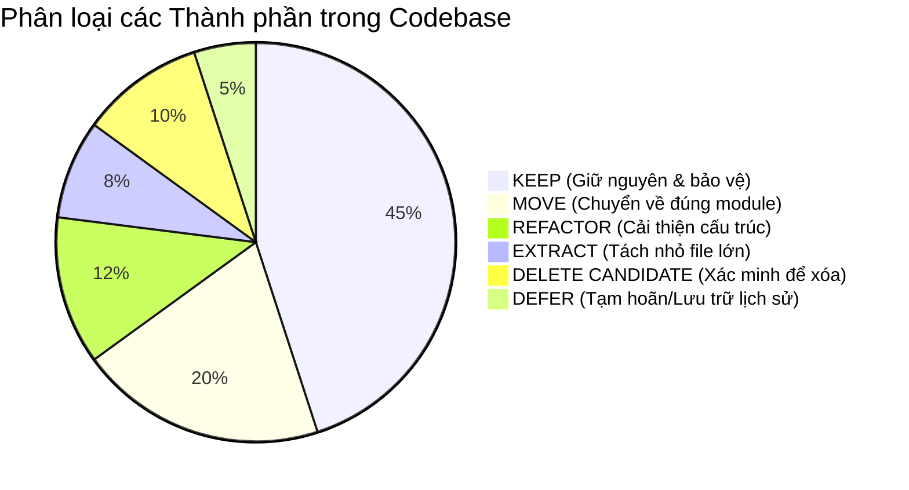

# 05 — KẾ HOẠCH DỌN DẸP REPOSITORY (CLEANUP AUDIT PLAN)
## Phân loại Chi tiết File: KEEP / MOVE / EXTRACT / MERGE / REFACTOR / DELETE / DEFER

**Dự án:** Promptify — Intrepid Workspace  
**Tác giả:** Senior Software Architect & Repository Refactoring Lead  
**Ngày kiểm toán:** 11/10/2026  
**Nguyên tắc nghiêm ngặt:** Tuyệt đối không xóa file chỉ vì tên file giống file rác. Mọi file được đề xuất xóa đều phải có bằng chứng kiểm tra references, dynamic imports, scripts và runtime usage.

---

## 1. Ma trận Phân loại Tổng thể (Classification Matrix)

---

## 2. Danh sách Đề xuất Chi tiết theo Từng Nhóm

### 2.1. Nhóm DELETE CANDIDATE (Ứng viên Xác minh để Dọn dẹp)

> [!WARNING]
> Tất cả các file trong nhóm này KHÔNG ĐƯỢC XÓA NGAY trong giai đoạn kiểm toán. Chỉ được xóa khi có sự phê duyệt chính thức từ người dùng ở giai đoạn refactor tương ứng.

#### 1. Các Component bản nháp cũ bị bỏ rơi trong `src/components/rebuild/`
- **Đường dẫn hiện tại:**
  - `src/components/rebuild/CombinedProductionHub.tsx`
  - `src/components/rebuild/CombinedProductionWorkspace.tsx`
  - `src/components/rebuild/ProductionStudio.tsx` (và `ProductionStudioV2.tsx`)
  - `src/components/rebuild/ProductionCohorts.tsx`
  - `src/components/rebuild/ProductionWorkshop.tsx`
  - `src/components/rebuild/ProductionRoster.tsx`
  - `src/components/rebuild/ProductionGovernance.tsx`
  - `src/components/rebuild/ProductionAnalytics.tsx`
  - `src/components/rebuild/ProductionSop.tsx`
  - `src/components/rebuild/ProductionCompare.tsx`
  - `src/components/rebuild/ProductionWorkspaceSource.tsx` (bản cũ bị thay thế bởi V7)
- **Vấn đề cụ thể:**
  - Đây là các file bản viết tay ban đầu, hoặc file thử nghiệm trung gian.
  - Hiện tại trong `ProductionApp.tsx`, các nhánh render thực tế (L104–L118) đều dùng các file `*Source.tsx` và `ProductionWorkspaceV7.tsx`.
  - Các file này chỉ còn xuất hiện ở đoạn code chết (dead fallback lines 120–145) mà không bao giờ được render.
- **Thay đổi đề xuất:** Sau khi xóa đoạn code fallback ở `ProductionApp.tsx`, xóa an toàn các component này khỏi `src/components/rebuild/`.
- **Lợi ích:** Giảm bớt 11 file thừa, giải phóng ~90 KB mã nguồn, ngăn chặn hoàn toàn việc sửa nhầm vào file chết.
- **Rủi ro:** Cực thấp, vì không có import nào khác từ ngoài trỏ tới các file này.
- **Cách kiểm chứng:** Chạy `npm run build` và `node test/verify_learner_ui_state.mjs` trước và sau khi gỡ bỏ để đảm bảo không lỗi import.

---

#### 2. Dữ liệu tĩnh Demo khổng lồ của Review Prototype
- **Đường dẫn hiện tại:**
  - `src/components/rebuild/review-templates.json` (533 KB)
  - `src/components/rebuild/ReviewScreen.tsx` (28.5 KB)
  - `src/components/rebuild/review-i18n.ts` (48.6 KB)
  - `src/components/rebuild/review-manifest.json` (6.8 KB)
  - `src/components/rebuild/review.css` (8.8 KB)
  - `src/components/rebuild/RebuildApp.tsx` (1.8 KB)
- **Vấn đề cụ thể:**
  - Phục vụ đường dẫn `/rebuild` — một prototype review giao diện 16 UI từ Word với dữ liệu tĩnh giả lập.
  - Chiếm hơn **620 KB** ngay trong `src/`, làm nặng bundle của Vite (chunk `RebuildApp` nặng 615 KB) và làm chậm các công cụ IDE/AI.
- **Thay đổi đề xuất:**
  - Lựa chọn A (Khuyến nghị): Lưu trữ vào `design-drafts/review-authority/` nếu vẫn cần giữ làm tài liệu tham khảo UI gốc.
  - Lựa chọn B: Xóa hẳn nếu sản phẩm đã chuyển sang giai đoạn chạy thật trên `ProductionApp`.
- **Cách kiểm chứng:** Kiểm tra xem `main.tsx` có còn cờ `isRebuild` hay không; chạy `npm run build` xác nhận kích thước bundle giảm 615 KB.

---

### 2.2. Nhóm REFACTOR (Cải thiện Cấu trúc & Tách Trách nhiệm)

#### 1. Chuẩn hóa Root Application Shell
- **Đường dẫn hiện tại:** `src/components/rebuild/ProductionApp.tsx` (và `src/main.tsx`)
- **Vấn đề cụ thể:**
  - `main.tsx` chứa nhánh rẽ tri-modal.
  - `ProductionApp.tsx` chứa dead fallback (L120–L145), trộn lẫn logic auth, state nạp class/lesson, timer polling, realtime listener và render 16 màn hình.
- **Thay đổi đề xuất:**
  - Biến `ProductionApp.tsx` thành `src/App.tsx` chính thức (hoặc `AppShell.tsx`).
  - Gỡ bỏ toàn bộ dead code từ dòng 120 đến 145 và các import tương ứng.
  - Tách logic auth và load snapshot thành custom hook `useProductSession()`.
  - Thay thế chuỗi `if (currentUi === ...)` bằng một router/dispatcher rõ ràng.
- **Lợi ích:** Code tinh gọn từ 147 dòng nén (29.6 KB) xuống thành component điều phối trong sáng ~80 dòng, loại bỏ cảnh báo chunk-size.
- **Rủi ro:** Trung bình. Cần đảm bảo các quyền truy cập `accessible` và điều hướng URL `?ui=00..15` hoạt động chính xác.
- **Cách kiểm chứng:** Chạy `node test/verify_app_session_state.mjs` và kiểm tra chuyển đổi URL trong trình duyệt.

---

#### 2. Chia nhỏ Monolith Backend Service
- **Đường dẫn hiện tại:** `src/services/productionServerService.ts` (431 dòng, 48 KB)
- **Vấn đề cụ thể:**
  - Switch-case chứa 25+ actions nằm chung trong một hàm `handleProductRequest`.
  - Mọi thao tác từ upload SOP, duyệt SOP, xoay key, lưu nháp, tạo bài học đều nằm chung trong 1 file.
- **Thay đổi đề xuất:**
  - Giữ `productionServerService.ts` làm Entry Point xác thực JWT và RLS Scope context.
  - Tách các nhánh action thành các service chuyên biệt trong `src/services/server/actions/`:
    - `learnerActions.ts`: `generate`, `judge`, `saveDraft`, `unlockSupport`, `uploadLearnerContext`.
    - `facilitatorActions.ts`: `broadcast`, `privateHint`, `saveStudio`, `createLesson`, `recordAttendance`.
    - `sopActions.ts`: `prepareSopUpload`, `submitSop`, `reviewSop`, `searchSop`.
    - `governanceActions.ts`: `saveDomain`, `setAccess`, `saveClass`, `syncSheet`.
- **Lợi ích:** Tuân thủ Single Responsibility, nhiều AI agents có thể sửa các tính năng khác nhau mà không chạm vào cùng một file.
- **Rủi ro:** Thấp, vì interface đầu vào của `handleProductRequest` và output trả về không hề thay đổi.
- **Cách kiểm chứng:** Chạy `npx tsx test/verify_product_http.ts` và `npx tsx test/verify_backend_failure_recovery.ts`.

---

### 2.3. Nhóm MOVE (Di chuyển về Đúng Thư mục Module Tính năng)

| File Hiện tại | Vị trí Đề xuất | Lý do Di chuyển |
| :--- | :--- | :--- |
| `src/components/rebuild/ProductionLanding.tsx` | `src/features/landing/LandingView.tsx` | Gom về module Landing |
| `src/components/rebuild/ProductionEntry1.tsx` | `src/features/auth/EnterpriseLoginView.tsx` | Gom về module Auth (UI01) |
| `src/components/rebuild/ProductionEntry2.tsx` | `src/features/auth/ProfileConfirmView.tsx` | Gom về module Auth (UI02) |
| `src/components/rebuild/ProductionEntry3.tsx` | `src/features/auth/AccessDeniedView.tsx` | Gom về module Auth (UI03) |
| `src/components/rebuild/ProductionHub.tsx` | `src/features/learner/LearnerDashboardView.tsx` | Gom về module Learner (UI04) |
| `src/components/rebuild/DepartmentSopLibrary.tsx`| `src/features/learner/components/DepartmentSopLibrary.tsx` | Sub-component của UI04 |
| `src/components/rebuild/LearnerResourceHub.tsx` | `src/features/learner/components/LearnerResourceHub.tsx` | Sub-component của UI04 |
| `src/components/rebuild/ProductionWorkspaceV7.tsx` | `src/features/learner/CodelabWorkspaceView.tsx` | Không gian Codelab chính thức (UI05) |
| `src/components/rebuild/learner-workspace.css` | `src/features/learner/styles/learner-workspace.css` | CSS riêng của Codelab V7 |
| `src/components/rebuild/ProductionCompareSource.tsx`| `src/features/learner/CompareDiffView.tsx` | Gom về module Learner (UI06) |
| `src/components/rebuild/ProductionJudgeSource.tsx` | `src/features/learner/AiJudgeScorecard.tsx` | Gom về module Learner (UI07) |
| `src/components/rebuild/ProductionSopInspectorSource.tsx` | `src/features/learner/SopInspectorModal.tsx` | Gom về module Learner (UI08) |
| `src/components/rebuild/ProductionWorkshopSource.tsx` | `src/features/facilitator/WorkshopControlView.tsx` | Gom về module Facilitator (UI09) |
| `src/components/rebuild/ProductionLearnerInspectorSource.tsx` | `src/features/facilitator/LearnerInspectorView.tsx` | Gom về module Facilitator (UI10) |
| `src/components/rebuild/ProductionStudioSource.tsx` | `src/features/facilitator/CurriculumStudioView.tsx` | Gom về module Facilitator (UI11) |
| `src/components/rebuild/SopRequestReview.tsx` | `src/features/facilitator/components/SopRequestReview.tsx` | Gom về module Facilitator (UI11) |
| `src/components/rebuild/ProductionAnalyticsSource.tsx` | `src/features/head/DepartmentAnalyticsView.tsx` | Gom về module Head (UI12) |
| `src/components/rebuild/PromptLibrary.tsx` | `src/features/head/components/PromptLibrary.tsx` | Gom về module Head (UI12) |
| `src/components/rebuild/ProductionSopSource.tsx` | `src/features/head/SopContributionView.tsx` | Gom về module Head (UI13) |
| `src/components/rebuild/ProductionGovernanceSource.tsx` | `src/features/governance/SystemGovernanceView.tsx` | Gom về module Governance (UI14) |
| `src/components/rebuild/ProductionRosterSource.tsx` | `src/features/governance/RosterConnectionsView.tsx` | Gom về module Governance (UI15) |

---

### 2.4. Nhóm KEEP (Bảo toàn Nguyên vẹn & Cấm Xâm phạm)

1. **Toàn bộ 48 Migration SQL (`supabase/migrations/002_*.sql` đến `049_*.sql`):**  
   - Tuyệt đối giữ nguyên lịch sử migration và rollback. Không rewrite hay gộp file để "dọn dẹp".
2. **Hợp đồng AI & Chấm điểm:**  
   - `src/services/rebuildRunService.ts`, `src/services/productionAiService.ts`, `src/services/weightedRubricService.ts`.  
   - Đây là lõi nghiệp vụ chấm điểm 5 tiêu chí weighted đã được kiểm chứng nghiêm ngặt.
3. **Cơ chế Bảo mật & Roster Worker:**  
   - `src/services/piiGuardService.ts`, `src/services/rosterWorkerService.ts`, `api/roster-worker.ts`.
4. **Bộ test xác minh hợp đồng (`test/verify_*.ts` và `test/verify_*.mjs`):**  
   - Giữ nguyên toàn bộ 15+ test script làm chốt chặn chất lượng (regression safety gate).
5. **Dữ liệu giáo trình gốc (`curriculum-specs/`, `curriculum-levels/`):**  
   - Giữ nguyên nguồn dữ liệu gốc của các bài lab và kịch bản nghiệp vụ.

---

### 2.5. Nhóm DEFER (Tạm hoãn Xử lý để Đảm bảo An toàn)

- **`src/App.tsx` (cũ) và `src/components/hybrid/HybridView.tsx`:**  
  Mặc dù hai file này rất lớn và thuộc kiến trúc cũ, chúng ta không xóa ngay trong Phase 1. Chúng sẽ được chuyển vào thư mục `src/legacy/` để làm căn cứ đối chiếu các thuật toán fallback nếu cần, và sẽ được loại bỏ hoàn toàn trong Phase cuối cùng khi hệ thống mới đã hoạt động ổn định trên Production.

