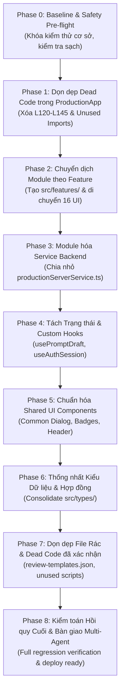

# 06 — LỘ TRÌNH TRIỂN KHAI REFACTOR (REFACTORING ROADMAP)
## Kế hoạch Tái cấu trúc Từng bước, An toàn, Có thể Kiểm chứng & Dễ dàng Rollback

**Dự án:** Promptify — Intrepid Workspace  
**Tác giả:** Senior Software Architect & Repository Refactoring Lead  
**Nguyên tắc triển khai:** Thực hiện tuần tự từng Phase nhỏ. Mỗi Phase kết thúc phải vượt qua `npm run build` và toàn bộ các bộ test hiện có trước khi chuyển sang Phase tiếp theo.

---

## 1. Sơ đồ Tổng quan Các Giai đoạn (Roadmap Overview)



---

## 2. Chi tiết Từng Giai đoạn Triển khai (Phase-by-Phase Plan)

### PHASE 0: Baseline & Safety Pre-flight (Thiết lập Chuẩn Cơ sở)
- **Mục tiêu:** Ghi lại trạng thái xanh của bản build hiện tại, bảo toàn các thay đổi chưa commit trong working copy, thiết lập bộ script kiểm tra regression tự động.
- **Danh sách thay đổi:**
  - Không thay đổi source code runtime.
  - Tạo script runner `test/run_all_contract_tests.mjs` để chạy đồng loạt 12+ bài test offline quan trọng.
- **Files liên quan:** `test/run_all_contract_tests.mjs`.
- **Mức độ ưu tiên:** **P0 (Bắt buộc làm đầu tiên)**.
- **Rủi ro:** Không có rủi ro.
- **Acceptance Criteria:**
  - `npm run build` kết thúc với exit code 0.
  - Bộ contract test offline pass 100%.
- **Verification Commands:**
  ```sh
  npm run build
  node test/verify_learner_ui_state.mjs
  node test/verify_app_session_state.mjs
  npx tsx test/verify_backend_failure_recovery.ts
  npx tsx test/verify_product_http.ts
  ```
- **Rollback Strategy:** Xóa script runner nếu có lỗi.

---

### PHASE 1: Dọn dẹp Dead Code trong `ProductionApp.tsx`
- **Mục tiêu:** Cắt bỏ hoàn toàn khối code fallback chết (dòng 120–145) trong `ProductionApp.tsx`, gỡ bỏ các import component cũ không dùng.
- **Danh sách thay đổi:**
  - Trong `src/components/rebuild/ProductionApp.tsx`:
    - Thay thế đoạn return fallback chết bằng một thông báo fallback tối giản nếu có mã UI ngoài phạm vi.
    - Xóa các import: `ProductionStudio` (từ `ProductionStudioV2`), `ProductionCohorts`, `ProductionWorkshop`, `ProductionRoster`, `ProductionGovernance`, `ProductionAnalytics`, `ProductionSop`, `ProductionCompare`.
  - Giữ nguyên toàn bộ logic từ dòng 1 đến 119.
- **Files liên quan:** `src/components/rebuild/ProductionApp.tsx`.
- **Mức độ ưu tiên:** **P0**.
- **Rủi ro:** Rất thấp. Logic render thực tế nằm ở dòng 104–118 không bị ảnh hưởng.
- **Acceptance Criteria:**
  - `ProductionApp.tsx` giảm dung lượng từ 29.6 KB xuống ~15 KB.
  - Bundle size của Vite giảm cảnh báo kích thước chunk.
- **Verification Commands:**
  ```sh
  npm run build
  node test/verify_app_session_state.mjs
  ```
- **Rollback Strategy:** Khôi phục `ProductionApp.tsx` từ git stash/checkout.

---

### PHASE 2: Chuyển dịch Module theo Feature (Feature-Driven Restructuring)
- **Mục tiêu:** Tạo cấu trúc thư mục `src/features/` và di chuyển 16 màn hình UI vào đúng thư mục module.
- **Danh sách thay đổi:**
  - Tạo các thư mục:
    - `src/features/auth/`
    - `src/features/learner/`
    - `src/features/facilitator/`
    - `src/features/head/`
    - `src/features/governance/`
    - `src/features/landing/`
  - Di chuyển các file từ `src/components/rebuild/` theo bảng mapping ở tài liệu 04 và 05.
  - Cập nhật import đường dẫn trong `ProductionApp.tsx`.
- **Files liên quan:** 16 UI components, `ProductionApp.tsx`.
- **Mức độ ưu tiên:** **P1**.
- **Rủi ro:** Trung bình (lỗi import relative path).
- **Acceptance Criteria:**
  - Tất cả các màn hình UI00 đến UI15 nằm trong `src/features/`.
  - `npm run build` thành công, không có module unresolved nào.
- **Verification Commands:**
  ```sh
  npm run build
  node test/verify_learner_ui_state.mjs
  ```
- **Rollback Strategy:** Hoàn tác các lệnh di chuyển file (hoặc git restore).

---

### PHASE 3: Module hóa Service Backend (`productionServerService.ts`)
- **Mục tiêu:** Tách switch-case 25+ actions của backend serverless thành các domain handler độc lập.
- **Danh sách thay đổi:**
  - Giữ `src/services/productionServerService.ts` làm router điều phối và kiểm tra JWT context.
  - Tạo các file con trong `src/services/server/actions/`:
    - `learnerActions.ts`: Xử lý `generate`, `judge`, `saveDraft`, `unlockSupport`, `uploadLearnerContext`.
    - `facilitatorActions.ts`: Xử lý `broadcast`, `privateHint`, `saveStudio`, `createLesson`, `recordAttendance`.
    - `sopActions.ts`: Xử lý `prepareSopUpload`, `submitSop`, `reviewSop`, `searchSop`.
    - `governanceActions.ts`: Xử lý `saveDomain`, `setAccess`, `saveClass`, `syncSheet`.
  - Chuyển logic từ switch-case sang các hàm chuyên biệt tương ứng.
- **Files liên quan:** `src/services/productionServerService.ts`, `api/product.ts`.
- **Mức độ ưu tiên:** **P1**.
- **Rủi ro:** Thấp (không thay đổi input/output của API).
- **Acceptance Criteria:**
  - `handleProductRequest` chỉ còn ~60 dòng đóng vai trò router.
  - Bộ test backend failure recovery và product HTTP pass 100%.
- **Verification Commands:**
  ```sh
  npx tsx test/verify_product_http.ts
  npx tsx test/verify_backend_failure_recovery.ts
  ```
- **Rollback Strategy:** Git restore `src/services/productionServerService.ts`.

---

### PHASE 4: Tách Trạng thái & Custom Hooks
- **Mục tiêu:** Tách logic quản lý trạng thái, debounce, phím tắt khỏi các component UI lớn.
- **Danh sách thay đổi:**
  - Tạo `usePromptDraft`: Tự động lưu nháp prompt sau 1.5s debounce, xử lý conflict revision.
  - Tạo `useAuthSession`: Quản lý session Supabase, theo dõi `onAuthStateChange`.
  - Tạo `useCodelabShortcuts`: Quản lý phím tắt `Ctrl+\` mở SOP, `Ctrl+Enter` / `Cmd+Enter` chạy model.
- **Files liên quan:** `src/features/learner/CodelabWorkspaceView.tsx`, `ProductionApp.tsx`.
- **Mức độ ưu tiên:** **P2**.
- **Rủi ro:** Thấp.
- **Acceptance Criteria:**
  - Codelab Workspace giảm bớt ~80 dòng code logic state.
  - Bộ test `verify_learner_ui_state.mjs` pass đầy đủ.
- **Verification Commands:**
  ```sh
  node test/verify_learner_ui_state.mjs
  ```
- **Rollback Strategy:** Rollback các file hook đã tạo.

---

### PHASE 5: Chuẩn hóa Shared UI Components & Icons
- **Mục tiêu:** Thống nhất các component dùng chung (Dialog, Alert, Header) và biểu tượng.
- **Danh sách thay đổi:**
  - Di chuyển `ProductDialog.tsx`, `ProductUseNotice.tsx`, `PromptifyMark.tsx`, `MarkdownView.tsx` vào `src/components/common/`.
  - Chuẩn hóa việc sử dụng `lucide-react` thay cho việc gọi font Google Material Symbols qua chuỗi thô.
- **Files liên quan:** `src/components/common/*`.
- **Mức độ ưu tiên:** **P2**.
- **Acceptance Criteria:** `npm run build` pass, giao diện dialog mở đóng chuẩn accessibility.

---

### PHASE 6: Thống nhất Kiểu Dữ liệu & Schema Types
- **Mục tiêu:** Đồng nhất hóa hệ thống types thành Single Source of Truth.
- **Danh sách thay đổi:**
  - Chuẩn hóa `src/types/product.ts` (các hợp đồng đang active trên production).
  - Loại bỏ các type mâu thuẫn trong `src/types/index.ts` (như role `STUDENT`/`CLASS_MANAGER` cũ) hoặc chuyển chúng về `src/types/legacy.ts`.
- **Files liên quan:** `src/types/*`.
- **Mức độ ưu tiên:** **P2**.
- **Acceptance Criteria:** TypeScript typecheck (`tsc --noEmit`) không có lỗi nào.

---

### PHASE 7: Loại bỏ Dữ liệu Tĩnh Rác & File Chết Đã Xác Nhận
- **Mục tiêu:** Dọn dẹp các component trùng lặp, file JSON 533 KB và script cũ.
- **Danh sách thay đổi:**
  - Xóa 11 file component trùng lặp đã liệt kê trong tài liệu 05 (`CombinedProduction*`, `ProductionStudio*` cũ, v.v.).
  - Di chuyển `review-templates.json` và `ReviewScreen.tsx` sang `design-drafts/` hoặc xóa nếu được duyệt.
  - Di chuyển các script compile cũ có nguy cơ ghi đè vào `scripts/historical/`.
- **Files liên quan:** `src/components/rebuild/`, `scripts/`.
- **Mức độ ưu tiên:** **P3 (Chỉ làm sau khi các Phase 1–6 đã ổn định)**.
- **Acceptance Criteria:**
  - Toàn bộ thư mục `src/components/rebuild/` được dọn sạch hoàn toàn (thay thế bởi `src/features/`).
  - Kích thước repository giảm đáng kể.

---

### PHASE 8: Kiểm toán Hồi quy Toàn diện & Bàn giao Multi-Agent
- **Mục tiêu:** Chạy toàn bộ các test suites, đối chiếu giao diện với Word/ZIP baseline và thiết lập tài liệu bàn giao.
- **Danh sách thay đổi:**
  - Chạy full verification suite.
  - Cập nhật `AGENTS.md` và `REPOSITORY_GUIDE.md` theo cấu trúc mới.
- **Acceptance Criteria:**
  - `npm run build` thành công trong < 3s, không cảnh báo chunk size.
  - Tất cả các luồng hoạt động chính xác.
  - Sẵn sàng bàn giao cho các agent tính năng độc lập.

