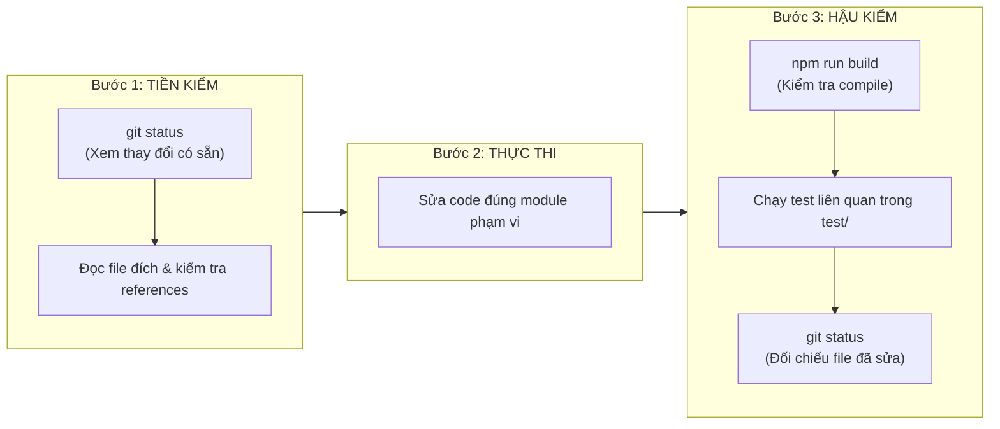

# 07 — QUY TẮC PHÁT TRIỂN DÀNH CHO AI AGENTS (AGENT GUIDELINES)
## Hướng dẫn Vận hành, Ranh giới Trách nhiệm & Phòng ngừa Hỗn loạn Codebase

**Dành cho:** Tất cả AI Coding Agents (Antigravity, Cursor, Claude Code, Aider, v.v.)  
**Áp dụng tại:** Repository Promptify — Intrepid Workspace  
**Hiệu lực:** Bắt buộc tuân thủ 100% trong mọi prompt và phiên làm việc.

---

## 1. Bản đồ Định vị: "Tôi Cần Sửa Code Ở Đâu?"

Khi nhận được yêu cầu công việc, AI Agent PHẢI xác định đúng thư mục phụ trách theo bảng sau:

| Nhiệm vụ / Yêu cầu | Thư mục Được phép Chỉnh sửa | File Cấm Đụng vào |
| :--- | :--- | :--- |
| **Giao diện Học viên (Codelab, Prompt, Diff, Judge, SOP)** | `src/features/learner/` | Không đụng vào `features/facilitator/` hay `features/governance/` |
| **Giao diện Giảng viên (Workshop, Studio, Learner Table)** | `src/features/facilitator/` | Không đụng vào `features/learner/` |
| **Giao diện Trưởng bộ phận (Analytics, Đóng góp SOP)** | `src/features/head/` | Không đụng vào `features/auth/` |
| **Giao diện Quản trị (Xoay Key, Roster Sheet Sync)** | `src/features/governance/` | Không đụng vào logic chấm điểm Codelab |
| **Đăng nhập, SSO, Xác nhận Hồ sơ Roster** | `src/features/auth/` | Không can thiệp vào các feature học tập |
| **Logic Serverless Backend, Routing Action** | `api/product.ts`, `src/services/server/` | Không nhúng code server vào `src/features/` |
| **Logic Nghiệp vụ Thuần (PII, Rubric, i18n)** | `src/services/domain/` | Không gọi DOM hoặc React hooks tại đây |
| **Kiểu dữ liệu chung (Types / Interfaces)** | `src/types/` | Cần xác nhận trước khi đổi schema |

---

## 2. Các Điều Răn Tối Thượng (Non-Negotiable Rules)

### ❌ ĐIỀU CẤM 1: Tuyệt đối KHÔNG chạy các Script Compiler cũ trong `scripts/`
- Các script như `scripts/compile_production_workspace_source.mjs`, `compile_production_studio.mjs` được tạo ra trong quá khứ để sinh code tự động từ Word.
- **HẬU QUẢ NẾU CHẠY:** Toàn bộ component V7 hiện đại, các bản vá layout, phím tắt `Cmd+Enter` và responsive design sẽ bị ghi đè mất hoàn toàn!
- **QUY TẮC:** Mọi chỉnh sửa giao diện phải được thực hiện trực tiếp trên file React TypeScript tương ứng, KHÔNG chạy compiler script.

### ❌ ĐIỀU CẤM 2: Tuyệt đối KHÔNG tự tạo Component Trùng lặp
- Trước khi tạo một component mới (ví dụ Modal, Button, Dialog, Card), Agent PHẢI tìm kiếm trong `src/components/common/` và module hiện tại.
- Nếu `ProductDialog.tsx` hoặc `MarkdownView.tsx` đã tồn tại, BẮT BUỘC tái sử dụng, không được tự viết thêm `CustomModal.tsx` hay `MarkdownRenderer.tsx`.

### ❌ ĐIỀU CẤM 3: Tuyệt đối KHÔNG đặt Business Logic vào UI
- Component React chỉ chịu trách nhiệm render giao diện và nhận tương tác.
- Toàn bộ logic kiểm tra PII, validate độ dài prompt, tính toán điểm rubric, xử lý lỗi API PHẢI nằm trong `src/services/domain/` hoặc custom hooks.

### ❌ ĐIỀU CẤM 4: Tuyệt đối KHÔNG sửa đổi Lịch sử Database Migrations
- Các file trong `supabase/migrations/` từ `002` đến `049` đã được áp dụng trên Supabase Production.
- CẤM sửa đổi nội dung các file migration cũ với danh nghĩa "dọn dẹp code".
- Nếu cần thay đổi database, PHẢI tạo migration mới có số thứ tự tiếp theo (ví dụ `050_*.sql`).

### ❌ ĐIỀU CẤM 5: Tuyệt đối KHÔNG để lộ API Secrets ở Client
- Trình duyệt chỉ nhận `VITE_SUPABASE_URL` và `VITE_SUPABASE_ANON_KEY`.
- CẤM đọc `GEMINI_API_KEY`, `SUPABASE_SERVICE_ROLE_KEY` hoặc `OPENAI_API_KEY` từ client. Mọi cuộc gọi AI đều phải đi qua serverless endpoint `/api/product`.

---

## 3. Quy trình Tiền Kiểm & Hậu Kiểm (Pre-flight & Post-flight Checks)

Mỗi Agent khi bắt đầu và kết thúc một tác vụ đều phải tuân thủ nghiêm ngặt quy trình 3 bước sau:

### Các lệnh kiểm tra an toàn được phép chạy:
1. `npm run build`: Kiểm tra toàn bộ mã nguồn có compile sạch sẽ không.
2. `node test/verify_learner_ui_state.mjs`: Kiểm tra logic tương tác của Learner Workspace.
3. `node test/verify_app_session_state.mjs`: Kiểm tra luồng session và thoát phiên hết hạn.
4. `npx tsx test/verify_product_http.ts`: Kiểm tra hợp đồng API HTTP backend.
5. `npx tsx test/verify_backend_failure_recovery.ts`: Kiểm tra cơ chế phục hồi lỗi backend.

---

## 4. Giao thức Phối hợp Đa Agent (Multi-Agent Concurrency Protocol)

Khi có từ 2 AI Agents trở lên cùng làm việc trong repository:

1. **Phân chia Phạm vi Tách biệt (Isolated Scope):**  
   - Agent A (ví dụ sửa giao diện Codelab Workspace) chỉ làm việc trong `src/features/learner/`.
   - Agent B (ví dụ nâng cấp tính năng Dual Approval) chỉ làm việc trong `src/features/governance/`.
   - Hai agent tuyệt đối không cùng sửa đổi file `AppShell.tsx` hoặc `productServerService.ts` trong cùng một lượt.
2. **Khóa Hợp đồng Dùng chung (Lock Shared Contracts):**  
   - Nếu Agent A cần một hàm mới từ `services/domain/`, Agent Lead phải tạo trước interface/stub hàm đó, sau đó các Agent khác mới import sử dụng.
3. **Báo cáo Minh bạch:**  
   - Khi hoàn thành, Agent phải báo cáo rõ ràng:
     - Danh sách file đã chỉnh sửa.
     - Kết quả lệnh `npm run build`.
     - Các bài test đã chạy thành công.
     - Bất kỳ cảnh báo hoặc giới hạn nào còn tồn đọng.

